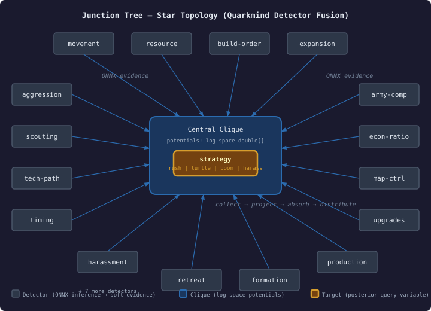

# Building a Production Bayesian Junction Tree on the JVM

Most game AI treats perception as a classifier: run an ONNX model, read the label, act on it. That works until you need to fuse evidence from 23 detectors that each see a different slice of the world, update every tick, and explain why the AI changed its mind.

We needed a Bayesian Junction Tree engine for exactly this scenario — a real-time strategy game where an orchestrator fuses detector outputs into a posterior distribution over opponent strategy classifications. The engine started as a port from Drools (where I originally wrote the BJT for knowledge uncertainty in production rule systems), stripped of all the Rete-specific machinery. What remained was correct but fragile: raw probability arithmetic, no retraction safety, no temporal awareness, and 8 bitmask classes ported from a pattern-matching context where they made sense but served no purpose in a 23-node star topology.

This is what we found fixing it, and why it matters if you're running probabilistic inference on the JVM.

## Division by zero is silent corruption

The retraction path — where old evidence is divided out of calibrated clique potentials before new evidence is multiplied in — has an obvious failure mode: if any potential is zero, the division produces Infinity or NaN. That corruption is silent. It propagates through every downstream clique during the distribute phase, and the marginals you read back look like valid probabilities. They're not.

The original code had a partial guard in one of two division sites. The other had none. The commented-out line `// is this necessary?` in the source suggested someone had asked the question before and not answered it.

The fix is trivial — clamp denominators below an epsilon — but the real lesson is how long a latent corruption bug can survive when the output type is `double[]`. There's no type-system protection for "this array contains valid probabilities." The values look normal until they don't.

## Log-space changes everything

Switching from probability space to log space is standard practice in production BJT implementations, but the mechanical change is more interesting than it sounds. Every operation transforms:

- Multiplication becomes addition
- Division becomes subtraction
- Marginalization becomes logsumexp
- Normalization subtracts the log-partition function
- Initial potentials (formerly 1.0) become 0.0

The epsilon clamp we'd just added? Unnecessary. In log space, the retraction path subtracts log-potentials. Subtracting negative infinity (log of zero) gives positive infinity — but `isRetractable()` already checks for that and falls back to the full recalculation path. No special-casing needed. The arithmetic handles it.

The real win isn't the retraction safety — it's underflow elimination. A 23-node network doesn't hit underflow in probability space, but the moment you scale to larger topologies or longer retraction chains, values approach the limits of double precision. Log space sidesteps this entirely. Addition of moderate numbers instead of multiplication of numbers approaching zero.

The conversion touched 11 source files. Every test passed without tolerance changes — the log-exp round-trip preserves enough precision that the 1e-10 assertions in the existing test suite didn't need relaxation.

## Sensitivity analysis: the ONNX skip optimisation

The detector orchestrator's tick budget problem: 23 detectors, each requiring an ONNX inference call, and the tick budget doesn't always accommodate all of them. Which detectors can be skipped?

The answer is value-of-information analysis. For each evidence variable, compute the KL divergence between the posterior with and without that variable's contribution. Variables with near-zero sensitivity don't shift the posterior — skipping their ONNX call saves more time than a thousand propagation optimisations.

The implementation creates a counterfactual BayesInstance for each sensitivity query — no state mutation, just a comparison between "posterior with all evidence" and "posterior without this one variable." It's O(E × propagation) but runs between ticks, not during them, so the cost is irrelevant relative to the ONNX calls it eliminates.

This is the practical payoff. A single skipped ONNX inference saves more wall-clock time than every other BJT optimisation combined.

## Temporal smoothing prevents classification flips

Each tick was independent. No memory. If a detector momentarily misclassifies — the opponent pauses between two rushes and a single tick of defensive posture flips the entire posterior — the strategy classification whiplashes.

The fix is a `TemporalEvidenceFusionEngine` that blends the current tick's posterior with the previous tick's: `result = (1-decay) × current + decay × previous`. With decay at 0.8, a single tick of contradictory evidence shifts the posterior but doesn't flip it. The previous classification's inertia stabilises the signal.

This is not a Kalman filter or a hidden Markov model. It's a one-line blend. The simplicity is the point — temporal smoothing doesn't need to be sophisticated when the primary signal (23 detectors fusing through a junction tree) is already doing the heavy probabilistic lifting.

## What the BitMask cleanup reveals

The engine shipped with 10 bitmask classes ported from Drools: `AllSetBitMask`, `AllSetButLastBitMask`, `EmptyBitMask`, `EmptyButLastBitMask`, `SingleLongBitMask`, `AllSetMask`, `EmptyMask`, plus the useful ones. These optimise for Rete pattern matching where you track which of hundreds of rule properties are set. The BJT uses bitmasks for two things: dirty variable tracking and decided variable tracking. Both are bounded by the variable count — 23 in our case.

Three classes remain: the interface, `LongBitMask` for networks under 64 variables, and `OpenBitSet` for anything larger. 528 lines deleted, zero functionality lost.

The broader lesson: when you port infrastructure from one domain to another, the abstractions that made sense in the source domain become dead weight in the target. Audit what you carried over. The 8-class BitMask hierarchy was correct, well-tested, and completely unnecessary.

## Where this is going

The engine now has the foundation for quarkmind's real-time perception layer: log-space arithmetic, temporal smoothing, sensitivity-driven detector scheduling, and batch evidence for the all-detectors-change-every-tick pattern. MAP inference (most likely joint assignment) and the scale-oriented work — buffer pooling, lazy cliques, parallel propagation — are next, but they're engine quality improvements. The capability work that changes how the game plays is landed.
