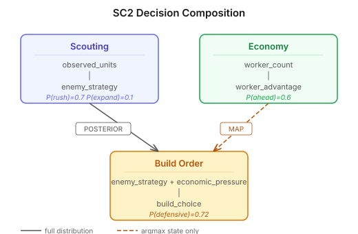
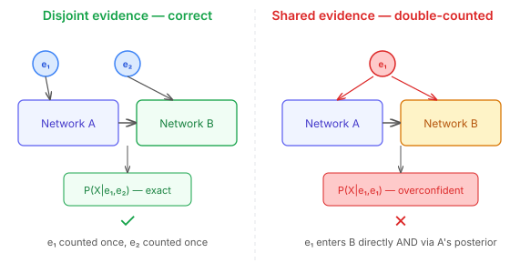
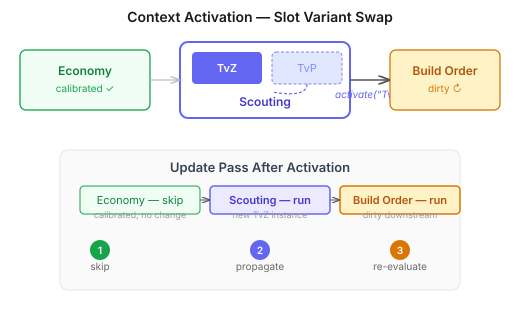

# Composing Bayesian Networks — Approximate Inference by Design

The BJT engine has been a single-network affair until now. One junction tree, one set of evidence, one propagation pass. Real scenarios need more — a scouting model that feeds P(enemy_strategy) into a build-order model, an economy model that feeds worker-advantage into a timing-risk model, each potentially swappable for different matchup contexts.

The obvious question is whether to build one big combined network or compose separate ones. A combined junction tree gives exact inference over the full joint distribution, but the state space explodes with every variable you add. Separate trees with posterior injection between them is an approximation — but it's one that works well under a specific constraint: the composed networks must have disjoint evidence sets.

That constraint is the key insight. When network A and network B share no evidence ancestry — when no piece of observed evidence feeds into both — injecting A's posterior as a likelihood into B produces the same result as exact inference. The approximation only breaks down when evidence is double-counted, and the double-counting only happens when the same observation reaches the same variable through two paths: once directly, once through a composed link. For the use cases I'm targeting (loosely coupled domain models with distinct observation streams), this condition holds naturally.

The composition layer is a DAG of named slots connected by directed links. Each slot holds a `JunctionTree` — the descriptor level, not a live instance. A `CompositionInstance` creates its own `BayesInstance` per slot at construction time, so two composition instances from the same descriptor are fully independent. This descriptor/runtime split matches the pattern already established by `BayesNetworkBuilder → BayesNetwork → JunctionTree → BayesInstance`. The design review caught an earlier version where slots held live instances — that would have meant shared mutable state between compositions, which is a silent data corruption path.

Links between slots declare a variable mapping and a transfer mode: full posterior distribution (the default, preserving uncertainty) or MAP (collapsing to the most probable state as hard evidence). The MAP mode exists because some downstream networks genuinely just need a categorical decision — "which matchup is this?" doesn't need a probability distribution, it needs an answer.

The update pass walks slots in topological order, injecting upstream posteriors before calling `globalUpdate()` on each slot. A skip-if-unchanged optimisation compares posterior snapshots within an epsilon threshold — if the upstream hasn't moved, the downstream doesn't recompute. This composes with `BayesInstance`'s own three-phase incremental mechanism, so the inner engine still gets its Phase 2 dirty-subtree tracking and Phase 3 fast retraction.

Context selection was the other interesting design question. The SC2 use case needs to swap the scouting model when the matchup changes (TvP vs TvZ) without rebuilding the entire composition. The solution is slot variants — a slot can hold multiple `JunctionTree`s keyed by context string. Activation creates a fresh `BayesInstance` for the new variant and marks downstream slots as dirty. The non-swapped upstream slots keep their calibrated state, so only the swapped slot and its dependents recompute.

One constraint that fell out of the design: link target variables can't have direct evidence set on them. If a variable receives its value from an upstream link, allowing the caller to also set evidence on it creates a silent overwrite — the upstream injection replaces the caller's evidence on the next `update()`. The composition guards this with an `IllegalArgumentException` at the API boundary.

The composition engine is approximate by design and explicit about it. The literature suggests the approximation is acceptable when linking variables represent less than 10% of the combined variable space. For the intended use cases — domain-specific models with a few shared variables out of many — that threshold is comfortably met.
