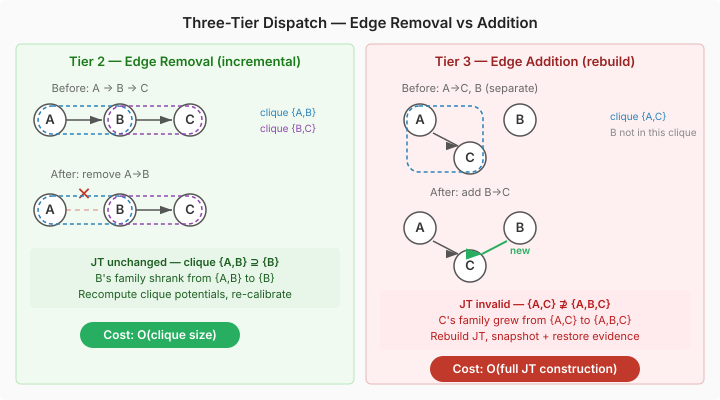

# Runtime Surgery on a Junction Tree

The BJT engine handles static networks well — build once, propagate many times. But cognitive agents need networks that change shape at runtime. An agent learns a new causal relationship: add an edge. A belief is abandoned: remove a variable. The environment changes in a way that makes a dependency irrelevant: remove the edge. The junction tree has to keep up.

The interesting part is that these operations aren't symmetric. Edge removal is cheap; everything else is expensive. I spent most of the design session understanding why, and the answer is in how junction trees are constructed.

## Why edge removal is free and edge addition isn't

When you build a junction tree, you moralize the DAG (marry the co-parents), triangulate it, then extract the maximal cliques. Each clique is a superset of the family it contains — the variable plus all its parents. Removing an edge from the DAG means a variable has fewer parents. Its family shrinks. But the clique that held the old, larger family is still a valid superset of the new, smaller family. The junction tree doesn't need rebuilding. You just recompute the clique's initial potentials with the new CPT and re-calibrate.

Adding an edge is different. The child now has an additional parent. Its family grows. There's no guarantee the existing clique contains the new parent — it might not have been moralized into the same clique. The junction tree's structure is no longer valid. You have to rebuild it.

## Three-tier dispatch

We implemented this as a three-tier dispatch. Tier 1 is the existing leaf variable operations — they already worked. Tier 2 is edge removal: mutate the DAG, update the CPT, recompute the affected clique's initial potentials, reset all states, and let `globalUpdate()` re-calibrate from scratch. Tier 3 is everything else — addEdge, addVariable, removeVariable — which snapshots all current evidence, rebuilds the network from the current variable definitions via `BayesNetworkBuilder`, and restores evidence on surviving variables.

The rebuild path uses a `NetworkMutation` helper that collects the modified variable definitions, runs a topological sort for correct builder ordering, and validates acyclicity before committing. The builder creates a fresh graph and junction tree. Evidence is matched by variable name, not internal ID, since IDs change across rebuilds.

## The stale-state bug

The bug that surprised me was in Tier 2. After recomputing the clique's initial potentials, the working clique states — the arrays that `globalUpdate()` actually reads during message passing — still held their old values. `globalUpdate()` calls `reset()` to copy initial potentials into working states, but only when `isDirty()` returns true. If no evidence has been set since the edge removal, nothing is dirty, `reset()` is skipped, and message passing runs on stale potentials. The marginals come back wrong, but not wildly wrong — the kind of error that looks like a numerical tolerance issue rather than a state management bug.

The fix is a `reset()` call after every edge removal. It's not elegant, but it's correct — it guarantees the working states always reflect the current initial potentials regardless of the evidence dirty flag.

## Batch mode

Batch mode wraps multiple mutations in a single rebuild. `beginStructuralChange()` sets a flag that makes all mutation methods accumulate changes without immediately rebuilding. `commitStructuralChange()` applies them. If only edge removals were queued, the commit stays in Tier 2 — recompute affected clique potentials and reset. If any Tier 3 operation was queued, the whole batch promotes to a full rebuild.

## The disconnected graph limitation

One limitation surfaced that's worth noting: `JunctionTreeBuilder` doesn't support disconnected graphs. If you add a root variable with no parents and no connections to any existing variable, the builder crashes with an IndexOutOfBoundsException during clique merging — it assumes the spanning tree connects all cliques. This isn't a new limitation; it's just one that addVariable makes easier to hit. The practical workaround is straightforward: always connect new variables to the existing network via at least one parent edge.

## What this opens up

The API that emerged — `removeEdge`, `addEdge`, `addVariable`, `removeVariable`, and the batch mode pair — gives cognitive agents the ability to restructure their belief networks in response to what they learn. The three-tier dispatch means the common case (removing a dependency that turned out not to hold) stays fast, while the rare case (discovering an entirely new causal relationship) pays the rebuild cost only when it has to.
