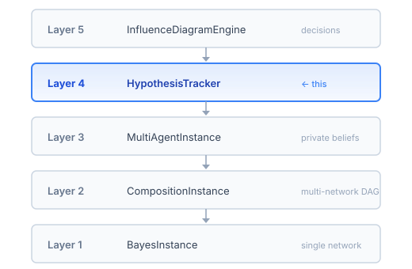
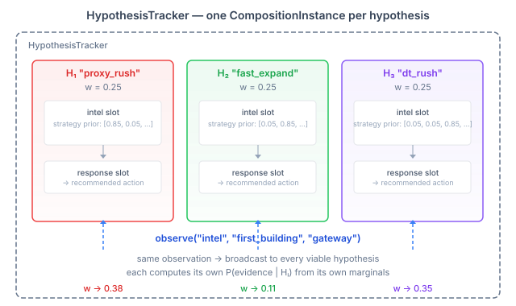
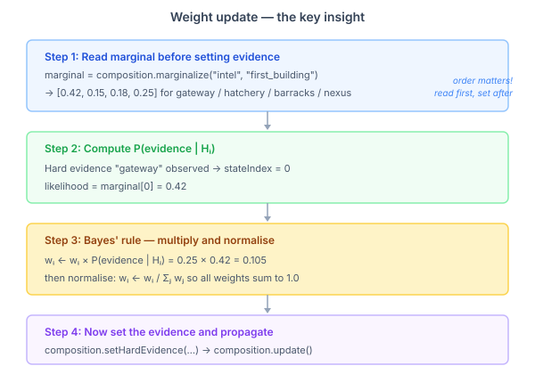
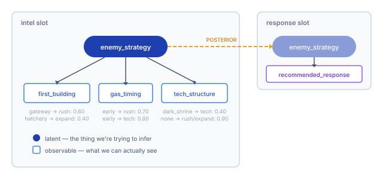
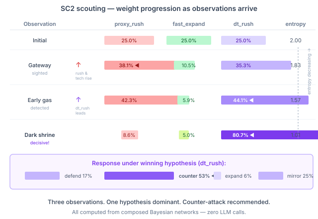
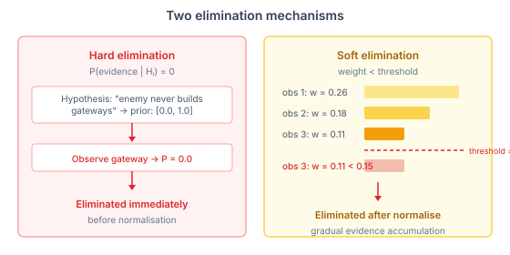

# Tracking Competing Hypotheses — Bayesian Path Elimination on the JVM

The composition layer landed a few days ago. Multiple Bayesian networks wired into a DAG, posteriors flowing between them, context-keyed variants for swapping network structure at runtime. That machinery answers one question at a time: given this evidence, what are the posteriors?

But the pattern that keeps showing up — in game AI, in medical diagnosis, in fault isolation — is a different question: *which of several competing explanations best fits the observations so far?*

A scouting probe sees a gateway in StarCraft. Is the opponent rushing? Teching to Dark Templar? Playing standard macro? Each explanation makes different predictions about what comes next. As evidence accumulates — gas timing, tech structures, army composition — some explanations become untenable and others become near-certain. The question isn't "what is the posterior on enemy_strategy" — it's "which world-model best explains what I'm seeing?"

That's hypothesis tracking. And it sits naturally as a layer above network composition.

## Where it lives in the stack

The BJT engine has grown into a five-layer inference stack. Each layer builds on the one below and adds a qualitatively different capability.



Layer 1 does exact inference on a single junction tree. Layer 2 composes multiple networks into a DAG with posterior transfer between them. Layer 3 gives each agent private beliefs over shared variables. Layer 4 — the new one — maintains competing explanations and eliminates dead paths as evidence arrives. Layer 5 selects optimal actions via influence diagrams.

Hypothesis tracking is the bridge between "what does the network say?" and "what should I do?" It collects the outputs of composed inference and answers the strategic question: which explanation is winning?

## The core idea: one composition per hypothesis

Each hypothesis gets its own complete `CompositionInstance` — its own copy of every network in the composition, with its own evidence state, its own propagation, its own posteriors.



A hypothesis isn't just a label. It's a complete world-model with its own prior beliefs. The "proxy_rush" hypothesis has a strong prior that enemy_strategy is rush — P(rush) = 0.85. The "dt_rush" hypothesis puts that probability mass on tech_aggression instead. Same network structure, different priors, different inferences from the same observation.

When evidence arrives — a gateway sighted, early gas detected — the tracker broadcasts it to every viable hypothesis. Each hypothesis evaluates the observation under its own model. Each produces a different predictive probability. And those probabilities determine which hypotheses gain weight and which lose it.

This is more expensive than maintaining a single composition. Memory scales linearly with hypothesis count — each hypothesis owns a full copy of the junction trees. For the typical case of 4–10 hypotheses with small-to-medium networks, the cost is negligible. For 100 hypotheses over large compositions, you'd want a different approach. The design chose clean isolation over shared state, and the math is correct by construction because of it.

## How weights update — the key insight

The weight update mechanism has one critical property that makes the whole thing work: **the predictive likelihood is computed from the current marginals *before* the evidence is set.**



After belief propagation in a junction tree, the marginal distribution for any variable gives the model's current prediction for that variable given all evidence seen so far. If I haven't yet told the composition that "gateway" was observed, the marginal of `first_building` gives me P(first_building | H_i, all prior evidence) — the hypothesis's prediction of what the first building will be.

For hard evidence — I observed "gateway" — the likelihood is just `marginal[gateway_index]`. If the hypothesis predicts a 42% chance of gateway, the likelihood is 0.42.

For soft evidence — a probabilistic observation like "70% gateway, 20% hatchery, 10% barracks" — the likelihood is the dot product of the observation distribution with the marginal. This handles noisy sensors, partial information, and uncertain observations with the same mechanism.

Then Bayes' rule:

```
w_i  ←  w_i × P(evidence | H_i)
normalise so all weights sum to 1.0
```

Only after computing the likelihood does the tracker set the evidence on the composition and propagate. Order matters. If you set the evidence first, the marginal becomes a delta function and you lose the predictive probability you needed.

This means no junction tree internals need to be exposed. The entire weight update works through the existing `marginalize()` API. The hypothesis tracker is a pure consumer of the composition layer — it doesn't reach into clique potentials or normalization constants.

## The SC2 scouting scenario

The test domain is StarCraft 2 scouting. An intel network models how enemy_strategy — the hidden variable — influences three observable signals: what building was spotted first, when gas was taken, and what tech structure appeared.



The intel slot connects to a response slot via a posterior link on enemy_strategy. Once we know what the enemy is doing, the response network recommends an action — defend, counter-attack, expand, or mirror their tech.

Four hypotheses compete, each encoding a different belief about enemy_strategy:

| Hypothesis | Prior on enemy_strategy | What it believes |
|---|---|---|
| proxy_rush | [0.85, 0.05, 0.05, 0.05] | The enemy is rushing |
| fast_expand | [0.05, 0.85, 0.05, 0.05] | The enemy is expanding economically |
| dt_rush | [0.05, 0.05, 0.85, 0.05] | The enemy is teching to Dark Templar |
| standard_macro | [0.05, 0.05, 0.05, 0.85] | The enemy is playing standard macro |

The scenario that demonstrates the tracker best is DT rush detection. Three observations arrive in sequence, each narrowing the hypothesis space.



After the first observation — a gateway — both proxy_rush and dt_rush rise. Gateway is consistent with either: you need a gateway for rush units and for Dark Templar alike. The expand hypothesis drops sharply. Ambiguity remains.

After early gas, dt_rush takes the lead. Early gas is the signature of tech play — you need the gas for Dark Templar research. But proxy_rush is close behind, because aggressive builds also take early gas.

The dark shrine is decisive. Only the dt_rush hypothesis predicted a reasonable probability of seeing a dark shrine. Its weight jumps to 81%. The response network, receiving this posterior, recommends counter-attack at 53% — the correct response to a DT rush is to attack before the Dark Templar hit the field.

Three observations. One hypothesis dominant. A recommended action. All computed from composed Bayesian networks with zero LLM calls.

## Elimination: two mechanisms

As evidence accumulates, some hypotheses become so unlikely they're not worth tracking. Two elimination mechanisms handle this.



**Hard elimination** is for impossible evidence. If a hypothesis says P(gateway) = 0 — the enemy literally cannot build gateways in this model — and a gateway is observed, the hypothesis is eliminated immediately. Zero likelihood means the evidence is impossible under this world-model. No amount of prior weight can rescue it.

**Soft elimination** handles gradual decay. After normalisation, any hypothesis whose weight drops below the configurable threshold is removed from the viable set. The default threshold is 0.01 — a hypothesis contributing less than 1% of the probability mass isn't worth the inference cost of updating its composition on every observation.

Eliminated hypotheses stay in memory for diagnostics — the tracker can report what was eliminated and when — but they're excluded from future observations, weight normalisation, and the viable set. This means the inference cost decreases as hypotheses are eliminated. A tracker that started with 10 hypotheses and has eliminated 7 only pays the cost of 3 composition updates per observation.

## The builder API

The fluent builder follows the same pattern as `CompositionBuilder` and `MultiAgentBuilder` — each hypothesis is configured inline:

```java
var tracker = HypothesisTracker.builder(composition)
    .hypothesis("proxy_rush")
        .priorWeight(0.25)
        .priorOverride("intel", "enemy_strategy",
            new double[]{0.85, 0.05, 0.05, 0.05})
    .hypothesis("dt_rush")
        .priorWeight(0.25)
        .priorOverride("intel", "enemy_strategy",
            new double[]{0.05, 0.05, 0.85, 0.05})
    // ...
    .eliminationThreshold(0.02)
    .resolutionThreshold(0.85)
    .build();
```

`priorOverride` sets soft evidence on a variable — encoding the hypothesis's belief as a likelihood function. `activateVariant` swaps a slot's junction tree to a different network variant, for hypotheses that differ in network structure rather than just priors.

Each `observe()` call returns an `ObservationResult` — an immutable snapshot of the hypothesis space after the observation:

```java
ObservationResult r = tracker.observeHard(
    "intel", "first_building", "gateway");

r.leader();     // "proxy_rush"
r.entropy();    // 1.83 bits
r.viable();     // [proxy_rush, fast_expand, dt_rush, standard_macro]
r.resolved();   // false — no hypothesis above 85% yet
```

Shannon entropy measures the remaining uncertainty. It starts at 2.0 bits for four equally-weighted hypotheses and decreases toward zero as evidence concentrates weight. The tracker reports `resolved = true` when the leader's weight exceeds the resolution threshold — but it doesn't stop tracking. The caller decides what "resolved" means operationally.

## What this means for the engine

Hypothesis tracking completes the inference-to-action pipeline. Raw observations enter at the bottom (junction tree evidence). Composed networks propagate information across model boundaries. The hypothesis tracker maintains and eliminates competing explanations. And influence diagrams — already in the engine — select optimal actions given the winning hypothesis's posteriors.

The pattern is domain-generic. SC2 strategy recognition is the proving ground, but the same `HypothesisTracker` handles differential diagnosis (which disease explains these symptoms?), fault isolation (which component failure explains these alarms?), or any domain where multiple world-models compete against incoming evidence.

The next interesting question is whether to learn the hypothesis priors from data. Right now they're hand-crafted — the "dt_rush" hypothesis knows that enemy_strategy should be mostly tech_aggression because a domain expert said so. With enough replay data or case history, those priors could be estimated. That's a natural connection point to the parameter learning infrastructure already in BJT.
