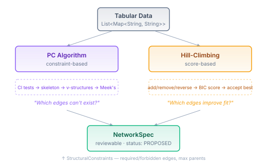
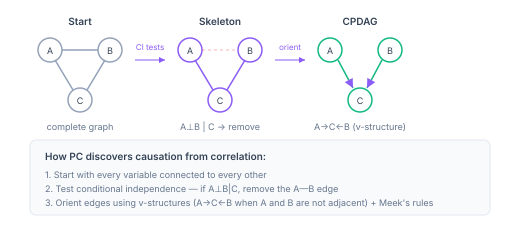
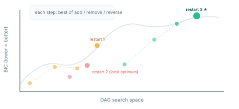
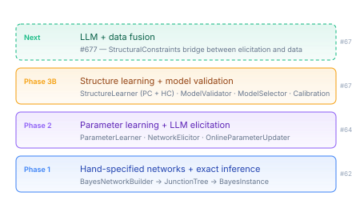

# Letting the Data Draw the Arrows — Structure Learning for Bayesian Networks

Every Bayesian network in the BJT engine so far was hand-drawn. Someone decided that Rain causes Wet Grass, that Enemy Strategy drives Building Observed, that Trust influences Cooperation. The human draws the arrows, the engine fills in the numbers.

That works when you know the causal structure. It doesn't work when you don't.

A StarCraft replay dataset has dozens of variables — gas timing, building order, army composition, expansion count, worker saturation, tech tree progress. Which variables actually predict opponent strategy? Which are independent given others? A domain expert could sketch the top-level relationships, but the interaction effects, the conditional independencies, the edges that *shouldn't* exist — those are empirical questions. The data knows. The human doesn't.

Structure learning lets the data draw the arrows.

## Two fundamentally different questions

There are two ways to learn network structure from data, and they ask different questions.



The **PC algorithm** is constraint-based. It starts with every variable connected to every other and then *removes* edges by testing conditional independence. If gas timing and building order are independent given enemy strategy, the edge between them is removed. What remains is the skeleton — the set of edges that can't be explained away by conditioning on other variables.

**Hill-climbing** is score-based. It starts with an empty graph and *adds* edges, one at a time, accepting whichever operation (add, remove, reverse) improves the BIC score the most. It's an optimisation search: find the DAG that best fits the data with the fewest parameters.

Same input (tabular data), same output (`NetworkSpec`), different philosophy. PC discovers what the data rules out. Hill-climbing discovers what the data favours. Both produce reviewable structures with `SpecStatus.PROPOSED` — the human or an LLM can inspect, accept, or reject any edge before the network is used.

## How PC discovers causal direction

The remarkable thing about the PC algorithm is that it can infer causal *direction* from purely observational data. No interventions, no experiments — just correlations and their absence.



The key insight is the **v-structure**. If A causes C and B causes C, but A doesn't cause B (and B doesn't cause A), then A and B are marginally independent but become dependent when you condition on C. This is the signature of a collider: A→C←B.

The PC algorithm detects v-structures by tracking which variables were in the conditioning set when an edge was removed. If A—B was removed when conditioning on some set S, and C is *not* in S, then the triple A—C—B is oriented as a v-structure: A→C←B.

From there, Meek's four orientation rules propagate direction through the remaining undirected edges. Not every edge can be oriented — some are genuinely ambiguous from observational data alone. The result is a CPDAG: a completed partially directed acyclic graph. Oriented edges are causal claims supported by the data. Undirected edges are equivalence classes — either direction is consistent.

For the BJT engine, undirected edges become `SpecStatus.PROPOSED` entries with a rationale noting the ambiguity. This is where #677 (LLM+data fusion) enters: the LLM can orient ambiguous edges using domain knowledge that the data can't provide.

## Why hill-climbing needs decomposable scoring

The naive approach to BIC-scored hill-climbing is: for every candidate edge operation, fit the entire network with `ParameterLearner`, compute `ModelSelector.bic()`, pick the best. For a 20-variable network, that's roughly 1,140 candidate operations per step, each requiring a full network fit. Impractical.

The fix is that BIC decomposes. The total BIC score is a sum of per-variable local scores:

```
BIC(G, D) = Σ_i [ LL(Xi | Parents_i, D) - (k_i / 2) × ln(n) ]
```

When you add an edge A→B, only B's parent set changes. Only B's local score needs recomputing. The other variables' contributions to the total BIC are unchanged. One local score recomputation instead of a full network fit — the difference between seconds and minutes for realistic network sizes.



The other essential ingredient is **random restarts**. Hill-climbing is greedy — it gets stuck in local optima. Running five independent searches from the empty graph, each with different tie-breaking, and keeping the best result is simple and effective. The restart count is configurable: more restarts for higher confidence, fewer for faster results.

## The integration point: StructuralConstraints

Both algorithms accept a `StructuralConstraints` record — required edges (must include), forbidden edges (must exclude), max parents per variable. This is a small addition with large consequences.

For PC: required edges skip CI elimination (they're never removed during skeleton discovery). Forbidden edges skip CI testing (they're never in the initial graph). Max parents limits conditioning set size.

For hill-climbing: required edges can't be removed or reversed. Forbidden edges can't be added. Max parents is checked before every add or reverse operation.

This is the bridge to #677 (LLM+data fusion). The `NetworkElicitor` proposes structure from domain descriptions — "Rain causes Wet Grass" with high confidence, "Sprinkler might affect Humidity" with low confidence. Those proposals become structural constraints: high-confidence LLM edges are required, contradicted edges are forbidden, uncertain edges are left for the data to decide.

The data draws some arrows. The LLM draws others. The constraints record is where they meet.

## Where this sits in the stack



Phase 1 built exact inference. Phase 2 added parameter learning (CPTs from data) and LLM elicitation (structure from domain descriptions). The model validation utilities from #676 landed yesterday — cross-validation, BIC comparison, and calibration diagnostics for verifying learned models.

Structure learning (#675) closes the last gap in Phase 3B: you can now go from raw tabular data to a validated Bayesian network with no manual structure specification. The validation tools from #676 verify the result — cross-validate to check generalisation, compare BIC scores between the PC-learned and hill-climbing-learned structures, calibrate to verify the probabilities are trustworthy.

After this, #677 fuses the two knowledge sources: LLM domain knowledge as structural priors, data-driven learning as empirical refinement. The LLM draws the edges it's confident about. The data fills in the rest. Both are validated by the same pipeline.

## The deeper point

Hand-specified networks encode what the builder knows. Structure learning discovers what the builder doesn't. The most interesting networks will be the ones where human knowledge and data-discovered structure disagree — where the LLM says "these variables should be connected" and the data says "they're conditionally independent given this third variable you didn't consider."

That disagreement is information. It's the signal that either the domain knowledge is wrong, or the data is too sparse to detect the relationship, or there's a confounding variable nobody modelled. Surfacing that tension — not papering over it — is the point. The `NetworkSpec` with its PROPOSED statuses, the `StructuralConstraints` with its required and forbidden edges, the BIC scores that quantify fit — they're all mechanisms for making the disagreement visible and forcing a resolution.

The data draws the arrows it can justify. The LLM draws the ones it can reason about. And where they disagree, something interesting is happening — something neither would have found alone.
