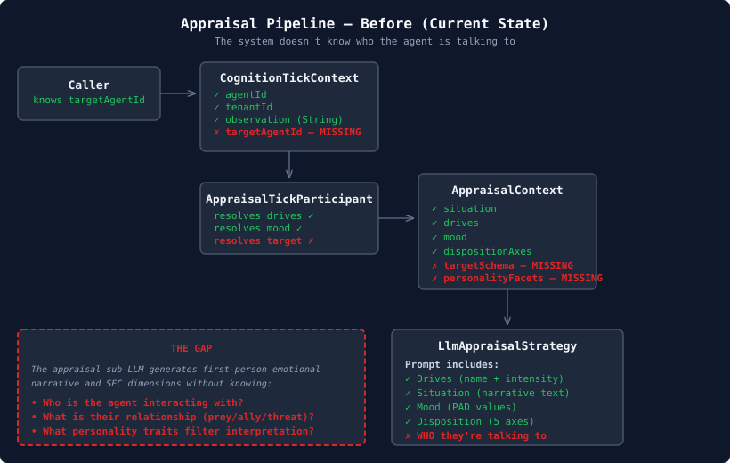
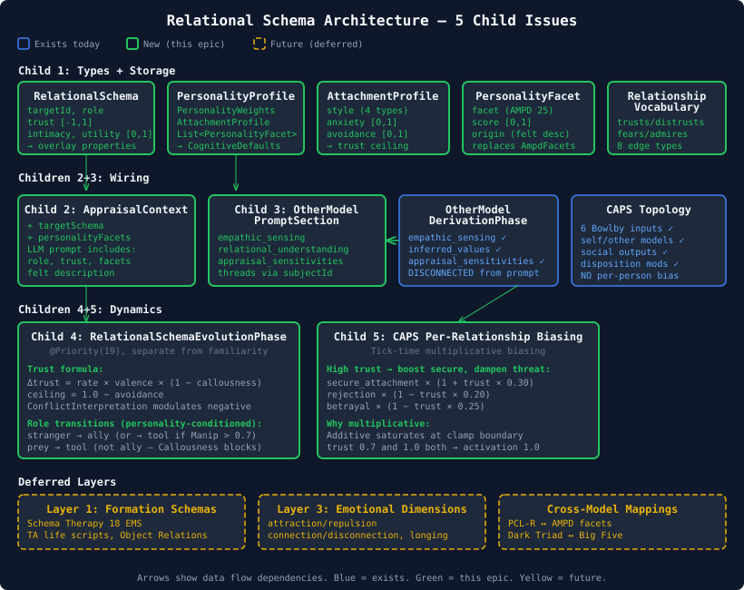
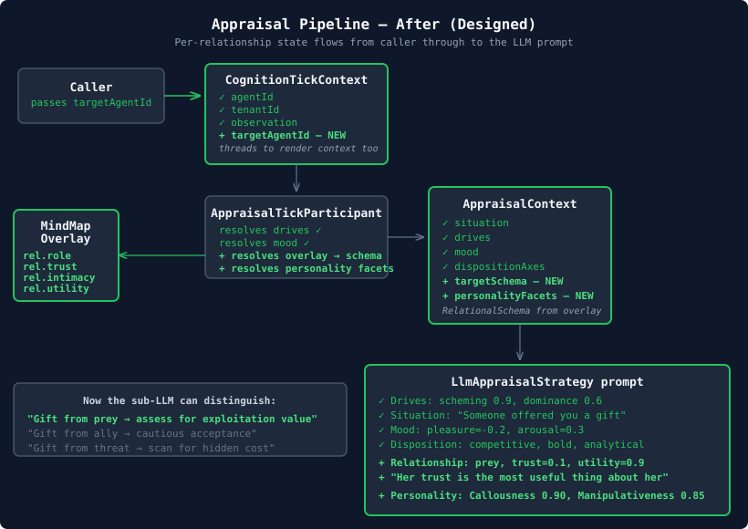

# The Anonymous Other — Why Our Cognitive Pipeline Couldn't Tell Friend from Prey

I went looking for a villain drift fix and found something worse: the entire cognitive pipeline is relationship-blind. Every appraisal, every CAPS settling, every prompt section treats the other party as anonymous. A psychopath receiving a gift from their prey and the same psychopath receiving a gift from an ally produce identical emotional responses. The system literally doesn't know who the agent is talking to.

The original issue (#477) was filed months ago under the title "Interpersonal relational schemas — personality-driven relationship formation and Cluster B modelling." It catalogued twelve psychological models, proposed a four-layer architecture, and used the Hooded Claw's agreeableness saturation as the motivating test case. The Hooded Claw — a scheming, manipulative villain with formation memories of neglect and exploitation — was drifting toward prosocial warmth by tick 20. The hypothesis was that without relational schemas, the LLM's agreeable substrate would override any declared personality.

I expected that hypothesis to still hold. I was wrong about the details.

## Verify, Don't Guess

The first thing I did was trace the actual code paths. Not "probably," not "likely" — I opened IntelliJ and read every line from caller to LLM prompt. This matters because a lot has shipped since #477 was filed: CAPS engine with Rescorla-Wagner weight updates, the CARMA appraisal pipeline with LLM sub-calls, behavioral attractor synthesis, disposition-weighted connection modifiers. The villain drift problem might already be fixed.

Here is what the appraisal sub-LLM actually receives today:

```
Drives:
- scheming: 0.9
- dominance: 0.6
- gloating: 0.7

Situation:
Someone offered you a gift.

Current mood: pleasure=-0.20, arousal=0.30, dominance=0.40

Disposition:
- Social orientation: competitive
- Risk appetite: bold
- Conflict mode: analytical
```

Drives, situation, mood, disposition. That's it. Five disposition axes — socialOrient, ruleFollowing, riskAppetite, autonomy, conflictMode — passed as prose context to an LLM sub-call that generates first-person emotional narrative and SEC appraisal dimensions.

What's missing? Everything about the person offering the gift.



The `AppraisalContext` record in `cognition-api` carries `PerceivedSituation`, `List<Drive>`, `AppraisalWeights`, `HabituationConfig`, `HabituationState`, `MoodState`, and `@Nullable DispositionAxes`. Seven fields. None of them identify the interaction target. None of them carry the agent's relationship to that target. None of them carry the AMPD personality facets that would tell the sub-LLM "this character has Callousness 0.90 and Manipulativeness 0.85."

The disposition axes tell the LLM that this agent is competitive and bold. They don't tell it that this agent sees kindness as naivety, trust as a tool to exploit, and emotional closeness as exposure.

## What Already Works (And What Doesn't)

The verification wasn't all bad news. Three mechanisms do resist villain drift at the agent-global level:

**Disposition-weighted CAPS connections.** The CAPS topology has six Bowlby attachment input nodes — `secure_attachment`, `inconsistent_care`, `rejection`, `betrayal`, `abandonment`, `neglect` — each with weighted vocabularies mapping keywords to activation strengths. Disposition modifiers in `caps-topology.yaml` scale connection weights per character. A bold risk-taker has BAS connections boosted by 1.3× and threat sensitivity reduced to 0.7×. This is real, structural, and it works — a psychopathic agent's CAPS network genuinely settles differently than a prosocial agent's.

**Behavioral attractors.** `BehavioralSynthesisPhase` graduates experience memories through CAPS settling and crystallises them as attractor nodes in the BEHAVIORAL subgraph. `BehavioralPromptSection` renders these into the prompt: "You have a deeply ingrained predatory satisfaction rooted in early manipulation of household staff." These attractors resist the LLM's prosocial bias because they're crystallised from actual experience processing, not declared drives that the LLM can reinterpret.

**ConflictInterpretation.** Already wired into `RelationshipStagePhase`. DISENGAGE amplifies negative interaction weight by 1.4×, REPAIR dampens it to 0.6×. This modulates how quickly trust erodes or recovers — genuinely personality-filtered.

But all three mechanisms are agent-global. They apply to every interaction equally. A psychopath with a behavioural attractor of "predatory satisfaction" feels it toward everyone — prey, ally, tool, obstacle. There's no per-relationship differentiation.

The Hooded Claw's CAPS network produces different outputs from Peter Perfect's network. But within the Hooded Claw's own network, Penelope (prey) and Dick Dastardly (tool) produce identical emotional responses to the same situation. The system can't tell them apart because neither `AppraisalContext` nor `CognitionTickContext` carries target identity.

## The Disconnected Mental Model

Here's what made me sit up. There's already a consolidation phase called `OtherModelDerivationPhase` that creates per-agent-pair mental model nodes. It uses an LLM sub-call to generate four channels of interpersonal understanding: empathic sensing (what the observer physically experiences when the target is in distress), inferred values (what the observer believes the target cares about), appraisal sensitivities (what situations hit the target hardest), and relational understanding (what the bond is built on).

These nodes exist in the COGNITIVE subgraph. They're well-structured, psychologically grounded, and per-relationship.

They're completely disconnected from the prompt pipeline.

No prompt section reads them. No appraisal context carries them. The consolidation phase runs, creates rich mental model nodes, and they sit in the graph unread. The infrastructure for per-relationship understanding was built. The wiring was never connected.

## The Eval Schema That Already Worked

The test fixtures in `eval-characters-generic.yaml` define exactly the schema we need in production:

```yaml
relational-schemas:
  - target: penelope-pitstop
    role: prey
    trust: 0.1
    intimacy: 0.0
    utility: 0.9
    description: "She inherited everything you built. Her trust
      in you is the most useful thing about her."
  - target: peter-perfect
    role: obstacle
    trust: 0.1
    intimacy: 0.0
    utility: 0.2
    description: "Predictably protective. You feel mild irritation
      at his earnestness."

attachment:
  style: dismissive-avoidant
  anxiety: 0.1
  avoidance: 0.8
```

Role, trust, intimacy, utility, description. Plus attachment style with the two-dimensional model (anxiety and avoidance). This is tested, validated against the Hooded Claw character scenarios, and it captures precisely the relational dimensions that the appraisal pipeline is blind to. The eval data knew what the production code didn't: who matters, and how.

## The Design

We decomposed #477 into five child issues. Not the original twelve-model taxonomy — that was a research catalogue, not a build plan. The verified gaps pointed to a tighter scope: make the existing pipeline relationship-aware using the data model that's already been tested.



**Child 1 (#716): Types and storage.** `RelationalSchema` record with `rel.`-prefixed overlay properties. `PersonalityFacet` replacing the old `AmpdFacets` (Map-based, integer-scored) with a normalised `[0,1]` scale and optional origin metadata. `AttachmentProfile` with Bowlby's two-dimensional model. `PersonalityProfile` composite that groups personality fields on `CognitiveDefaults` — the record had 19 fields and every `withX` method was threading all of them positionally. `RelationshipVocabulary` with eight interpersonal edge types.

**Child 2 (#717): Wire into appraisal.** The highest-impact change. Add `@Nullable String targetAgentId` to `CognitionTickContext`. Resolve the overlay, read the `RelationalSchema`, pass it through to `AppraisalContext`. Extend `LlmAppraisalStrategy.buildUserMessage()` to include role, trust, description, and personality facets.



**Child 3 (#718): Connect OtherModel to prompts.** Create `OtherModelPromptSection` that reads the existing mental model nodes and renders them when interacting with a known target. Thread `targetAgentId` through to `CognitionRenderContext.subjectId` — the field exists, it's just never populated.

**Child 4 (#719): Dynamic evolution.** `RelationalSchemaEvolutionPhase` at `@Priority(19)`, separate from the simpler familiarity computation. Trust update formula with Callousness dampening for positive interactions and `ConflictInterpretation` modulating negative. Intimacy update where attachment anxiety amplifies closeness-seeking and avoidance dampens it. Role evolution state machine with personality conditioning — a high-Manipulativeness agent experiencing positive interactions with prey transitions to "tool," not "ally."

**Child 5 (#720): CAPS biasing.** Multiplicative biasing of CAPS input activations based on per-relationship trust. High trust boosts `secure_attachment` and dampens `rejection`; low trust does the reverse. Multiplicative because additive biasing saturates against the `[-1,1]` clamp — two agents with trust 0.7 and 1.0 both produce activation 1.0 when the base is already high, and the trust difference vanishes.

## What the Review Taught Me

We ran a standard three-dimension design review — coherence, structure, robustness — three rounds each. Forty-six issues raised, thirty-five verified against the codebase. The review caught several things I'd missed:

**The PersonalityProfile composite was the reviewers' idea.** I was going to add `AttachmentProfile` and `List<PersonalityFacet>` as two more fields on `CognitiveDefaults`, pushing it from 19 to 21 fields. The structure reviewer pointed out this was deepening a god-record. The composite groups five related fields into one, dropping `CognitiveDefaults` from 19 to 17 fields despite adding two new concepts.

**Two `AppraisalContext` types.** The robustness reviewer found that `mindmap-api` already has an `AppraisalContext` with `Map<String, Double> relationshipScores` — used for node surfacing and attention priority. Different purpose, different layer, but the name collision needed explicit disambiguation in the spec. Attention weights (how much cognitive attention to allocate) versus relational schema (how the agent feels about and behaves toward someone). Complementary, not redundant.

**The dependency chain was wrong.** I had Child 5 (CAPS biasing) depending on Child 4 (dynamic evolution). The structure reviewer pointed out that CAPS biasing reads static trust values from overlay properties — it works with whatever's stored, whether seeded initially or evolved dynamically. Children 4 and 5 are both independent consumers of Child 1's types.

**Additive biasing saturates.** The robustness reviewer traced the CAPS settling math and showed that additive biasing (`activation + trust * 0.3`) hits the `[-1,1]` clamp at high base activations, collapsing trust differences. Multiplicative biasing (`activation * (1 + trust * 0.3)`) preserves relative differences. The fix came with provenance — each scaling factor traced back to a specific connection weight in `caps-topology.yaml` with its literature citation.

## The Attachment Ceiling

One design element I find particularly satisfying: the trust ceiling from attachment avoidance.

```
trustCeiling = 1.0 − avoidance
```

A dismissive-avoidant agent (avoidance = 0.8) can never reach trust above 0.2, regardless of how many positive interactions they accumulate. The ceiling isn't about distrust — it's about the inability to let trust grow past a structurally imposed limit. Years of positive interaction push trust toward 0.2 and then it stops. Not because something went wrong, but because the agent's attachment architecture physically cannot accommodate more.

On the other end, attachment anxiety amplifies intimacy gain. An anxious-preoccupied agent seeks closeness aggressively — positive interactions produce disproportionate intimacy growth. The system models the paradox of anxious attachment: desperate for closeness but unable to sustain it, because the same anxiety that drives intimacy also drives the hypervigilance that corrodes trust.

These aren't heuristics I invented. They're well-documented patterns from Bowlby's attachment theory, Hazan and Shaver's adult attachment work, and Bartholomew and Horowitz's four-category model. The two dimensions (anxiety and avoidance) produce four attachment styles:

| Style | Anxiety | Avoidance | Trust ceiling | Intimacy rate |
|-------|---------|-----------|---------------|---------------|
| Secure | Low | Low | 1.0 | Normal |
| Anxious-preoccupied | High | Low | 1.0 | Amplified |
| Dismissive-avoidant | Low | High | 0.2 | Dampened |
| Fearful-avoidant | High | High | 0.2 | Amplified then dampened |

The Hooded Claw is dismissive-avoidant: low anxiety (doesn't need closeness), high avoidance (can't let trust grow). His trust ceiling of 0.2 means even Dick Dastardly — his most useful confederate — never gets close. Kindness from Penelope gets classified as target assessment, not gratitude, because Callousness 0.90 dampens positive trust gain to near zero: `trustDelta = rate × valence × (1.0 − 0.90) = rate × valence × 0.10`.

## What This Opens Up

The relational schema system as designed addresses the immediate gap — per-relationship awareness in the cognitive pipeline. But it also creates the foundation for three deferred capabilities:

**Formation schemas** (Layer 1 from the original issue). Once we have per-relationship state that evolves, we can seed it from childhood formation memories — Schema Therapy's eighteen Early Maladaptive Schemas, Transactional Analysis life scripts. The Hooded Claw's dismissive-avoidant attachment doesn't exist in isolation; it was produced by specific formation experiences (parental death at six, care-as-obligation, kindness-as-transaction). Modelling the causation — not just the result — lets the LLM reason about why a character behaves this way, not just that they do.

**Emotional dimensions** (Layer 3). The current schema captures cognitive assessment dimensions: trust, intimacy, utility. The original issue proposed emotional dimensions: attraction/repulsion, connection/disconnection, longing/indifference. These map to per-relationship PAD overlays and are architecturally distinct from what we're building. Cognitive dimensions serve the appraisal pipeline; emotional dimensions serve mood. Both are needed for a complete relational model.

**Personality-filtered relational interpretation.** Right now the role evolution state machine uses personality facets to condition transitions — high Manipulativeness routes prey → tool instead of prey → ally. But the same facets could condition how the agent interprets events within a relationship. A high-Suspiciousness agent receiving a compliment from a high-trust ally could still feel the suspicion, muted but present. Personality traits aren't gates; they're filters. The architecture supports this, but the per-event modulation is future work.

The key thing is that none of these require architectural changes. The data model, the overlay storage, the appraisal wiring, the CAPS biasing — all of them are designed so that richer relational state flows through the same pipeline. Formation schemas would populate the same `rel.*` overlay properties. Emotional dimensions would be additional fields on the same `RelationalSchema` record. Personality filtering would use the same `PersonalityFacet` list that's already being passed to the appraisal LLM.

The pipeline needed to know who it was talking to. Now it will.
