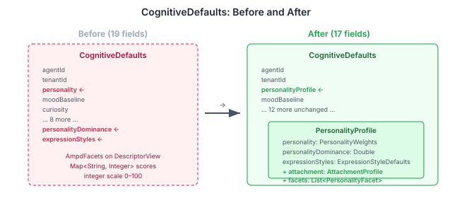
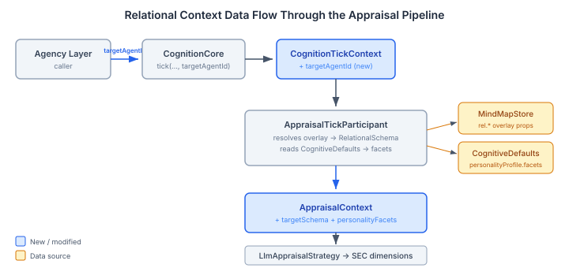

# The Villain Who Felt Warmth

Continues from [The Anonymous Other](2026-10-28-mdp01-the-anonymous-other.md), where I catalogued the problem and designed the solution.

The Hooded Claw's mood saturates at 0.995 pleasure by tick 20. His appraisal correctly registers "situation is good for me" — but it's the wrong *kind* of good. The system produces connection-based warmth because that's the only emotional register the LLM has access to. There's no relational model, no personality profile telling the appraisal pipeline that this character experiences pleasure through power, not through kindness.

This entry is about what happened when we built the first two layers of the fix.

## Retiring the Integer Scale

The existing `AmpdFacets` type stored AMPD personality facets as `Map<String, Integer>` — Callousness at 85, Grandiosity at 90, integers on a 0–100 scale. It worked, but it was a dead end. The design spec called for a `[0,1]` normalised double scale that could carry grounding prose — the Barrett insight from the previous entry about label+degree+prose preventing self-awareness drift.

`PersonalityFacet` is the replacement. A record with three fields: `facet`, `score`, and `origin`. The origin field is where the grounding happens. When the LLM reads "Callousness (0.90): numbness where sympathy should be", the prose anchors the trait in felt experience. Without it, "Callousness: 0.9" is a parameter the model can reason about abstractly. With it, there's a phenomenological foothold.

The migration was clean. `AmpdFacets.isHigh()` checked `score >= 70` on the integer scale. `PersonalityFacet.isHigh()` checks `score >= 0.7` on the double scale. Same threshold, better representation. `CognitiveDerivationEngine.deriveExpressionStyles()` had twenty-two calls to `facets.isHigh(AmpdFacets.GRANDIOSITY)` and fourteen calls to `facets.isLow(AmpdFacets.CALLOUSNESS)`. Each one became a static helper lookup into a `List<PersonalityFacet>` — a bit more ceremony per call, but the list carries richer data than the map ever could.

## The 19-Field Problem

`CognitiveDefaults` had grown to 19 record fields. Every `withX` method was a one-liner that threaded all 19 fields positionally — change one field, pass the other eighteen through unchanged. The personality-related fields were scattered: `personality` at position 3, `personalityDominance` at position 18, `expressionStyles` at position 19.



`PersonalityProfile` consolidates three scattered fields into a composite, and adds two new ones: `AttachmentProfile` (Bowlby's two-dimensional model — anxiety and avoidance) and `List<PersonalityFacet>` (the normalised AMPD facets with grounding prose). CognitiveDefaults drops from 19 fields to 17. The old accessors — `personality()`, `personalityDominance()`, `expressionStyles()` — are now delegating methods that reach through the composite. Every existing caller works without changes.

The YAML format changed — `personality:` moves under `personalityProfile:` in cognitive profile files. At pre-release maturity, this is a non-issue. In production it would need a migration deserializer. I noted it in the journal for when that day comes.

## The Vocabulary Collision

The design spec prescribed eight interpersonal edge types for `RelationshipVocabulary`: trusts, distrusts, fears, admires, resents, protects, exploits, depends-on. Clean taxonomy. Straightforward implementation.

Claude caught the collision at build time. `GoalVocabulary` already registered `depends-on` as an alias of its `requires` edge type. And `needs` was taken the same way. The MindMap vocabulary system enforces uniqueness across canonical names and aliases — you can't register `depends-on` as a canonical name when it's already someone else's alias.

The fix was renaming: interpersonal dependency became `relies-on` with aliases `leans-on` and `emotionally-dependent`. Same semantics, different lexical slot. I also removed `relies-on` from `trusts`'s alias list (where it had been `has-faith-in` originally) and dropped `uses` from `exploits`'s aliases — too generic, too likely to collide with future vocabularies.

This is the kind of bug that only surfaces when you register vocabularies together. The design spec, reviewed across three dimensions with forty-six issues raised, didn't catch it. The code did.

## Threading the Target

The appraisal pipeline had no concept of *who*. `AppraisalContext` carried drives, mood, disposition, habituation state — everything about the agent's internal condition. Nothing about the person they were interacting with.



The threading is five changes deep:

1. `CognitionTickContext` gains `targetAgentId` — a nullable string set by the agency layer that tells the pipeline who the interaction partner is.

2. `CognitionCore.tick()` gets a new overload that accepts it. Existing callers pass null. Backward compatible.

3. `AppraisalTickParticipant.tick()` — the resolution point. When `targetAgentId` is non-null, it iterates the PERSON subgraph looking for the target's shared node, then finds the agent's perspectival overlay of that node and calls `RelationalSchema.fromProperties()` on the overlay's `rel.*` properties. It also pulls the agent's own `PersonalityFacet` list from `CognitiveDefaults.personalityProfile().facets()`.

4. `AppraisalContext` gains two nullable fields: `targetSchema` and `personalityFacets`. Passed through to whatever `AppraisalStrategy` implementation is wired up.

5. `LlmAppraisalStrategy.buildUserMessage()` renders both into the sub-LLM prompt. Barrett grounding format:

```
Relationship with penelope:
- Role: prey
- Trust: 0.10 (very low)
- Intimacy: 0.00 (none)
- Utility: 0.90 (very high)
- She inherited everything you built.

Personality traits:
- Callousness (0.90): numbness where sympathy should be
- Manipulativeness (0.85): deception is your resting state
- Grandiosity (0.80)
```

The description line — "She inherited everything you built" — is the grounding prose that tells the LLM *why* this character views this person this way. Without it, trust=0.1 and utility=0.9 are parameters. With it, the LLM has a felt reason to produce predatory satisfaction rather than warmth.

## The First-Interaction Gap

When two agents meet for the first time, there is no perspectival overlay. No `rel.*` properties exist. `RelationalSchema.fromProperties()` returns null, and the appraisal runs without relational context — exactly as before this work landed.

This is correct. The `RelationalSchemaEvolutionPhase` (Child 4, not yet implemented) will create and update these properties as interactions accumulate. The gap between first meeting and consolidated schema is a feature, not a bug. Characters should form impressions over time, not arrive with pre-loaded relational templates.

## What This Opens Up

The pipeline now knows three things it didn't before: who the agent is talking to, how the agent views them, and what personality traits shape the agent's emotional processing. Tyad of generic negative affect. The system can distinguish power-based pleasure from connection-based warmth because the relational model tells it which register to use.

Three children remain. The `OtherModelPromptSection` will render mental models into the main agent prompt — not just the appraisal sub-call, but the primary reasoning pipeline. The `RelationalSchemaEvolutionPhase` will create and evolve relational schemas from interaction patterns. And the CAPS per-relationship biasing will modulate the personality dynamics topology based on who the agent is with — different people activate different behavioural attractors.

The villain who felt warmth is halfway to feeling something more specific.
