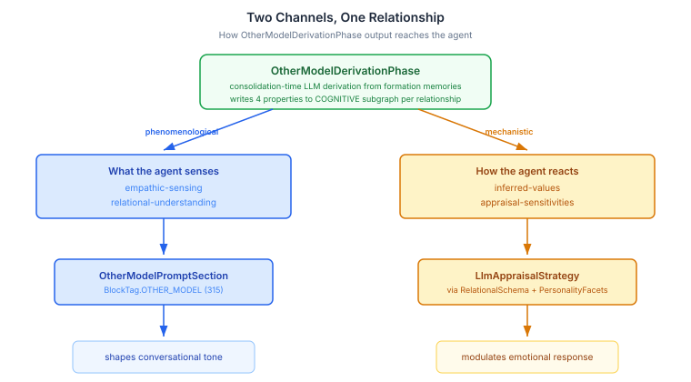
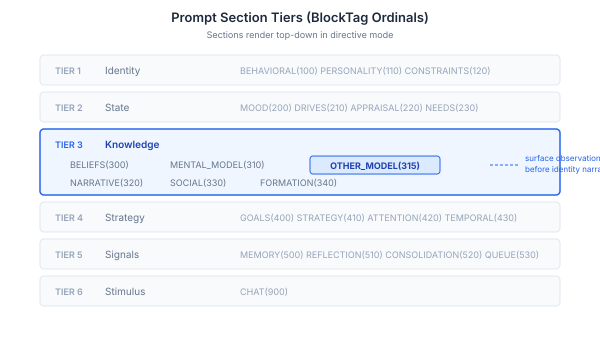

# Closing the Loop — When Mental Models Reach the Prompt

[Continued from [The Anonymous Other](2026-10-28-mdp01-the-anonymous-other.md)]

Yesterday gave the cognitive pipeline relational schemas and personality-aware appraisal. The system could resolve who the agent is talking to and modulate emotional responses accordingly. But there was a gap I should have noticed earlier: the `OtherModelDerivationPhase` — which runs during consolidation to build per-relationship mental models from formation memories — was writing its output to the COGNITIVE subgraph and then nothing happened. The nodes sat there, queryable, correct, inert. The agent's pre-computed understanding of another person never reached the conversation.

This is the architectural equivalent of building a periscope and forgetting to point it at the viewport. The optics work. The image is sharp. Nobody can see it.

## What the Agent Senses vs How It Reacts

The OtherModelDerivationPhase writes four properties per relationship: `empathic-sensing` (somatic and attentional cues), `inferred-values` (what the target cares about), `appraisal-sensitivities` (what hits the target hardest), and `relational-understanding` (what the bond is built on). The interesting question isn't how to render them — it's *which* of them belong in the prompt at all.

The answer splits along a boundary that turns out to be fundamental to how cognitive systems should handle relational knowledge.

`inferred-values` and `appraisal-sensitivities` already feed the appraisal pipeline. Yesterday's `LlmAppraisalStrategy` receives the relational schema and personality facets — that's the mechanistic channel for how the agent *reacts* to this person. Duplicating that information in a separate prompt section would produce competing framings of the same relationship, and I've seen that degrade LLM output quality in other systems: two sections saying slightly different things about the same entity create ambiguity that manifests as hedging or contradiction in the response.

What the prompt section should carry is the phenomenological layer: what the agent *senses* about the other person, and what the relationship *is built on*. These are experiential dimensions that shape conversational tone without overlapping the appraisal pathway. The Hooded Claw sensing "a tightness behind the words" is a different kind of knowledge from the appraisal system computing elevated threat-conduciveness. The first is texture. The second is mechanism. Both come from the same underlying data, but they serve different cognitive functions — and they must travel through different channels to avoid interference.

This two-channel pattern — phenomenological awareness through prompt rendering, mechanistic response through appraisal — isn't something I designed upfront. It emerged from the constraint that duplicate information degrades output. But it maps cleanly onto how emotion researchers describe the difference between *feeling* and *appraising*: you feel warmth toward someone before your appraisal system has computed why. The architecture accidentally recapitulated a real distinction in affective science.

## Threading the Target Through the Stack

The more interesting engineering problem was getting the target identity from the tick to the prompt. `CognitionCore.tick()` already receives `targetAgentId` — yesterday's work added that parameter. But `promptSections()` builds its list of renderers without knowing who the target is. The `CognitionRenderContext` record has a `subjectId` field that every subject-aware section can read, but every construction site was passing `null`.

The fix is a stored field on `CognitionCore`: `lastTargetAgentId`, set during `tick()`, exposed through a getter. `CognitionObservationBuilder` — which orchestrates the rendering pipeline — now threads `cognitionCore.lastTargetAgentId()` into `CognitionRenderContext.subjectId`. Every prompt section that cares about the target gets it through the same channel: `MentalModelPromptSection`, `UserModelPromptSection`, and the new `OtherModelPromptSection`.

This matters beyond this one section. Before this change, subject-aware prompt sections had to independently resolve who they were rendering for, or simply render everything and hope the right data floated to the top. Now the caller declares the target once, and the entire prompt stack renders in that context. It's the difference between each section carrying its own compass and the ship having one heading.

## Where It Sits in the Prompt

`OtherModelPromptSection` carries `BlockTag.OTHER_MODEL` at ordinal 315, slotted between `MENTAL_MODEL(310)` and `NARRATIVE(320)` in Tier 3 — Knowledge.

The ordering is deliberate. BDI theory of mind — beliefs, desires, intentions extracted per-conversation — renders first at 310. Then the deeper empathic model at 315, derived from formation memories during consolidation. Then the agent's narrative identity at 320. The prompt builds from surface observation inward: what I notice about you, what I sense about us, who I am. Each layer adds depth. None repeats what another covers.

## What This Opens Up

With the phenomenological channel wired, the agent can now sense the quality of a relationship before responding. A character who has built trust with someone over dozens of interactions will approach that conversation differently from a first encounter — not because the appraisal system modulates the emotion (it does that too), but because the prompt itself carries an awareness of the bond. "The relationship is built on shared adversity" is context that shapes word choice, topic selection, emotional register. It's the difference between knowing someone is your ally (a fact) and feeling the weight of what you've been through together (an experience).

The next piece is `RelationalSchemaEvolutionPhase` — the consolidation phase that updates trust, intimacy, and role based on accumulated interaction history. Yesterday's relational schemas are static: seeded from consolidation, but not yet responsive to what happens in conversation. Tomorrow they become dynamic.
