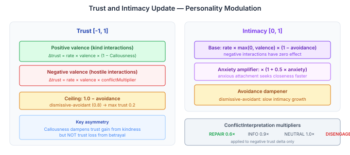
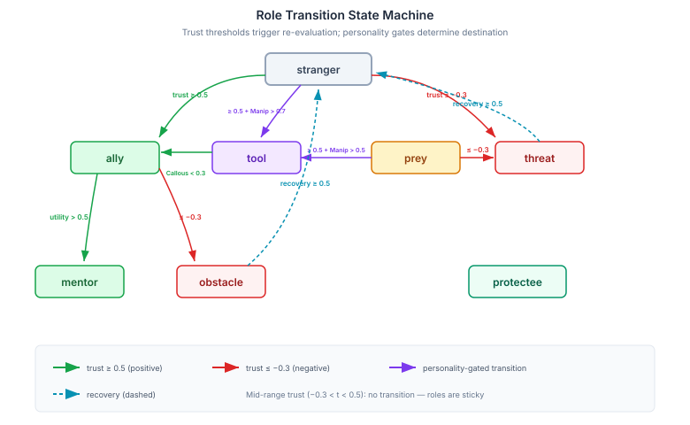

# Closing the Loop — When Mental Models Reach the Prompt and Relationships Learn

[Continued from [The Anonymous Other](2026-10-28-mdp01-the-anonymous-other.md)]

Yesterday gave the cognitive pipeline relational schemas and personality-aware appraisal. The system could resolve who the agent is talking to and modulate emotional responses accordingly. But two gaps remained. First, the `OtherModelDerivationPhase` — which runs during consolidation to build per-relationship mental models from formation memories — was writing its output to the COGNITIVE subgraph and then nothing happened. The nodes sat there, queryable, correct, inert. The agent's pre-computed understanding of another person never reached the conversation. Second, those relational schemas were static. Seeded once, never updated. A relationship that started hostile stayed hostile regardless of what happened next.

Both gaps are now closed.

## What the Agent Senses vs How It Reacts

The OtherModelDerivationPhase writes four properties per relationship: `empathic-sensing` (somatic and attentional cues), `inferred-values` (what the target cares about), `appraisal-sensitivities` (what hits the target hardest), and `relational-understanding` (what the bond is built on). The interesting question isn't how to render them — it's *which* of them belong in the prompt at all.

The answer splits along a boundary that turns out to be fundamental to how cognitive systems should handle relational knowledge.

`inferred-values` and `appraisal-sensitivities` already feed the appraisal pipeline. Yesterday's `LlmAppraisalStrategy` receives the relational schema and personality facets — that's the mechanistic channel for how the agent *reacts* to this person. Duplicating that information in a separate prompt section would produce competing framings of the same relationship. I've seen that degrade LLM output quality: two sections saying slightly different things about the same entity create ambiguity that manifests as hedging or contradiction in the response.

What the prompt section should carry is the phenomenological layer: what the agent *senses* about the other person, and what the relationship *is built on*. These are experiential dimensions that shape conversational tone without overlapping the appraisal pathway. The Hooded Claw sensing "a tightness behind the words" is a different kind of knowledge from the appraisal system computing elevated threat-conduciveness. The first is texture. The second is mechanism. Both come from the same underlying data, but they serve different cognitive functions — and they must travel through different channels to avoid interference.

This two-channel pattern — phenomenological awareness through prompt rendering, mechanistic response through appraisal — emerged from the constraint that duplicate information degrades output. But it maps cleanly onto how emotion researchers describe the difference between *feeling* and *appraising*: you feel warmth toward someone before your appraisal system has computed why. The architecture recapitulated a real distinction in affective science.

## Threading the Target Through the Stack

The more interesting engineering problem was getting the target identity from the tick to the prompt. `CognitionCore.tick()` already receives `targetAgentId` — yesterday's work added that parameter. But `promptSections()` builds its list of renderers without knowing who the target is. The `CognitionRenderContext` record has a `subjectId` field that every subject-aware section can read, but every construction site was passing `null`.

The fix is a stored field on `CognitionCore`: `lastTargetAgentId`, set during `tick()`, exposed through a getter. `CognitionObservationBuilder` — which orchestrates the rendering pipeline — threads it into `CognitionRenderContext.subjectId`. Every prompt section that cares about the target gets it through the same channel: `MentalModelPromptSection`, `UserModelPromptSection`, and the new `OtherModelPromptSection`.

This matters beyond this one section. Before this change, subject-aware prompt sections had to independently resolve who they were rendering for, or simply render everything and hope the right data floated to the top. Now the caller declares the target once, and the entire prompt stack renders in that context.

## Where It Sits in the Prompt

`OtherModelPromptSection` carries `BlockTag.OTHER_MODEL` at ordinal 315, slotted between `MENTAL_MODEL(310)` and `NARRATIVE(320)` in Tier 3 — Knowledge.

The ordering is deliberate. BDI theory of mind — beliefs, desires, intentions extracted per-conversation — renders first at 310. Then the deeper empathic model at 315, derived from formation memories during consolidation. Then the agent's narrative identity at 320. The prompt builds from surface observation inward: what I notice about you, what I sense about us, who I am. Each layer adds depth. None repeats what another covers.

That closes the first gap. The mental model now reaches the conversation. But a static model of a relationship is barely better than no model — it says who someone *was*, not who they're becoming.

## Making Relationships Learn

The `RelationalSchemaEvolutionPhase` runs at `@Priority(19)`, immediately after `RelationshipStagePhase(18)` computes raw familiarity. It reads the same relationship memories and overlay nodes, but produces something fundamentally different: personality-modulated relational dynamics. Trust, intimacy, and role all evolve — and they each evolve differently depending on who the agent *is*.

### The Callousness Asymmetry

The trust formula has a deliberate asymmetry that took me a while to get right. When interactions are positive, Callousness dampens trust *gain* — a callous agent doesn't warm to kindness easily. But when interactions are negative, Callousness does NOT dampen trust *loss*. Even callous agents respond to betrayal.

This isn't symmetry for its own sake. It mirrors how Cluster B personality disorders actually work: the psychopath who cannot be moved by generosity can absolutely be destabilised by treachery. Dampening both directions would create a character who is simply numb. Dampening only the positive creates a character who is selectively armoured — hard to earn, easy to lose. That's the real pattern.

### Attachment Shapes the Ceiling

Bowlby's attachment model enters through avoidance and anxiety, and they push in opposite directions:

**Avoidance caps trust.** A dismissive-avoidant agent (avoidance = 0.8) can never reach trust above 0.2, regardless of how many positive interactions accumulate. The ceiling is structural. This means a character with avoidant attachment literally *cannot* form deep trust bonds through interaction alone — the system prevents it. That's not a limitation, it's a feature: avoidant attachment IS the inability to form deep trust from positive experience.

**Anxiety amplifies intimacy.** An anxious agent (anxiety = 0.9) develops intimacy 45% faster than a secure agent (the multiplier is `1 + 0.5 * anxiety`). Anxious attachment *is* the tendency to seek closeness intensely — the formula captures that without making it pathological. The intimacy itself is real; the speed is what changes.

**ConflictInterpretation** modulates how negative interactions damage trust. An agent with `REPAIR` disposition (multiplier 0.6) loses trust 60% as fast from conflict — they interpret it as information, not attack. An agent with `DISENGAGE` (multiplier 1.4) loses trust 40% faster — withdrawal amplifies the wound.

### Roles Are Not Labels

The role transition table is the part that matters most for downstream behaviour. Trust thresholds trigger re-evaluation, but personality determines where the relationship goes.

The test case that proved this matters: the Hooded Claw (Manipulativeness = 0.8) has `prey` whose trust has risen to 0.5 through exploitation — the pleasure signal from successful manipulation reads as positive interaction. Without personality conditioning, `prey` at high trust would transition to `ally`. That's semantically wrong. The Hooded Claw doesn't *befriend* prey that cooperates; they *upgrade* them to a more useful category.

The personality gate routes `prey → tool` when Manipulativeness > 0.5. The prey hasn't become an ally — they've become a reliable instrument. The trust is real (the Hooded Claw trusts them to be useful). The relationship category is correct (the Hooded Claw sees them as a means, not a peer).

Mid-range trust (-0.3 < t < 0.5) triggers no transition. Roles are sticky. A stranger at trust 0.3 is still a stranger — not yet trusted enough to be an ally, not yet distrusted enough to be a threat. This dead zone prevents oscillation: a single positive interaction after a negative one doesn't flip someone from threat to stranger and back.

Recovery is possible but hard. An `obstacle` or `threat` can recover to `stranger` — never directly to `ally`. They have to rebuild from scratch. This mirrors how real relationships work after a breakdown: you don't go from enemy to friend. You go from enemy to acquaintance, and maybe — over enough positive interactions — from acquaintance to something more.

## The Architecture, Stepped Back

What we built this session completes a pipeline that didn't exist two days ago:

1. **Consolidation** derives per-relationship mental models and evolves trust/intimacy/role from interaction history
2. **Tick-time** threads the target identity through the cognitive stack
3. **Prompt rendering** gives the agent phenomenological awareness of the other person
4. **Appraisal** modulates emotional response based on the relational schema and personality

Four stages, each personality-conditioned, each operating at a different timescale. Consolidation runs in the background. The tick fires per conversation turn. The prompt shapes the response. The appraisal colours the emotion. A relationship is not a single value — it's a dynamic process distributed across the cognitive architecture.

The last child of the epic — CAPS per-relationship biasing — will close the loop at the CAPS level, making the personality processing system itself respond differently depending on who the agent is interacting with. The relational schema won't just shape what the agent says and feels. It will shape what the agent *notices*.
