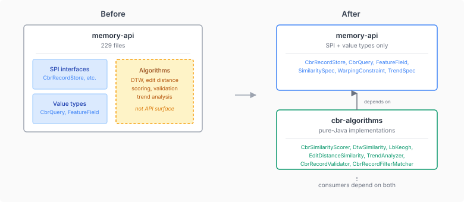

# Contracts vs. Algorithms: When Your API Module Stops Being One

An API module has one job: define the contract between producers and consumers. Interfaces, value types, SPIs, sealed hierarchies — the shapes that both sides agree on. When it starts accumulating implementation code, the contract gets buried under weight it was never meant to carry.

Neocortex's `memory-api` hit 229 Java files. That number alone isn't the problem — some API surfaces are genuinely large. The problem was what those files contained: alongside CbrRecordStore (the SPI), CbrQuery (the query type), and FeatureField (the schema definition), the module also held `CbrSimilarityScorer` (a 300-line weighted scoring engine), `DtwSimilarity` (an O(n×m) dynamic time warping implementation), `EditDistanceSimilarity` (Levenshtein with weighted substitutions), `TrendAnalyzer` (least-squares regression, Welford's stddev, CUSUM change-point detection), and two validation classes.

These are real algorithms. They have tests, edge cases, and performance characteristics. They do useful work. But they aren't API surface — no consumer needs to know they exist to implement the SPI.

## The tell: who depends on what

The split boundary isn't "big file vs. small file" or "complex vs. simple." It's a dependency question: **does the SPI reference this class?**

I ran `ide_find_references` on every candidate. The algorithm classes had zero inbound references from any SPI interface. `CbrRecordStore` doesn't mention `CbrSimilarityScorer`. `CbrQuery` doesn't reference `DtwSimilarity`. The algorithms consume the API types (they take `FeatureValue`, `SimilaritySpec`, `CbrRecordSchema` as inputs), but the API types don't know the algorithms exist.

That's the clean cut. If the SPI doesn't reference it, it's not API surface — it's an implementation that happens to live in the wrong module.

## Where the boundary gets tricky

The interesting cases are the value types that sit between the two worlds.

`WarpingConstraint` is a sealed hierarchy (`Unconstrained`, `SakoeChibaBand`, `ItakuraParallelogram`) used to configure DTW. It sounds like it belongs with the DTW algorithm. But `SimilaritySpec.DtwSpec` — a schema type that stays in memory-api — holds a `WarpingConstraint` field. The schema needs to declare *what kind of warping* without knowing *how warping is computed*. So `WarpingConstraint` stays.

Same pattern with `TrendSpec` and `TrendType` — they're configuration that the schema references, not output that the algorithm produces.

`TrendProfile`, on the other hand, is a pure output record from `TrendAnalyzer.analyze()`. I moved it to cbr-algorithms initially, then the build broke: `cognition-api`'s `StrategyReflection.Reflected` record holds a `TrendProfile` field. A class used at the API level in another module isn't an algorithm output — it's a shared value type. Back to memory-api it went.

The principle: **inputs and configuration stay with the contract. Outputs stay with the algorithm — unless another API references them.**



## Same package, different module

One decision made the whole extraction frictionless: keeping the same Java package (`io.casehub.neocortex.memory.cbr`) across both modules. Split-package in Maven means the classes move to a different JAR but all imports stay identical. Every consumer just adds `cbr-algorithms` to its POM — zero code changes.

This works because none of the algorithm classes use package-private access. They're all public static utility methods. If they'd had package-private collaborators, the split would have required either making those collaborators public (widening the API) or restructuring internal dependencies. Pure functions with public interfaces are the easiest things to extract.

## The dependency chain after extraction

```
memory-api            (SPI + value types)
     ^
cbr-algorithms        (scoring, DTW, edit distance, trend, validation)
     ^
memory-cbr-inmem, memory-qdrant, cognition, ...
```

Both modules sit at the same layer — Tier 1 pure Java, zero CDI. `cbr-algorithms` depends on `memory-api` for the types the algorithms operate on. Consumers that need scoring depend on both. The seven consumer modules that use algorithm classes (memory-cbr-inmem, memory-cbr-jpa, memory-cbr-spring-jpa, memory-qdrant, memory-core, memory-testing, cognition) each got one new dependency line.

## Why this matters beyond tidiness

API modules that accumulate implementation code create a subtle coupling problem. Every consumer that depends on `memory-api` for the SPI contract also transitively pulls in all the algorithm code — code they may never call. When the DTW implementation changes (say, adding a new warping constraint), every module that depends on memory-api recompiles, even if they only use `CbrRecordStore`.

More importantly, it blurs what's stable. An API module signals to consumers: "depend on this, it won't change under you." Mixing in algorithm implementations weakens that signal. The scoring engine might evolve for performance reasons, the trend analyzer might add new metrics — these are implementation concerns that shouldn't ripple through the dependency graph as if they were contract changes.

Separating contracts from algorithms makes the stability promise honest. memory-api changes when the contract changes. cbr-algorithms changes when the implementation changes. Consumers choose which kind of change they're exposed to.
