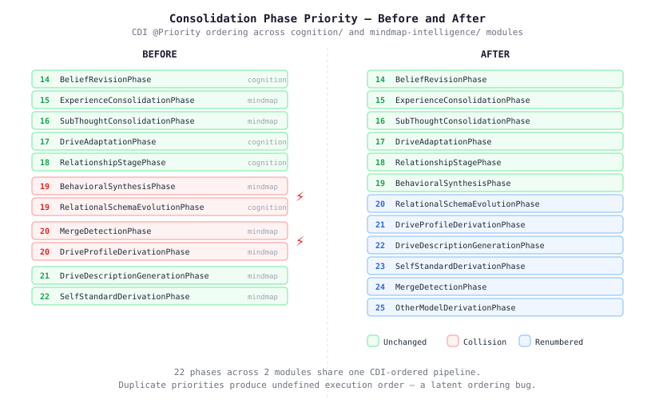
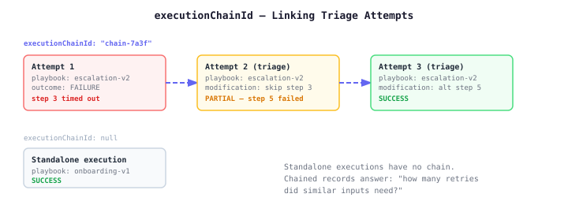

# Four Bugs That Passed CI

The cognitive consolidation pipeline runs 22 phases across two modules — `cognition/` and `mindmap-intelligence/` — all sorted by CDI `@Priority` into a single ordered sequence. Each phase does one job: graduate experience into beliefs, detect merge candidates, derive drive profiles, resolve goals. The ordering matters. A phase that reads another's output has to run after it.

Two of those phases had identical priorities. So did two others. The compiler didn't care. The tests didn't care. CI was green. The execution order was whatever CDI happened to discover first — which on a given JVM, on a given day, was probably fine.

Probably.

The collision at priority 19 was between `BehavioralSynthesisPhase` (CAPS settling from graduated experience) and `RelationalSchemaEvolutionPhase` (trust and intimacy formulas for relational schemas). Neither reads the other's output today. But "today" is doing a lot of work in that sentence. The collision at 20 was between `MergeDetectionPhase` and `DriveProfileDerivationPhase` — again independent, again one JVM restart away from not being independent if either gains a dependency on the other.

The fix was a renumber of the 19–27 range. Eight files, one line each. Every phase now has a unique priority, and the drive derivation chain (`DriveProfile` → `DriveDescription` → `SelfStandard` → `OtherModel` → `PrioritySignature`) stays in sequence. MergeDetection shifts from 20 to 24, which is fine — it only needs to run before `CommunitySummaryPhase` at 30.

## The Test That Wasn't Testing

The second bug was subtler. Six test sites across `memory-seeding` used `"collaborative"` as a disposition value for `socialOrient`. The CAPS topology vocabulary defines `"cooperative"`. The `DispositionAxes` record doesn't validate its inputs — it's an open value type — so the tests compiled and passed. They hit the `default -> {}` branch in the derivation engine, which does nothing. The assertions checked the stored value, which was whatever the test put in.

The tests were green. They were also inert. The drive modulation and appraisal weight paths that should fire for a cooperative social orientation never executed. Replacing `"collaborative"` with `"cooperative"` in four test sites means those paths actually run now. Whether they're correct is a separate question, but at least the question is being asked.

## Documentation as Debt

`CognitionConfig` has 24 boolean toggles. Each one gates a cognitive subsystem — mood tracking, drive orchestration, appraisal, salience filtering, behavioral synthesis. Each toggle corresponds to a section in the agency `CognitionDefinition` YAML schema, which is how agent authors configure their cognitive agents.

The mapping was implicit. Knowing that `moodEnabled` maps to the `mood` section required reading both codebases. That `characterDrivesEnabled` gets suppressed when `appraisalEnabled` is active? You'd need to read `CognitionCore.promptSections()` to find that. Twenty-four toggles, zero documentation on what connects to what.

A Javadoc table on the record itself now maps every toggle to its definition section, its orchestrator, and its prompt section. Not a design doc that drifts. Not a wiki page that rots. A table that lives one line above the fields it describes, updated by the same commit that adds the next toggle.

## Linking Triage Chains

The fourth change is a structural addition to `CbrPlanRecord` — a nullable `executionChainId` field that links triage attempts into a chain. When a playbook fails and gets triaged (steps modified, retried), each attempt previously existed as an independent record. There was no way to ask "how many retries did similar inputs need?" because there was no way to express "these three records are the same execution, attempted three times."

The field is nullable — standalone executions don't carry one. The first attempt in a triage chain sets it; subsequent attempts copy it. A backward-compatible constructor means all 27 existing call sites compile unchanged. The Qdrant store serialises it as a payload field, so chain-based retrieval is a filter away.

The interesting bit is what this enables downstream. The engine's `PlaybookOutcomeRecorder` can now write records with a chain ID, and CBR retrieval can surface patterns like "this playbook type averages 2.3 triage attempts for inputs in this feature cluster." That's not a metric you can compute from independent records.

## The Common Thread

None of these four bugs would have shown up in a code review of the files that contained them. The priority collisions were invisible until you listed every `@Priority` across two modules. The stale vocabulary was invisible until you traced the test value through the derivation engine's switch statement. The documentation gap was invisible until someone needed the mapping and couldn't find it. The missing chain link was invisible until you tried to aggregate across retries.

CI tests what you tell it to test. The rest is maintenance — the kind that doesn't feel productive until the day you discover a phase running in the wrong order and can't figure out when it started.
