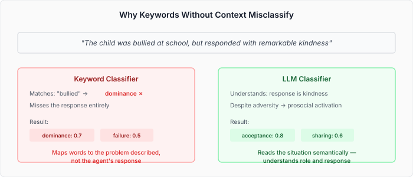
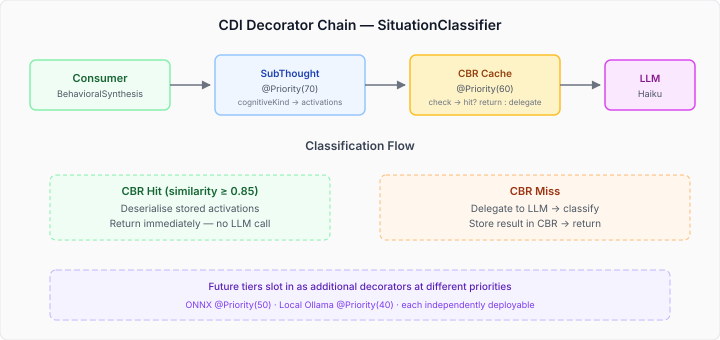

# When Keywords Lie — Teaching a Cognitive Agent to Classify Situations Through Understanding, Not Vocabulary

A child is bullied at school. She responds with remarkable kindness — comforting the bully, sharing her lunch, absorbing the hostility and reflecting warmth. The keyword classifier sees "bullied" and activates `dominance` and `failure`. The actual situation — gallantry, prosocial behaviour under pressure — is invisible to it. The word describes the problem. The agent's *response* describes the situation. Keywords cannot tell the difference.

This is the vocabulary abstraction gap, and it killed our CAPS situation classification pipeline.

## The Problem with Academic Vocabulary

The CAPS (Cognitive-Affective Processing System) model maps experiences to personality-shaping behavioural attractors. A `SituationClassifier` takes a description of what happened and produces activations — which CAPS input nodes fire, and how strongly. Those activations flow into the settling network, and the settled output determines which behavioural tendencies strengthen over time.

The `RuleBasedSituationClassifier` matched words against topology vocabulary. The vocabulary came from the psychological literature — Bowlby's attachment terms, McClelland's achievement motivation constructs. Academic terms for academic constructs. The problem: runtime narratives don't use academic language. "Struggling with a door" maps to `failure`, not the persistence and determination the agent is actually demonstrating. "Being left out" maps to `exclusion` regardless of whether the agent chose solitude or was abandoned.



We proved this quantitatively. In production scenarios, the keyword classifier produced a gallantry score of 2.50 where the target was 4.0+. Disabling it entirely (returning empty activations) was *less harmful* than the wrong activations it produced — wrong CAPS inputs actively break the appraisal filtering mechanism that determines which drives render in the prompt. The classifier was no-opped with a comment and an issue number.

## The Real Question: What Replaces It?

I'd been thinking about this as a three-tier problem: NLP structural classification as the fast path, LLM as fallback, ONNX as the eventual learned model. But we kept circling back to a harder question — can you do reliable situation classification without semantic understanding?

Keywords without context are a dead end. That's not a tuning problem or a vocabulary gap you can fill with more terms. The gap is structural: a keyword sees the word, not its role in the narrative.

What about a local model? A 3B or 7B parameter model running on Ollama could handle simple action sentences ("turn off the light") without a network round trip. But for the complex narrative that caused the original failure — where the difference between the described situation and the agent's response is the whole point — small models are likely too weak. The same semantic reasoning that makes LLMs good at this is what small models lack.

The answer was simpler than the question. Use the LLM. Get it right. Then make it cheaper.

## LLM First, Cache Second

The `LlmSituationClassifier` already existed — it calls Haiku, feeds it the CAPS topology (node descriptions, vocabulary, categories), and asks for JSON activations. It works correctly. The problem was purely mechanical: no CDI annotations, no producer, unreachable by any consumer.

The architecture we landed on puts the LLM as the ground truth classifier and wraps it with a CBR (Case-Based Reasoning) caching decorator. The decorator checks whether we've classified a semantically similar situation before. If yes, return the cached result. If no, delegate to the LLM, store the result, and return it.



The decorator chain follows the platform's established pattern — the same `@Decorator` + `@Priority` + `@IfBuildProperty` composition used by `RerankingCbrRecordStore`, `CorrectiveCaseRetriever`, and every other cross-concern module. Each decorator is independently deployable via classpath activation. Adding a tier means adding a module, not changing existing code.

## The SPI Had to Change

The existing `SituationClassifier` interface took a description and metadata. Two parameters. The CBR decorator needs a tenant ID to store and retrieve cases — multi-tenancy is a platform constraint, not an optional feature. The interface didn't carry that context.

We widened the SPI:

```java
@FunctionalInterface
public interface SituationClassifier {
    List<SituationActivation> classify(String description,
                                        Map<String, String> metadata,
                                        ClassificationContext context);

    default List<SituationActivation> classify(String description,
                                                Map<String, String> metadata) {
        return classify(description, metadata, ClassificationContext.NONE);
    }
}
```

The three-param method is abstract. The two-param is a convenience default. This direction matters — if two-param were abstract, any decorator that only overrides two-param (like `SubThoughtSituationDecorator`) would silently drop the context before the CBR decorator ever sees it. No error, no warning, no caching. Making three-param abstract forces a compile error in every existing implementation. The breakage is the point.

`ClassificationContext` carries only a `tenantId`. The CBR-specific details — entity ID, scope, domain — are implementation concerns hardcoded in the decorator, not SPI surface. This keeps `caps-api` free of platform identity types.

## CBR as the Learning Layer

The CBR case structure is straightforward. Each classification is stored as a `CbrFeatureRecord`:

| Field | Purpose |
|-------|---------|
| `description` | Semantic text — embedding similarity for retrieval |
| `event-type` | Structural filter (observation, action, outcome) |
| `cognitiveKind` | Structural filter (concern, intention, etc.) |
| `model-version` | Cache invalidation — filter by current LLM model |

Retrieval uses embedding similarity on the description text. "Struggling with a door" and "having trouble opening a door" score high similarity despite sharing few keywords — exactly the semantic equivalence that keywords miss.

The `model-version` field handles cache invalidation without explicit erasure. When you upgrade the LLM or change the prompt template, bump the version string. Old entries stay in storage — available as training data for a future ONNX classifier — but retrieval filters them out. No migration, no cleanup, no operational ceremony.

## The Concurrency Bug Nobody Hit Yet

The `LlmSituationClassifier` had a session ID field: `"classifier-" + System.identityHashCode(this)`. One ID, shared across all invocations. With `@ApplicationScoped` (singleton) and `BehavioralSynthesisPhase` fanning out classifications across virtual threads, concurrent calls would interleave on the same LLM session. The fix: per-invocation session IDs via `UUID.randomUUID()`. The bug was latent because the classifier wasn't wired into CDI — nobody was calling it through the singleton path.

## What This Opens Up

The decorator chain has explicit extension points for cheaper classification tiers. An ONNX model at `@Priority(50)` could handle situations the CBR has seen enough times to train on. A local Ollama model at `@Priority(40)` could handle simple action sentences without a network round trip. Each tier is independently deployable — add the module to the classpath, set the config flag, done.

But the more interesting direction is what the CBR store accumulates. Every LLM classification is a training example. Over time, the store becomes a labelled dataset of (situation description → CAPS activations) pairs, grounded in real runtime narratives, not academic vocabulary. That's the dataset an ONNX classifier needs. The CBR isn't just a cache — it's a data flywheel that bootstraps the next tier.

The tiers discover themselves empirically. If a local 7B model proves accurate enough for the cases a keyword approach would have handled, there's no point building NLP for those same cases. The progressive trust model — run the cheaper tier in parallel, compare against the LLM, graduate when agreement crosses a threshold — tells you which tiers earn their place. Build the measurement, not the assumption.
