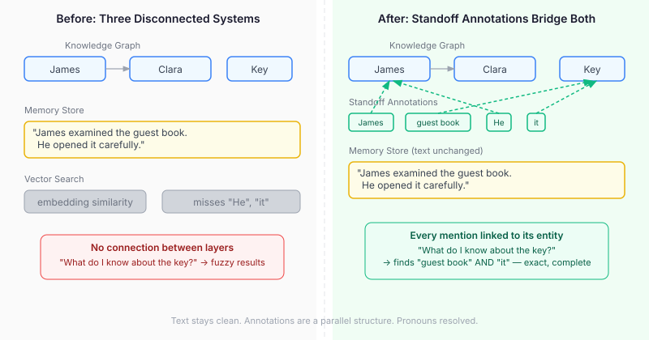
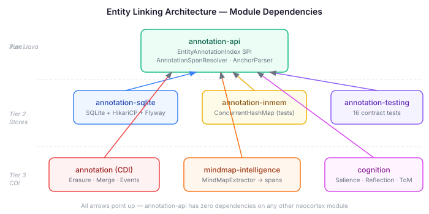

# The Pronoun Problem — Why Cognitive Architectures Need Standoff Annotation

Ask a cognitive agent "what do you know about the key?" and you get back whatever vector search finds for "key." If a memory says "James picked up the key. He examined it carefully. The thing was cold" — that memory has three references to the key. Vector search finds one of them. Maybe. The other two — "it" and "the thing" — are invisible.

This is the pronoun problem. And it isn't just pronouns. Definite descriptions ("the detective"), nicknames, epithets — any referring expression that isn't the canonical entity name is a gap. In a cognitive architecture where text memories and a knowledge graph are supposed to be two views of the same world model, that gap is structural.

I've spent the last session designing a fix for neocortex: unified entity linking via standoff annotation. The core idea is borrowed from computational linguistics, but the application — bridging a live knowledge graph with a text memory store inside a cognitive tick loop — raises design questions that the NLP literature doesn't address.

## What standoff annotation actually is

The term comes from corpus linguistics. "Standoff" means the annotations don't live inside the text — they stand off to the side.

```
Text:  "James examined the guest book. He opened it carefully."
Spans: [{0,5 → node:james}, {19,29 → node:book}, {31,33 → node:james}, {41,43 → node:book}]
```

The text is always clean. No inline markup, no special characters, no rendering artifacts. The annotations are a parallel data structure — a list of `(start offset, end offset, entity ID)` triples. You can render the text without annotations and it reads naturally. You can query the annotations without the text and get entity co-occurrence patterns.



The annotation layer bridges two worlds that are otherwise disconnected. The knowledge graph knows about entities and their relationships. The text corpus knows about natural language descriptions of events. Without the bridge, querying one tells you nothing about the other.

## Why this matters for cognitive architectures specifically

A general-purpose NLP system can get away without entity linking. Run the query, get the embedding, return the top-k results. Close enough.

A cognitive architecture can't. Four subsystems depend on knowing exactly which entities appear in which text:

**Salience.** When an agent perceives something new, the salience filter decides what deserves attention. Currently that's keyword overlap between the observation and active concerns. "James" in the observation matches "James" in a concern about James. But "he" doesn't match. "The detective" doesn't match. Entity linking makes salience exact — if the observation text contains any referring expression for James, the concern fires.

**Reflection.** "What do I know about James?" should return every memory that mentions James — including the ones where he's referred to as "he" or "that man" or "the older brother." Without entity linking, reflection is keyword search. With it, it's a graph traversal: find all annotations pointing to James's node, retrieve their source memories.

**Belief revision.** When two memories contradict each other about the same entity, the system needs to identify the conflict. "James is trustworthy" and "He lied about the key" — these contradict, but only if you know "He" refers to James. Entity annotations provide the provenance chain: this belief was grounded in these specific spans in these specific memories.

**Theory of Mind.** Building a mental model of another agent requires gathering everything known about them. Not just memories where their name appears — everything. The pronoun problem directly undermines Theory of Mind construction.

## The design decisions that shaped this

We started from first principles. Where should annotations live? Memory attributes? The MindMap graph? A dedicated store?

The decisive factor was the query direction. The primary use case is entity→text: "given this entity, find all text that mentions it." The secondary direction is text→entity: "given this memory, what entities appear in it?" A dedicated annotation index serves both directions with proper indexes. Memory attributes would require full-scan deserialization for the primary direction. MindMap node properties would invert the natural ownership — text owns its spans, not entities.

The second key decision was the coreference model. Explicit chain structures (mention→chain→entity) preserve discourse structure but add a layer of indirection that no query pattern actually needs. The flat model — every span points directly to its entity node ID — is simpler and supports every query through `GROUP BY`. The coreference chain IS the set of spans sharing an entity ID. No separate concept needed.

The third was how to produce annotations. LLMs are good at semantic tasks — identifying which surface form refers to which entity. They are bad at positional tasks — reporting character offsets. We split the pipeline: the LLM identifies mentions semantically ("He" → "James Pond"), and a deterministic resolver computes the exact character positions by scanning the text. Zero hallucinated offsets.



## The annotation index as a Tier 1 module

The annotation-api module has zero dependencies on mindmap-api. Entity node IDs are opaque strings. This was a deliberate boundary decision — the annotation layer bridges text and graph without coupling to either side's type system.

The SPI is small:

```java
public interface EntityAnnotationIndex {
    List<EntityAnnotation> findByEntity(String entityNodeId, String tenantId);
    List<EntityAnnotation> findByEntityPair(String id1, String id2, String tenantId);
    List<EntityAnnotation> findBySource(String sourceType, String sourceId, String tenantId);
    int repointEntity(String fromId, String toId, String tenantId);
    // ... write methods
}
```

`findByEntityPair` is the query that enables relationship-scoped retrieval — "find all memories where both James and Clara appear." The same-document constraint means it returns annotations from source documents mentioning both entities, not a cartesian product.

`repointEntity` handles node merges. When two MindMap nodes are merged and one ID is retired, all annotations pointing to the retired ID are repointed to the survivor. A CDI observer on `GraphMutationRecorded` triggers this automatically.

## Beyond cognition — a general-purpose knowledge store

I designed this for cognitive agents, but the architecture doesn't know that. The annotation-api has zero dependencies on cognitive-api or cognition-api. Entity node IDs are opaque strings. Source types are extensible strings. Nothing in the SPI assumes its entities are characters in a story or memories in an agent's mind.

What it actually is: a general-purpose linking layer between prose and a `Thing`-based knowledge graph. Any application that has entities and text about those entities benefits from the same bridge. Wiki pages about products. Case notes about customers. Research documents about concepts. Field reports about locations. The queries are the same — "find everything that mentions this entity," "find documents that mention both X and Y."

The piece that makes it more than a wiki is the LLM annotation pipeline. A wiki requires authors to create links manually. This system can annotate existing prose automatically — the LLM resolves pronouns, definite descriptions, and implicit references that no author would manually link. You feed it a corpus of unstructured text and it weaves it into the knowledge graph without anyone touching the source.

For an LLM-based agent, this is what turns flat memory storage into a world model. The agent learns things over time — through conversation, through reading, through observation. That knowledge lands as text in the memory store. Without entity linking, each memory is an island. The agent can retrieve similar text, but it can't answer "what do I know about this thing?" with any completeness. With entity linking, every memory that mentions an entity — by name, by pronoun, by description — is connected to that entity's node in the knowledge graph. The graph and the text become two views of the same understanding.

Take that to its logical end. An agent that records everything it does for its users, everything it hears about, everything it learns — every conversation, every event, every observation — all stored with entity annotations. A conversation about a doctor's appointment mentions "Dr. Chen," "she," "the appointment," "next Thursday." Each of those becomes a linked span pointing to an entity node. Six months later, "what do I know about Dr. Chen?" doesn't require keyword search. It traverses the annotation index and reconstructs the complete picture from hundreds of scattered mentions across thousands of memories. The density of connections IS the understanding. That's not a search engine over your notes. That's a knowledge network of a life.

## What's built, what's next

The foundation is in place: annotation-api with 14 tests for the span resolver and anchor parser, annotation-testing with 16 contract tests covering CRUD, entity queries, pair queries, merge repointing with deduplication, and tenant isolation. Both the in-memory and SQLite backends pass all contracts.

The extraction pipeline extension is started — `ParsedMention` and the LLM prompt changes are committed, awaiting the observer wiring that writes annotations to the index after each extraction pass.

Still ahead: the CDI lifecycle observers, biography YAML anchor syntax (`James[pp] examined the guest book[obj-7]`), and the four cognitive integration points. The design spec covers all of it. The implementation plan decomposes it into six batches.

The deeper question this opens up is about computed knowledge. Today, "what do I know about James?" is a retrieval question — search the memory store, return matching text. With entity linking, it becomes a graph question — traverse the annotation index, collect source documents, reconstruct the complete picture from scattered mentions. That's a different kind of knowledge. Not stored anywhere as a single record. Computed from the intersection of text and structure.

That's what the standoff layer enables. Not just better search — a different category of query. And not just for cognitive agents — for anything that needs to understand its own knowledge.
