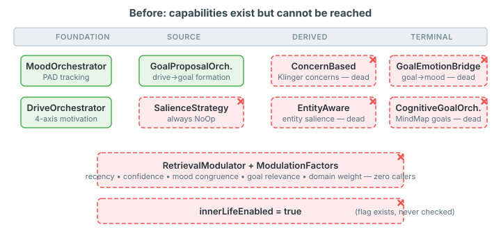
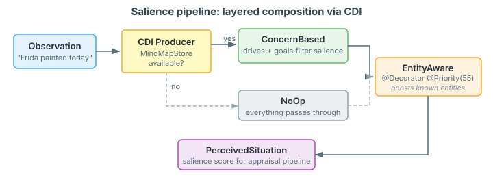
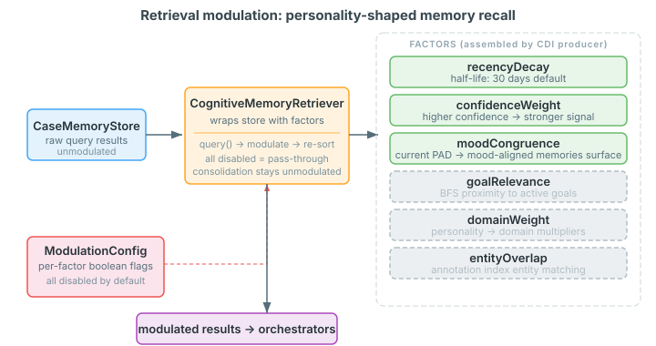

# The perception gap

There is a failure mode in cognitive agent systems that doesn't show up in tests, doesn't trigger alarms, and doesn't look like a bug. The code compiles. The unit tests pass. The agent runs. But the agent is cognitively flat — every observation carries the same weight, every memory retrieval returns the same ranking, and emotional feedback loops that should shape behaviour are severed.

I'm calling this the perception gap. Not missing capabilities, but present ones that the runtime cannot reach.

## What we found

A systematic audit of the neocortex cognitive pipeline revealed six independent capabilities that were fully implemented, individually tested, and completely dead in production:

The `ConcernBasedSalienceStrategy` — a full implementation of Klinger's Current Concerns theory for filtering perception based on active drives and goals — had been displaced by `NoOpSalienceStrategy` via a `@DefaultBean` that always returned the no-op. The `EntityAwareSalienceStrategy`, designed to boost salience when observations mention entities the agent already knows about, had the right interface but no CDI wiring. `GoalEmotionMoodBridge`, which feeds goal success and failure back into the mood subsystem, was never registered as a tick participant. The entire retrieval modulation framework — six composable factors for biasing memory recall based on recency, confidence, mood congruence, goal relevance, domain expertise, and entity overlap — had zero callers anywhere in production code.

Each capability was individually well-designed. Some had thorough test suites. The gap was at the composition layer: the three-layer wiring pattern (builder method, configure method, CDI factory injection) that connects a capability to the cognitive pipeline had never been completed.

## Why this matters for agent builders

If you're building agents that go beyond single-turn request-response — agents that maintain state across interactions, develop preferences, track goals, remember past conversations — the perception gap is the difference between an agent that feels alive and one that feels like a chatbot with extra steps.

Consider two concrete consequences.

**Without salience filtering**, every observation the agent receives is treated as equally important. A passing mention of the weather gets the same cognitive weight as a user expressing frustration about a blocked goal. The agent has drives and goals (it tracks them, updates them, proposes new ones) but those internal states never shape what the agent notices. Klinger's Current Concerns theory, which the codebase already implemented, says that perception is filtered by what currently matters to the organism. A hungry agent notices food cues. An agent pursuing a deadline notices time pressure signals. Without salience, the agent has concerns but is incapable of using them.

**Without retrieval modulation**, memory recall is a flat keyword search. The agent retrieves the same memories in the same order regardless of its current emotional state, active goals, or how recently the memories were formed. In humans, memory is profoundly shaped by mood — depressed recall favours negative memories, positive mood surfaces positive ones. Goal-relevant memories are more accessible when the goal is active. Recent experiences have stronger traces. None of this is exotic psychology; it's the baseline of how memory actually works. Without modulation, the agent has mood and goals but they cannot influence what it remembers.

## The salience pipeline

The fix for salience was compositional. Two strategies, layered via CDI's decorator pattern:

The CDI producer makes a runtime decision: if a `MindMapStore` is available (meaning the agent has a knowledge graph), the base strategy is `ConcernBasedSalienceStrategy`, which filters perception through the agent's active drives and goals. If no graph is available, `NoOpSalienceStrategy` takes over and everything passes through.

On top of whichever base strategy is active, `EntityAwareSalienceStrategy` wraps it as a `@Decorator`. When the agent's entity annotation index is available, observations that mention known entities — people, places, projects the agent already has relationships with — get a salience boost. When the annotation index isn't on the classpath, the decorator delegates straight through.

The result is a pipeline that activates progressively. An agent with no knowledge graph gets flat salience. An agent with a graph but no entity annotations gets concern-based filtering. An agent with both gets concern-based filtering plus entity-aware boosting. No configuration needed — CDI classpath presence determines capability.

This matters because it means the same cognitive pipeline code can serve a minimal prototype and a full deployment. The perception model degrades gracefully rather than requiring you to wire capabilities for each tier.

## Retrieval modulation

Memory recall modulation follows a different pattern. Rather than a decorator chain, it uses a factor-assembly model — a CDI producer inspects which dependencies are available and which config flags are enabled, then builds a list of composable scoring functions:

Each factor is a `ModulationFactor<Memory>` — a function that takes a memory and a context, and returns a score multiplier. The factors compose multiplicatively: a memory that is recent, high-confidence, and mood-congruent gets boosted on all three axes. A stale, low-confidence memory that contradicts the current mood gets suppressed.

All factors are disabled by default. This is a deliberate choice. Retrieval modulation changes what the agent "remembers" and therefore how it responds. Enabling mood-congruent recall means the agent will surface different memories when happy versus sad. That's cognitively realistic, but it's also a behaviour change that needs to be understood and tested per deployment. Opt-in per factor, per deployment.

One architectural constraint shaped the entire design. Consolidation phases — the background processes that graduate experiences, detect merge candidates, revise beliefs, discover schemas — must see unmodulated data. Modulation is an agent perception concern: it shapes what the agent uses to form responses. It is not a system operation concern. If the merge detection phase could only see mood-congruent memories, it would miss merge candidates that happen to contradict the agent's current emotional state. `CognitiveMemoryRetriever` wraps `CaseMemoryStore` for cognitive orchestrators; consolidation phases continue to use the store directly.

## The wiring pattern

Each capability follows the same three-layer wiring pattern, established by prior work and now applied to six more capabilities:

**Layer 1: Builder.** `CognitivePipelineBuilder` gets a nullable field and a fluent setter. The builder doesn't require any capability — it builds a valid pipeline whether the field is null or populated.

**Layer 2: Configure.** `CognitionCore` gets a `configure*()` method that creates the participant, registers it at a specific phase, and optionally chains prompt sections. The phase assignment matters: `GoalEmotionMoodBridge` must register after `CognitiveGoalOrchestrator` in the TERMINAL phase because it reads goal state that the orchestrator just updated.

**Layer 3: Factory.** `CognitionCoreFactory` gets an `@Inject Instance<T>` field with an `isResolvable()` guard. When the dependency is on the classpath, it wires itself in. When it's not, the pipeline works without it.

Config flags gate behaviour inside the participant, not at the wiring layer. `innerLifeEnabled = false` doesn't prevent `InnerLifeOrchestrator` from being wired — it prevents it from executing during ticks. This means you can wire everything and toggle capabilities at runtime via configuration, without restarting or rebuilding.

## What landed

Six commits. Three batches. All test suites green (525 cognition, 365 cognitive-index).

Batch 1 wired `GoalEmotionMoodBridge` and `CognitiveGoalOrchestrator` into the TERMINAL phase, fixed the `innerLifeEnabled` config gate that was never actually checked, and added three `@DefaultBean` stubs for graceful degradation.

Batch 2 activated the salience pipeline — `ConcernBasedSalienceStrategy` conditionally displaces the no-op, `EntityAwareSalienceStrategy` layers on top as a decorator.

Batch 3 created `RetrievalModulationConfig` and `CognitiveMemoryRetriever`, wired modulation into the cognitive pipeline with a CDI producer that assembles factors from config and available dependencies.

Eight child issues track the follow-on work: integrating the retrieval module into specific orchestrators, extending modulation to the RAG layer, completing biography pipelines, and wiring the full cognitive pipeline into the Manor game characters.

## The lesson

The hardest bugs in a cognitive architecture are not the ones where something is wrong. They are the ones where something is absent. The agent runs, responds, appears to function — but its inner life is simulated rather than enacted. It has goals but they don't shape perception. It has mood but mood doesn't shape memory. It has drives but drives don't filter what it notices.

These are not missing features. The code exists. The tests pass. The types are correct. What's missing is the wire — the line of composition that connects a capability to the pipeline that exercises it. And because the agent still produces reasonable responses without these wires (the LLM compensates), the gap can persist indefinitely.

The fix is not better testing. Unit tests verify that each capability works in isolation — which these all did. The fix is systematic audit of the composition layer. For each SPI, ask: who calls this? For each config flag, ask: does anything check this? For each strategy, ask: is the production bean the real implementation or the no-op?

The capabilities were always there. The perception gap was in the wiring.
