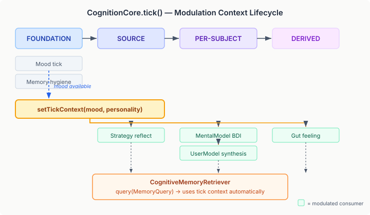
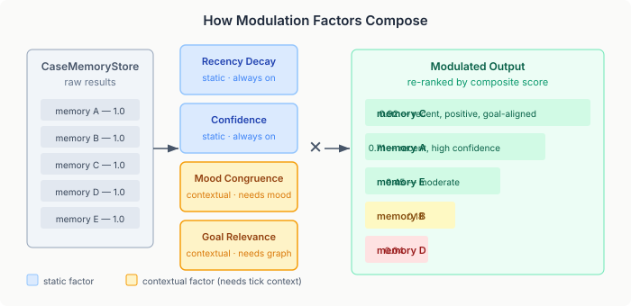

# Memory through mood

Ask someone to recall a time they felt confident and they'll retrieve memories of success. Ask the same person during a depressive episode and they'll retrieve failures. The memories haven't changed. The retrieval mechanism has.

This is mood-congruent memory bias — one of the most replicated findings in affective psychology. It's not a bug in human cognition. It's a feature. Mood acts as a retrieval cue, surfacing memories whose emotional signature matches the current state. The result is a feedback loop: mood shapes what you remember, and what you remember reinforces the mood. For better and worse.

I've been building a cognitive architecture for autonomous agents — the kind that maintain state across interactions, track goals, develop preferences, hold theory-of-mind models of the people they talk to. The architecture already had a mood system (PAD emotional state, per-interaction appraisal, exponential decay toward a personality-derived baseline). And it had a memory system (CaseMemoryStore, text-based retrieval with FTS). What it didn't have was a wire between the two.

## The problem with flat retrieval

When an agent's strategy orchestrator reflects on its engagement history, it calls an LLM with a prompt containing recent evidence: engagement rates, sentiment trends, per-subject patterns. The LLM synthesises this into strategy adjustments — shift verbosity down, increase directness with this user, ask fewer questions.

Without modulated retrieval, this reflection operates in a vacuum. The orchestrator has CBR-backed structured data (engagement evidence, strategy profiles) but no general experiential context. It doesn't know that yesterday's conversation about the user's project deadline left the agent feeling tense and the user feeling heard. It doesn't know that a creative brainstorming session last week produced strong positive affect. The strategy reflection is structurally complete but experientially hollow.

The same gap exists in theory-of-mind. The mental model orchestrator extracts beliefs, desires, and intentions from what a person says. It uses an LLM to infer BDI state from verbal cues. But the inference has no experiential grounding — the agent has interacted with this person across many conversations, but those memories don't inform the inference. And the agent's own mood doesn't bias the inference, which means the agent lacks the perceptual asymmetry that makes human social cognition feel natural. An anxious person reads ambiguous statements as threatening. A confident person reads them as neutral. Without mood-biased retrieval, the agent always reads them the same way.

## Tick-scoped modulation context

The retrieval modulator already existed — six composable factors, multiplicative scoring, factor-assembly from CDI config. What was missing: a way for the factors to access the agent's current cognitive state without every consumer having to assemble it.

The cognitive pipeline runs in phases. FOUNDATION establishes mood and memory hygiene. SOURCE runs strategy and narrative orchestrators. Then a per-subject loop runs user model and mental model orchestrators. DERIVED runs appraisal, gut feeling, and CAPS.

The insight: mood and personality are established once per tick and stable across all downstream phases. The retriever doesn't need per-query context — it needs per-tick context. So `CognitiveMemoryRetriever` gained a volatile `tickContext` field. `CognitionCore.tick()` calls `setTickContext()` once, right after FOUNDATION completes. Every downstream consumer just calls `query(MemoryQuery)` — the context is already there.

This is a small change with a large consequence. Contextual modulation factors — mood congruence, personality-weighted domain bias, entity overlap — were previously dead. They existed in the CDI producer, guarded by null checks on `ModulationContext` fields. With the tick context set, those guards pass, and the factors activate.

## How factors compose

Each factor returns a score multiplier for each memory. The factors compose by multiplication. A memory that scores well on all active factors gets strongly boosted. A memory that fails on one axis gets suppressed even if it scores well on others.

Two factors are static — they don't need cognitive context:
- **Recency decay** (exponential half-life, configurable). Recent memories score higher. A seven-day half-life means a two-week-old memory scores 0.25 relative to today.
- **Confidence weight**. Memories stored with higher confidence (stated facts vs. inferred speculation) rank above uncertain ones.

Four factors are contextual — they activate only when tick context is set:
- **Mood congruence**. The PAD distance between the memory's emotional signature and the agent's current mood. Happy agent, happy memories surface. The weight is configurable — full congruence at 1.0, partial at 0.5, off at 0.
- **Goal relevance**. BFS proximity from the memory's associated entities to active GOAL nodes in the MindMap. A memory about a person connected to an active goal scores higher.
- **Domain weight**. Personality-driven weighting across memory domains. An agent with high curiosity weights experience memories higher. An agent with high affiliation weights relationship memories higher.
- **Entity overlap**. When the current tick involves entities the agent already knows about (via the EntityAnnotationIndex), memories mentioning those same entities get boosted.

The distinction between static and contextual factors matters for testing and deployment. Static factors work immediately — they need nothing from the cognitive pipeline. Contextual factors only activate when the tick context is present and the relevant dependency (MindMapStore, MoodOrchestrator, personality profile) is on the classpath. An agent deployed without a knowledge graph still gets recency and confidence modulation. The full set activates progressively as capabilities are added.

## Where it lands

Four integration points. One direct substitution, three supplementary.

`GutFeelingParticipant` is the direct substitution. It was already calling `CaseMemoryStore.query()` to find experience memories semantically similar to the current observation, then averaging their PAD values to produce an APPROACH/AVOID/CAUTIOUS signal. Now that query goes through the retriever. In a positive mood, the gut feeling probe surfaces memories with positive affect — reinforcing approach behaviour. In a negative mood, it surfaces negative memories — triggering caution. This is the affective feedback loop that was architecturally planned but never connected.

The three orchestrators — strategy, mental model, user model — get supplementary context. Their existing CBR-backed queries are untouched. What changes: each orchestrator's LLM prompt now includes a section of modulated experience memories as additional context. The strategy reflection prompt gains experiential grounding. The BDI extraction prompt gains mood-biased experiential context. The user profile synthesis prompt gains recency-weighted recent experiences.

The orchestrators don't know how the memories were modulated. They don't know whether mood congruence is active or how many factors are composed. They call `retriever.query()` and get ranked results. The modulation is transparent to consumers and configurable by deployers.

## Why this matters beyond this codebase

Most agent frameworks treat memory as a storage problem. You store memories, you retrieve them by similarity or recency, you inject them into prompts. RAG for agents. This works for factual recall — "what did the user say about their project deadline?" — but it misses the role memory plays in cognition.

In humans, memory retrieval is not a search engine. It's a constructive process shaped by current state. Mood, goals, recent attention, personality traits — all of these modulate what surfaces. The same query produces different results depending on who is asking and how they feel. This is not noise to be filtered out. It is the mechanism by which internal state shapes external behaviour.

An agent that retrieves the same memories regardless of its emotional state, regardless of what it's currently pursuing, regardless of its personality profile — that agent has memory but not cognitive memory. It recalls facts but doesn't experience recall. The difference is visible in conversation: the agent's responses are informationally correct but affectively flat. It knows what happened but doesn't feel the weight of it.

The modulation framework doesn't simulate this — it implements it. Mood congruence is not a heuristic bolted on top. It's a scoring function derived from the same PAD model that drives the mood system. Goal relevance uses the same MindMap graph that the goal orchestrator maintains. Domain weights come from the same personality profile that shapes the agent's drives. The modulation isn't an approximation of cognitive bias — it's the computational expression of the same state that produces the bias.

This is what makes it practical for agent builders: you don't need to understand affective psychology to deploy it. Enable the config flags, provide the dependencies, and the agent's memory retrieval starts reflecting its internal state. Disable them and retrieval is flat — still works, just cognitively inert.

The config surface is six boolean flags and a handful of parameters. The cognitive surface is the difference between an agent that remembers and one that experiences remembering.
