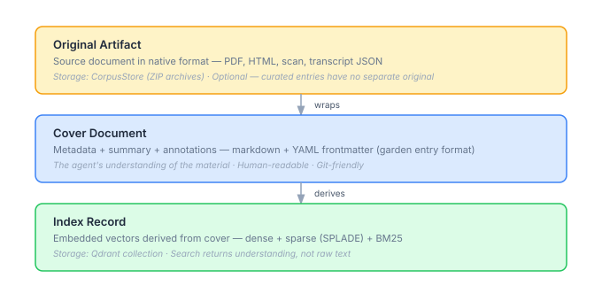
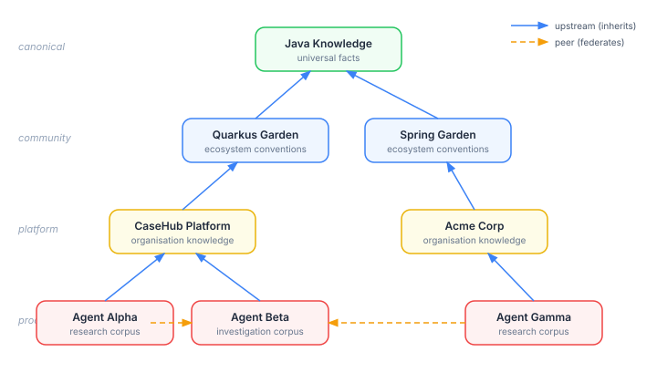
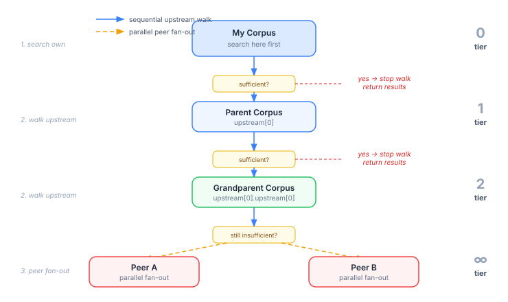

# Knowledge That Outlives the Session

An LLM agent starts every session knowing nothing about its work. This is not a product gap that better models will fix — it is a structural limitation of the architecture. Fixing it requires infrastructure that does not exist in standard AI toolchains. I have been building that infrastructure: a corpus management abstraction that gives agents typed, searchable, federable knowledge collections with lifecycle, provenance, and quality signals. Not a wrapper around a vector store. A body of knowledge the agent owns.

## 1. The Problem: Sessions Don't Accumulate

A model with a million-token context window can hold a lot in working memory. But working memory is not knowledge. The research the agent conducted last Tuesday, the pattern it noticed across three debugging sessions, the user preference it learned from five consecutive corrections — all evaporate when the session ends. Every session is a first encounter.

The obvious fix is to persist things. Write them to a vector store, retrieve them later via RAG. This works at the retrieval layer. But retrieval is the wrong abstraction level for knowledge management, the same way a file system is the wrong abstraction level for a database. You can build a database on a file system, but the file system does not give you queries, schemas, transactions, or integrity constraints. You have to build all of that yourself.

The same is true for vector stores and knowledge. Qdrant will embed your text and return nearest neighbours. It will not tell you which collection an entry belongs to, whether it is stale, whether a newer entry in a parent corpus supersedes it, or whether the agent should even see it given its current goals.

## 2. What a Vector Store Doesn't Give You

Here is what goes wrong when you treat a vector store as a knowledge system.

**No typed collections.** Every document goes into one namespace. Research notes, interaction transcripts, and curated knowledge garden entries all land in the same pile. There is no way to say "search only my research corpus" or "search everything except transcripts." The agent has no concept of knowledge organisation — it has a haystack with a similarity function.

**No lifecycle.** Documents are either present or absent. There is no concept of archiving a corpus when a project ends, or reviving it when the project restarts. No way to say "this knowledge was relevant during Q3 but should not pollute current results."

**No federation.** An agent's knowledge is isolated. There is no way for one agent's research corpus to inherit from a shared platform knowledge base, or for two peer agents to search each other's findings without merging their collections.

**No provenance.** Where did this entry come from? When was it last validated? Has it led to good outcomes when retrieved? A vector store treats every embedded chunk as equal. Knowledge is not equal — some of it is stale, some of it is gold, and without provenance signals there is no way to tell.

**A fair counter:** you could build all of these features on top of a vector store. Metadata fields for type, lifecycle flags, federation logic in application code. Many teams do exactly this. But that is exactly the point. You have to build it yourself, every time, because the vector store abstraction does not include any of it. A corpus abstraction packages these concerns into a single concept the agent can reason about.

## 3. The Corpus: A Knowledge Concept Agents Can Own

A corpus is a typed, searchable, federable collection of knowledge with a lifecycle. An agent does not interact with a vector store — it interacts with its research corpus, its transcript corpus, its knowledge garden.

The word matters. Not "index" (too mechanical), not "store" (too generic), not "garden" (too specific to one use case, though gardens are one corpus type). A corpus is a body of knowledge. It implies curation, organisation, and purpose.

An agent conducting a literature review creates a research corpus. It ingests papers, writes cover documents summarising each one, indexes them for semantic search, and retrieves across its growing library — shaped by its current goals and disposition. When the project ends, the corpus archives. It remains searchable on demand but drops out of the default search path.

An agent's interaction history becomes a transcript corpus. Every conversation is indexed with metadata — interaction type, activity type, domain, participants. "Show me all design discussions about attention mechanisms from last month" is a corpus query. So is "when did I last discuss CAPS topology changes?"

Each corpus has a type that defines its schema:

```java
public static final CorpusType RESEARCH = new CorpusType(
    "research",
    Map.of("id", FieldSchema.STRING, "title", FieldSchema.STRING,
           "type", FieldSchema.STRING, "domain", FieldSchema.STRING),
    Map.of("tags", FieldSchema.STRING_LIST,
           "citations", FieldSchema.STRING_LIST),
    null
);
```

A `RESEARCH` corpus requires id, title, type, and domain. A `TRANSCRIPT` corpus requires interaction_type, activity_type, and artifact_ref. The schema validates on ingestion — no half-formed entries polluting search results.

This is not a wrapper around Qdrant. This is the concept the agent reasons about when managing its knowledge.

## 4. Three Layers: The Agent Searches Its Own Understanding

The hardest design question was how to handle heterogeneous source material. Research papers are PDFs. Interaction transcripts are structured JSON. Knowledge garden entries are curated markdown. Forcing everything into one format loses fidelity.

The answer is a three-layer document model.



The original artifact stays in its native format — the PDF, the scan, the transcript log. A cover document wraps it in a standard format: markdown body with YAML frontmatter carrying metadata, summary, annotations, and cross-references. The index record embeds the cover into Qdrant for vector search.

**The agent searches its own understanding, not the raw material.** The cover document captures what the agent learned from a paper — "Walker demonstrates two-stage sleep consolidation, contradicting the single-stage model." That synthesis is more searchable than the raw PDF text. And it evolves as the agent's understanding deepens.

```yaml
---
id: CE-20261102-a4f2c8
title: "Two-Stage Consolidation in Sleep"
type: research-paper
corpus: neuroscience-research
domain: memory-consolidation
tags: [sleep, consolidation, SWS, REM]
---
Walker (2005) presents evidence for two-stage memory consolidation
during sleep. SWS handles declarative memory; REM handles procedural
and emotional memory. This contradicts the single-stage model and
aligns with the dual-process theory used in our memory hygiene pipeline.
```

For curated knowledge — knowledge garden entries — the cover IS the knowledge. There is no separate original. Same format, same indexing, same search infrastructure. The cover is human-readable, Git-friendly, and carries enough structure for schema validation.

## 5. Federation: Knowledge Inheritance with Override Semantics

A single agent's corpus is useful. A network of corpora is something different.



Every corpus sits in a federation graph. It can have upstream sources — a parent chain of inherited knowledge, searched sequentially — and peer sources — sibling corpora searched in parallel when local results are insufficient. The hierarchy has four levels:

- **Canonical** — universal knowledge anyone benefits from. A Java knowledge corpus that any JVM agent can search.
- **Community** — ecosystem conventions. How to do things the Quarkus way, distinct from the Spring way.
- **Platform** — one organisation's accumulated knowledge. What the team has learned.
- **Product** — one agent's local understanding, which can override any of the above.

A child entry with an `overrides` field supersedes the parent entry in search results. Local knowledge wins. This is knowledge inheritance with override semantics — the same pattern that makes type systems composable.

The practical consequence: an agent researching memory consolidation inherits everything the platform's neuroscience garden knows. It adds its own findings on top. When it discovers something that contradicts a parent entry, it overrides locally. If the discovery is validated, it can be promoted upstream for the whole community.

**A fair counter:** most agent systems today are single-instance. Why build federation? Because knowledge is not a single-agent problem. The moment two agents work on related topics — even within the same organisation — their knowledge either flows between them or it doesn't. If it doesn't, both agents are doing redundant research. If it does through a shared database, you lose the ability for each agent to have its own perspective on the same material. Federation gives you both: local ownership with shared access.

## 6. The Chain Walker: How Federated Search Works

Federation is not theoretical. It is implemented. The search algorithm — the chain walker — is a tier-based graph traversal with sufficiency short-circuit.



The walk starts at the queried corpus (tier 0). If the local results are insufficient — fewer high-confidence matches than requested — the walker moves to upstream corpora sequentially, one tier per hop. Each upstream search increments the tier. If at any point the combined results exceed the sufficiency threshold, the walk stops. No wasted queries to distant ancestors when the nearby results are good enough.

If the upstream chain is exhausted and results are still insufficient, the walker fans out to peer corpora in parallel (tier MAX). Peer results always rank below upstream results in the merge — they are auxiliary, not primary.

The merge is tier-grouped: all tier-0 results first, sorted by relevance within that tier, then tier-1, then tier-2, and so on. A peer result with 0.95 relevance still appears after an upstream result with 0.3 relevance. Provenance matters more than raw similarity score.

```java
return deduped.stream()
    .collect(Collectors.groupingBy(tr -> tr.tier))
    .entrySet().stream()
    .sorted(Map.Entry.comparingByKey())
    .flatMap(entry -> entry.getValue().stream()
        .sorted(Comparator.comparingDouble(
            (TieredResult tr) -> tr.result.score()).reversed())
        .map(tr -> tr.result))
    .limit(limit)
    .toList();
```

Cycle detection is a visited set on `CorpusRef`. Upstream refs support an `always` search order — an always-upstream corpus is searched even when local results are sufficient, for the case where a canonical source should always be consulted.

## 7. From Indexed Knowledge to Structured Understanding

A corpus gives the agent breadth — everything indexed, everything searchable. But breadth is not understanding. Understanding is structural: it is knowing that sleep consolidation relates to memory hygiene, that Walker's findings contradict Stickgold's, that both connect to the dual-process theory driving the agent's own memory pipeline. That kind of knowledge lives in a graph, not an index.

Neocortex already has this graph. The MindMap is a typed knowledge graph where entities carry edges, traits, emotional dimensions, temporal validity, and subgraph membership. A `MindMapNode` is not a document — it is a concept the agent can traverse, relate, and reason about structurally. Nodes live in typed subgraphs — PERSON, PROJECT, RESEARCH_AREA, CONCEPT, GOAL — and connect via typed edge vocabularies that define the relationship semantics.

Not everything in a corpus deserves a MindMap node. A corpus entry is cheap — ingest it, index it, search it later. A MindMap node carries semantic weight. It participates in graph analysis, consolidation phases, goal resolution, and attention signalling. Promoting everything would drown the graph in noise.

So promotion is explicit. The agent decides when a corpus entry has earned structural representation — when it has proved durable, when it connects to other things the agent knows, when it matters beyond retrieval.

The mechanism is a bidirectional cross-reference. When an entry is promoted, the new MindMap node carries a `NodeRef` pointing back to the corpus entry:

```java
var nodeRef = new NodeRef("corpus", entryId, corpusName);
```

The corpus entry gains a `promoted_to` field pointing to the node. Neither side owns the other. The corpus entry remains searchable in its original corpus — the promotion adds a structural representation alongside it, not instead of it.

What does the node gain that the entry lacked? Edges to other nodes — "contradicts", "supports", "derived-from". Traits that classify the node's nature. PAD emotional dimensions that let the cognitive pipeline modulate how the agent feels about this knowledge. Subgraph membership that places it in context. Confidence with temporal decay — knowledge that fades if not reinforced.

A corpus entry says "I found this." A MindMap node says "I understand this well enough to relate it to other things I know."

The consolidation pipeline already handles this transition for experience memories. The `ExperienceConsolidationPhase` graduates memories to COGNITIVE subgraph nodes when they are corroborated across multiple observations. Corpus promotion follows the same pattern: accumulate evidence in the corpus, promote to the graph when the evidence is strong enough. The corpus is the staging area. The MindMap is the committed understanding.

## 8. What This Changes for Agent Builders

Three capabilities that were not possible before this infrastructure.

**Knowledge accumulates across sessions.** An agent's research corpus grows over weeks and months. Each session picks up where the last left off, with the full body of indexed knowledge available for retrieval — modulated by recency, goal relevance, and the agent's current cognitive state. The hippocampus that the architecture was missing now exists.

**Agents manage their own knowledge lifecycle.** An agent creates corpora when it recognises an emerging interest. It archives them when a project closes. It promotes entries to permanent knowledge in the MindMap when they prove durable. This is cognitive autonomy over knowledge management, not a pre-configured pipeline someone else designed.

**Knowledge has provenance and quality signals.** Every corpus entry carries metadata about where it came from, when it was ingested, and what type it is. Stale entries get flagged. The agent's knowledge is not just stored — it is curated by the agent itself.

The session still starts cold. But the agent has its library card.
