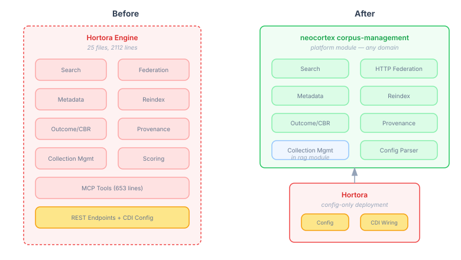
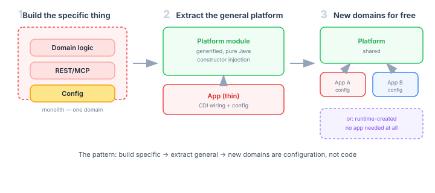

# The Application That Disappeared Into Its Platform

*Continues from [Knowledge That Outlives the Session](2026-11-02-mdp01-knowledge-that-outlives-the-session.md).*

Hortora started as a knowledge garden — a Quarkus application for managing technical gotchas about Java, Qdrant, CDI, and the rest of the operational surface a JVM developer accumulates over years. It had search, federation, provenance tracking, outcome feedback via CBR, collection migration, metadata extraction, MCP tools, REST endpoints. Nine months of production use. Around 4000 lines of Java across two packages.

Today it has 1465 lines and is heading toward zero.

Not because it was decommissioned. Because every capability it had turned out to be general. Search is not a garden thing — it is a corpus thing. Federation is not a garden thing — it is a corpus thing. Outcome tracking, provenance, collection migration — none of these are specific to "a knowledge garden for Java gotchas." They are specific to "a searchable, federable body of knowledge with lifecycle." The domain was the configuration. The capabilities were the platform.

## The migration in three acts



The work happened across three sessions, each with a different lesson.

**The first session** designed the abstraction. Sixteen architectural decisions, a reviewed spec, and eight tasks produced `corpus-management-api` (the SPIs and value types) and `corpus-management` (the runtime). The key insight: a corpus is not a vector store with metadata. It is a typed, searchable, federable collection with a lifecycle and schema. That distinction drove every SPI design.

**The second session** discovered a mistake. The first session's plan said "migrate from Hortora using IntelliJ refactoring." What actually happened was that someone rewrote the Hortora code from scratch in the new package — losing nine months of edge-case handling, test coverage, and battle-tested behaviour. We caught it, deleted the reimplementations, and IntelliJ-moved the original Hortora files into `corpus-management`. Then generified them: stripped CDI annotations, replaced field injection with constructor parameters, removed Quarkus-specific imports. The mature code survived. The test suite came with it.

**The third session** — today — finished the job. Five remaining services moved to neocortex. The HTTP federation walker, the federation config parser, the outcome service, the collection migration logic, the scoring strategies. Each one was copied, generified to pure Java, tested independently, and the Hortora original deleted. Seven source files and six test files removed from Hortora. 1937 lines gone, replaced by two thin CDI adapter classes totalling 113 lines.

What remains in Hortora is CDI producers, REST endpoints, MCP tools, and config bindings. All of that goes next — replaced by `@McpDomain("corpus")` auto-generated endpoints from neocortex. After that, Hortora is `application.properties` and a `SCHEMA.md` that defines what a Java knowledge garden looks like. No Java source code at all.

## The pattern



This is not a refactoring story. It is a platform extraction story, and the pattern is worth naming because it recurs every time you build something specific enough to be useful and general enough to extract.

**Build the specific thing first.** Hortora was built to solve one problem: managing a knowledge garden for JVM gotchas. It was not designed as a platform. It was designed as an application. Every feature was added because the application needed it — not because "this might be reusable someday." Federation existed because I wanted my local garden to inherit from a canonical Java knowledge base. Outcome tracking existed because I wanted to know which entries were actually useful when retrieved. These were product requirements, not platform abstractions.

**Recognise when the domain is the smallest part.** After nine months, I looked at Hortora's code and noticed something: the domain-specific parts — what makes a Java gotcha different from a literature review note — were all in configuration. The entry schema. The federation topology. The domain labels. Everything else was machinery that any knowledge corpus would need. The search algorithm does not care whether it is searching Java gotchas or clinical guidelines. The federation walker does not care whether it is walking a JVM knowledge hierarchy or a legal precedent chain.

**Extract by moving, not rewriting.** The second session's mistake was instructive. Rewriting mature code means losing the accumulated fixes — the edge cases caught in production, the timeout handling added after a real outage, the dedup logic refined over months of actual use. Moving preserves all of it. The generification step is then minimal: strip the framework annotations, widen the constructor, let the caller provide what the framework used to inject. The code stays the same. The coupling changes.

**The application becomes a deployment descriptor.** Once the platform module contains all the capabilities, the application collapses to configuration. Which corpora exist. What domains they cover. Where the federation peers live. What scoring weights to apply. A new domain does not require a new application — it requires a new configuration, or an API call that creates the corpus at runtime.

## What generification actually looks like

The pattern's hardest step is generification. Not intellectually hard — the principle is simple: replace injected dependencies with constructor parameters. But the details matter.

Hortora's `ChainWalker` used `@Inject FederationConfig`, `@Inject ManagedExecutor`, and built REST client proxies via `QuarkusRestClientBuilder`. All three are Quarkus-specific. The generified `HttpFederationWalker` takes `FederationConfig` and `ExecutorService` as constructor parameters, and accepts a `Function<String, RemoteCorpusClient>` factory for creating remote clients. The walk algorithm — tier-based upstream traversal, parallel peer fan-out, sufficiency short-circuit, dedup — is identical. The framework coupling is gone.

```java
public HttpFederationWalker(FederationConfig config, ExecutorService executor,
                             Function<String, RemoteCorpusClient> clientFactory) {
    this.config = config;
    this.executor = executor;
    for (var ref : config.upstream()) {
        upstreamClients.put(ref.url(), clientFactory.apply(ref.url()));
    }
    for (var ref : config.peers()) {
        peerClients.put(ref.url(), clientFactory.apply(ref.url()));
    }
}
```

In Hortora, the CDI producer bridges the gap:

```java
var walker = new HttpFederationWalker(federationConfig, managedExecutor,
    url -> QuarkusRestClientBuilder.newBuilder()
        .baseUri(URI.create(url))
        .readTimeout(federationConfig.federationTimeoutSeconds(), TimeUnit.SECONDS)
        .build(HortorRemoteClient.class));
```

The Quarkus-specific code — `QuarkusRestClientBuilder`, `ManagedExecutor`, the JAX-RS annotated client interface — stays in the one place that should know about Quarkus: the deployment's CDI producer. The platform module is pure Java. It runs in Quarkus, Spring, or a unit test with a `DirectExecutor` and a mock client.

The same pattern applied five times. `FederationConfigParser` lost its `@ApplicationScoped` and `@Observes StartupEvent` — the static `parse()` method was already pure. `CorpusOutcomeService` replaced `@Inject CbrRecordStore` and `@Inject GardenConfig` with constructor parameters. `CorpusCollectionMigration` replaced `GardenConfig.id()` with a `String corpusId`. Each generification was ten minutes of mechanical editing. The nine months of production-tested logic was untouched.

## Why this matters for AI knowledge systems

The previous entry in this series argued that agents need corpus management — typed, searchable, federable knowledge with lifecycle — not just a vector store with metadata on top. That argument stands. But it raised a practical question: if every agent needs this infrastructure, does every agent team need to build it?

The platform extraction answers no. Build it once, for one domain, with real requirements driving the design. Then extract the general platform. New domains — a literature review corpus, a legal precedent collection, a clinical guideline library, a game NPC's world knowledge — are configuration on the same platform. Not a new codebase. Not a fork. A deployment descriptor.

Runtime corpus creation takes this further. An agent conducting a research project does not need someone to build it a knowledge system. It calls an API: create a corpus with this schema, in this domain, with these federation links. The corpus exists. Search, federation, provenance, lifecycle — all immediate. The agent's knowledge infrastructure is as dynamic as its goals.

Hortora was useful because it was specific. The platform it became is useful because it is not.
