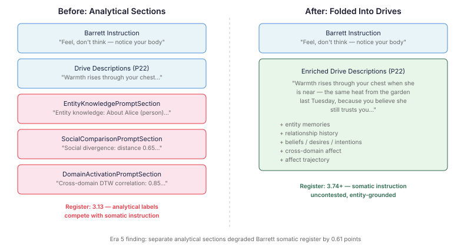
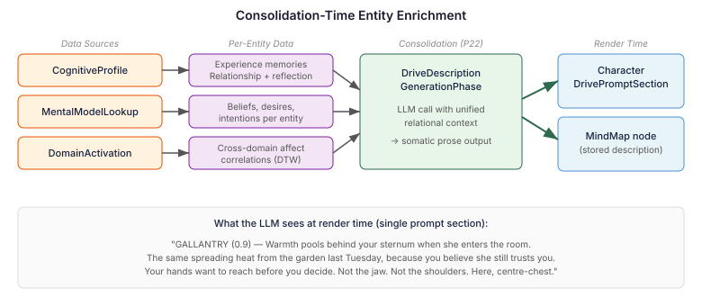

# Who your body remembers

Continues from [Memory through mood](2026-11-01-mdp02-memory-through-mood.md).

---

There is a difference between "warmth rises through your chest" and "warmth rises through your chest when she enters the room — the same spreading heat from the garden last Tuesday, because you believe she still trusts you."

The first is a generic somatic description. Any character could feel it toward anyone. The second is grounded — it refers to a specific person, a specific interaction, a specific belief the character holds. When an LLM reads the first, it generates plausible emotional prose. When it reads the second, it generates behaviour that makes sense for *this character* in *this relationship*.

Era 5 of our cognitive architecture research established that the Barrett constructionist framework — body, attention, time, action readiness — produces the best drive descriptions for agent characters. Quality scores of 4+ across all drives. The somatic instruction ("feel, don't think") works. But it had a ceiling: reactive drives. Drives that activate toward *specific people in specific situations* — gloating, gallantry, protection — regressed because the pipeline was blind to WHO the agent interacts with.

## The analytical section problem

The data existed. `CognitiveProfile` could resolve entity knowledge — memories, relationships, affect trajectory per person. The system computed inter-agent perspective divergence, cross-domain emotional correlations. The question was how to get it to the LLM.

The first approach was what you'd expect: separate prompt sections. `EntityKnowledgePromptSection` rendered structured factual blocks about each entity. `SocialComparisonPromptSection` rendered pairwise PAD distance metrics. `DomainActivationPromptSection` rendered cross-domain DTW correlation statistics.

It degraded everything.

Barrett somatic register dropped from 3.74 to 3.13. The analytical sections gave the LLM ready-made labels for classifying others — easier than constructing body-based understanding, and directly competing with the "feel, don't think" instruction. The agent stopped noticing warmth in its chest and started reporting that its trust score toward Alice was 0.85.

The problem isn't the data. The problem is rendering it as a separate analytical block that the LLM can latch onto instead of doing the harder work of somatic construction.

## Fold, don't append

The architecture decision was simple once the evidence was clear: relational information folds INTO drive descriptions, not alongside them. The data feeds the LLM that generates the somatic prose at consolidation time. It never reaches the character's runtime prompt as raw numbers.

`DriveDescriptionGenerationPhase` — priority 22 in the consolidation pipeline — already generated somatic drive descriptions via LLM from personality facets, formation memories, and relational schemas. The enrichment extends its inputs:

**Entity knowledge** from `CognitiveProfile.resolve()` — per-entity memories across three domains: experiences with this person, how interactions have gone (relationship quality signals), and reflective insights about them. Plus the affect trajectory: is the relationship improving or deteriorating?

**Theory of Mind** from a new `MentalModelLookup` SPI — beliefs, desires, and intentions the agent holds about each specific entity. "You believe they are trustworthy" (confidence 0.9). "You want them to succeed" (confidence 0.6). These are BDI states from the mental model orchestrator, now accessible at consolidation time.

**Cross-domain affect** from `DomainActivation.correlate()` — emotional patterns that span knowledge domains. When your emotional response to art tracks your emotional response to a relationship, that correlation shapes how drives express.

The LLM receives all this as structured context alongside the existing relational schemas. The system prompt already says: "use discovery verbs, weave four channels, ground in formation memories." The entity data enriches the grounding without changing the instruction. The output is stored as MindMap nodes — pre-baked somatic prose that `CharacterDrivePromptSection` reads at render time. No analytical text ever reaches the character's prompt.

## The dependency question

Getting Theory of Mind data to the consolidation phase required a new dependency: `mindmap-intelligence` needed access to `MentalModelSnapshot` from `cognition-api`. I initially dismissed this as creating a circular dependency. Claude pushed back — and was right to.

The actual dependency graph has no cycle. `cognition-api` (the SPI module) does not depend on `mindmap-intelligence`. The *implementation* module `cognition` does, but `cognition-api ≠ cognition`. The distinction between SPI and implementation modules exists precisely for this kind of cross-cutting access. A `@FunctionalInterface` SPI — `MentalModelLookup` — bridges the gap. `MentalModelMemory` in the cognition module implements it. P22 injects it via `Instance<>` for graceful degradation when cognition isn't on the classpath.

One interface, one method, no cycle. The lesson: verify dependency concerns against the actual graph before letting them shape the design.

## What this changes

A character who gloats now gloats toward someone specific — the warmth in its chest is connected to a memory of that person failing, a belief about their vulnerability, a desire to see them struggle again. A character who protects protects because it believes the other person trusts it, because their last interaction was warm, because the affect trajectory is positive.

The drive descriptions are still somatic. They still follow Barrett's four channels. The difference is they're grounded in the character's actual knowledge and beliefs about specific people, not in generic relational schemas that say nothing about history.

And because the folding happens at consolidation time — not on every tick — the cost is paid once, when the cognitive landscape changes. Runtime prompt rendering stays lean: one section, no analytical blocks, no competing instructions. The character feels, it doesn't compute.

The analytical sections still exist in the codebase. `entityKnowledgeEnabled` can be toggled back on for A/B evaluation. But the default is off. The data flows through drives now.
