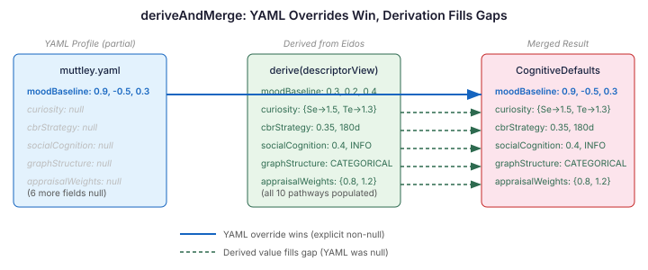

# Sixteen characters, one mind

Continues from [Who your body remembers](2026-11-02-mdp03-who-your-body-remembers.md).

---

I noticed it while reviewing the cognitive pipeline wiring. Sixteen Manor characters. Each defined through eidos with unique disposition axes — social orientation, risk appetite, rule-following, autonomy, conflict mode. Jungian function profiles. Goals and constraints that shape every dialogue choice. Rich, distinct personalities.

Under the hood, every character thinks with the same brain.

CognitionCore runs. Prompt sections render — mood, drives, appraisal, salience. The pipeline is wired and functional. But `CognitiveDefaultsRegistry` is empty. No cognitive profiles exist. Every mood baseline is zero. Every curiosity weight is the default. When Muttley retrieves memories, the scoring is identical to Penelope Pitstop's. The personality data stops at eidos. It never reaches cognition.

## The derivation engine was waiting

`CognitiveDerivationEngine` exists for exactly this gap. It takes a `DescriptorView` — disposition axes, a Jungian function profile, goals — and derives cognitive parameters through ten pathways, each grounded in published research:

- **Disposition profile → personality weights** — which memory domains surface first
- **Disposition axes → mood baseline** — where the character's emotional resting state sits in pleasure-arousal-dominance space
- **Disposition + goals → curiosity configuration** — what counts as interesting
- **Goals → temporal focus** — how far the character's attention reaches
- **Rule-following + risk appetite → CBR strategy** — how similar is "similar enough" for case-based reasoning
- **Social orientation + conflict mode → social cognition** — trust formation speed, conflict interpretation
- **Disposition profile → graph structure** — whether the character connects knowledge or categorises it
- **Disposition profile → extraction bias** — what gets noticed in conversation
- **Disposition profile → appraisal weights** — emotional reactivity to events
- **Risk appetite + rule-following → habituation** — how quickly novelty fades

The eidos descriptors map one-to-one onto the inputs. `AgentDisposition` carries the same five axes as neocortex's `DispositionAxes`. The disposition profile is the same weighted term list. The goals are the same strings. The derivation engine was built for this data. Nobody had connected the pipe.


## Why a bridge, not a config file

The obvious solution is YAML. Write sixteen `cognitive-profiles/*.yaml` files, one per character, with hand-authored personality weights and mood baselines. The cognitive engine already loads them. Ship it.

The problem is drift. The personality data already lives in eidos — disposition axes, function profiles, goals. A YAML cognitive profile is a second source of truth for the same character. Change a character's risk appetite in eidos and forget to update the YAML? The character's dialogue shifts but its cognitive parameters don't. It says bold things and then retrieves memories like a conservative. The inconsistency is silent — no test catches it, no compile error flags it, because the two files never reference each other.

The alternative is making eidos depend on neocortex directly. Then eidos could produce cognitive profiles itself. But that inverts the dependency — identity should not know about cognition. Eidos defines who a character is. Cognition defines how a character thinks. Those are different concerns with different change rates.

A bridge module sits between them. `cognitive-eidos` depends on both `casehub-eidos-api` and `casehub-neocortex-cognitive-index`, but neither depends on the bridge or on each other. It's a single CDI bean that reads each character's eidos `AgentDescriptor`, converts it to a `DescriptorView`, and calls `CognitiveDerivationEngine.derive()`. The resulting `CognitiveDefaults` are registered with `CognitiveDefaultsRegistry.register()` — a method that already existed but had no callers outside test fixtures.

The bridge is pure mapping. No business logic, no state. It converts types from one system into types the other system expects. Any project that has eidos on its classpath can add `cognitive-eidos` and get derived cognitive profiles for free — no YAML authoring, no maintenance, no drift.

## The merge that matters

The first implementation skipped derivation entirely when a YAML profile existed. If you'd hand-tuned Muttley's mood baseline in YAML, the bridge saw "profile exists" and walked away. Every other cognitive parameter stayed null — curiosity, CBR strategy, social cognition, all of it.

That's the wrong semantics. A YAML profile that overrides one field doesn't mean the character doesn't need the other nine. It means one field was worth hand-tuning and the rest should be derived.

`deriveAndMerge()` handles this correctly. It derives all ten pathways from the eidos descriptor, then overlays the YAML values on top. Explicit wins. Null defers to derived. A character with a hand-tuned mood baseline but no curiosity config gets the YAML baseline and a derived curiosity config. The derivation fills gaps rather than competing with explicit intent.



This is a pattern that shows up everywhere in configuration systems. The question is always "what happens when partial overrides meet computed defaults?" Skip-if-exists is the lazy answer. Merge-with-precedence is the correct one, because it respects both the author's explicit intent and the system's ability to fill in what the author didn't specify.

```java
var existing = registry.forAgent(view.agentId());
if (existing.isPresent()) {
    var merged = CognitiveDerivationEngine.deriveAndMerge(
        existing.get().withDescriptor(view));
    registry.register(merged);
} else {
    registry.register(CognitiveDerivationEngine.derive(view));
}
```

Five lines. The difference between "characters with YAML profiles have no derived cognition" and "characters with YAML profiles get the best of both."

## What changes when characters remember differently

`AgentExperienceService.recall()` was querying `CaseMemoryStore` directly. Every character got the same memory scores. `CognitiveMemoryRetriever` existed on the classpath — a wrapper that applies `ModulationFactor` chains to re-score results — but nobody called it.

The wiring is a contextual factory. Each recall builds modulation factors from the current agent's personality weights:

```java
new CognitiveMemoryRetriever(caseMemoryStore, List.of(),
    List.of(ctx -> ctx.personalityWeights() != null
        ? ModulationFactors.domainWeight(ctx.personalityWeights())
        : null))
```

A character with high experience weight surfaces experience memories. One with high relationship weight surfaces interaction histories. Same memory pool. Different ordering. The ordering determines what appears in the context window and what gets truncated.


Consider two characters encountering the same person entering a room. Muttley — high experience weight, low relationship weight — recalls what happened last time: the prank, the chase, the consequence. Penelope — high relationship weight, high reflection weight — recalls how the relationship has developed: the warmth in the garden, her belief about trust between them.

Neither is filtering. The modulation changes scores, not availability. But the difference in what surfaces first shapes what the character thinks about, which shapes what it says, which shapes what it feels about the person in the room.

This is the practical difference between a reskinned agent — same prompt, different name — and one whose personality runs deep enough to change what it notices.

## Identity as cognition

Most multi-agent systems treat personality and cognition as separate configurations. A character sheet says "bold and impulsive." A retrieval config somewhere else says "similarity threshold: 0.85, temporal decay: moderate." Nobody checks whether those two descriptions of the same character agree. When they don't — and they will, because they're maintained by different people at different times — the character contradicts itself in ways that are hard to diagnose. The dialogue sounds bold. The memory retrieval acts cautious. The agent feels incoherent and nobody knows why, because the inconsistency lives across two files that never reference each other.

Derivation eliminates the category. There is no "cognitive config" to maintain. There is identity, and everything else follows. Change a character's risk appetite in eidos, and its CBR similarity threshold adjusts. Change its social orientation, and trust formation rate follows. The mapping is deterministic, auditable, and — importantly — reversible: given a character's cognitive parameters, you can trace every value back to the specific disposition axis or function weight that produced it.

That traceability matters when you're debugging behaviour. "Why did this character retrieve relationship memories first?" Because its disposition profile weights Fe at 0.9, which the derivation engine maps to high relationship domain weight. Not because someone typed `relationship: 1.6` into a YAML file six months ago and forgot why.

The bridge doesn't make characters smarter. It makes them coherent. Identity flows into cognition flows into memory retrieval flows into what the character says. One source of truth. One pipe. The personality that eidos declares is the personality that cognition enacts.
