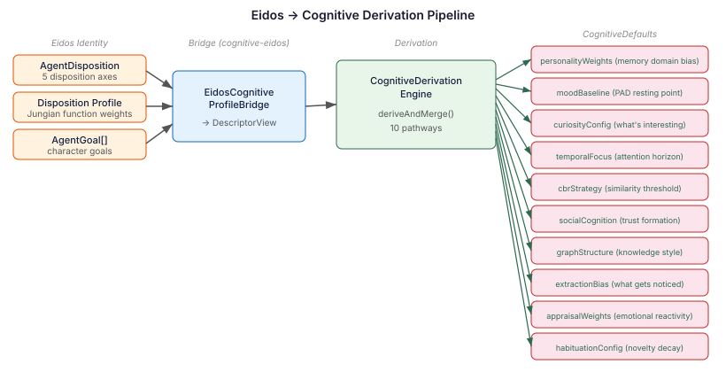
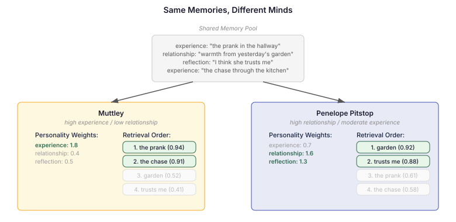

# Sixteen characters, one mind

Continues from [Who your body remembers](2026-11-02-mdp03-who-your-body-remembers.md).

---

I noticed it while reviewing the cognitive pipeline wiring. Sixteen Manor characters. Each defined through eidos with unique disposition axes — social orientation, risk appetite, rule-following, autonomy, conflict mode. Jungian function profiles. Goals and constraints that shape every dialogue choice. Rich, distinct personalities.

Under the hood, every character thinks with the same brain.

CognitionCore runs. Prompt sections render — mood, drives, appraisal, salience. The pipeline is wired and functional. But `CognitiveDefaultsRegistry` is empty. No cognitive profiles exist. Every mood baseline is zero. Every curiosity weight is the default. When Muttley retrieves memories, the scoring is identical to Penelope Pitstop's. The personality data stops at eidos. It never reaches cognition.

## The derivation engine was waiting

`CognitiveDerivationEngine` exists for exactly this gap. It takes a `DescriptorView` — disposition axes, a Jungian function profile, goals — and derives cognitive parameters through ten pathways, each grounded in published research:

- **Disposition profile → personality weights** — which memory domains surface first
- **Disposition axes → mood baseline** — where the character's emotional resting state sits in pleasure-arousal-dominance space
- **Disposition + goals → curiosity configuration** — what counts as interesting
- **Goals → temporal focus** — how far the character's attention reaches
- **Rule-following + risk appetite → CBR strategy** — how similar is "similar enough" for case-based reasoning
- **Social orientation + conflict mode → social cognition** — trust formation speed, conflict interpretation
- **Disposition profile → graph structure** — whether the character connects knowledge or categorises it
- **Disposition profile → extraction bias** — what gets noticed in conversation
- **Disposition profile → appraisal weights** — emotional reactivity to events
- **Risk appetite + rule-following → habituation** — how quickly novelty fades

The eidos descriptors map one-to-one onto the inputs. `AgentDisposition` carries the same five axes as neocortex's `DispositionAxes`. The disposition profile is the same weighted term list. The goals are the same strings. The derivation engine was built for this data. Nobody had connected the pipe.

## One module, one bridge

The bridge is a single CDI bean in a new `cognitive-eidos` module. At startup, it reads each character's eidos `AgentDescriptor`, converts it to a `DescriptorView`, and calls `deriveAndMerge()`. The resulting `CognitiveDefaults` are registered with `CognitiveDefaultsRegistry.register()` — a method that already existed but had no callers outside test fixtures.

Each character now gets unique cognitive parameters derived from the same personality data that drives their dialogue and decisions. Not hand-authored in a YAML file that drifts from the identity data. Derived.

`deriveAndMerge()` overlays explicit values on the derived base. A character who needs a hand-tuned curiosity config can still get one — a YAML override wins. The defaults are calculated, not imposed.

## What changes when characters remember differently

This is where it becomes practical.

`AgentExperienceService.recall()` currently queries `CaseMemoryStore` directly. Every character gets the same memory scores. Personality-weighted retrieval — `CognitiveMemoryRetriever` — exists on the classpath but nobody calls it. The routing change is straightforward: recall goes through the retriever, which applies `ModulationFactor` chains that include domain weighting from the character's personality weights.

A character with high experience weight surfaces experience memories. One with high relationship weight surfaces interaction histories. Same memory pool. Different ordering. The ordering determines what appears in the context window and what gets truncated.

Consider two characters encountering the same person entering a room. Muttley — high experience weight, low relationship weight — recalls what happened last time: the prank, the chase, the consequence. Penelope — high relationship weight, high reflection weight — recalls how the relationship has developed: the warmth in the garden, her belief about trust between them.

Neither is filtering. The modulation changes scores, not availability. But the difference in what surfaces first shapes what the character thinks about, which shapes what it says, which shapes what it feels about the person in the room.

This is the practical difference between a reskinned agent — same prompt, different name — and one whose personality runs deep enough to change what it notices.

## The pattern generalises

Any multi-agent system with structured identity descriptors can derive cognitive parameters rather than defining them separately. The identity IS the cognition. Change a character's risk appetite in eidos, and its CBR similarity threshold adjusts. Change its social orientation, and trust formation speed follows. No second configuration to keep in sync. No drift.

The alternative — hand-authoring cognitive profiles for each agent, maintaining them alongside but independently from identity data — scales badly and drifts silently. When the personality says risk-taking but the cognitive profile says conservative, the character contradicts itself in ways that are hard to diagnose because the inconsistency lives across two configuration files that nobody compares.

Derivation makes personality and cognition one thing. The mapping is deterministic and auditable. That matters when you're trying to understand why a character did something unexpected — was it the personality, or was it a stale config?
