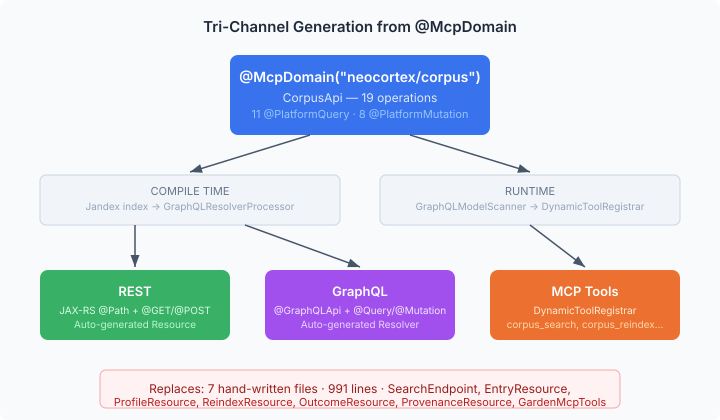

# The Interface That Replaced Seven Files

*Continues from [The Application That Disappeared Into Its Platform](2026-11-02-mdp02-application-that-disappeared.md).*

The previous entry ended with a forward pointer: Hortora's remaining code — REST endpoints, MCP tools, CDI producers — would be replaced by `@McpDomain("corpus")` auto-generated endpoints from neocortex. That work is done. One Java interface, eighty lines, nineteen annotated methods. It replaces seven hand-written files totalling 991 lines.

The interesting part is not the line count. It is what those lines were doing and why they should never have existed as source code.

## What was there before

Hortora had two parallel API surfaces for the same operations. A REST layer with six endpoint classes — `SearchEndpoint`, `EntryResource`, `ProfileResource`, `ReindexResource`, `OutcomeResource`, `ProvenanceResource` — each doing the same thing: parse HTTP parameters, call a service, return the result. And a 653-line MCP tools class, `GardenMcpTools`, doing exactly the same thing a second time: parse tool arguments, call the same services, format the result as markdown.

Every operation existed twice. Search lived in `SearchEndpoint.search()` and in `GardenMcpTools.gardenSearch()`. Provenance recording lived in `ProvenanceResource.record()` and in `GardenMcpTools.gardenRecordProvenance()`. When the service signature changed, both had to be updated. When a new parameter was added, both needed it wired through. The MCP tool descriptions drifted from the REST API docs. The parameter names diverged — `geId` in one place, `entryId` in another, `documentId` in a third, all meaning the same thing.

This is not a Hortora problem. It is the standard outcome when a domain module grows its API surface organically. You build REST first because browsers need it. You add GraphQL because the frontend wants flexible queries. You add MCP because AI agents need tool access. Each channel is a hand-written translation of the same operations, maintained independently, drifting independently.

## One interface, three channels



The platform's `@McpDomain` pattern eliminates this by generating all three channels from a single source. You write one Java interface:

```java
@McpDomain(value = "neocortex/corpus", app = "neocortex",
    summary = "Corpus knowledge management — search, lifecycle, provenance, and feedback")
public interface CorpusApi {

    @PlatformQuery("Search a corpus with optional domain, type, and tag filters")
    List<SearchResult> search(String corpusId, String query,
            List<String> domains, String type, String tags,
            Integer limit, String profile, String stack);

    @PlatformMutation("Record provenance links between corpus entries and an issue")
    int recordProvenance(String issueRepo, Integer issueNumber,
            String specName, String entryIds, String recordedBy);

    // ... 17 more operations
}
```

At compile time, the annotation processor reads the Jandex index, finds every `@McpDomain` interface, and generates a JAX-RS resource class and a GraphQL resolver. At runtime, the MCP scanner discovers the same interface and registers each operation as a tool. Three channels, one source of truth, zero hand-written translation code.

The `@PlatformQuery` and `@PlatformMutation` annotations carry the semantic split. Queries become `@GET` in REST, `@Query` in GraphQL, and tools with `readOnlyHint=true` in MCP. Mutations become `@POST`, `@Mutation`, and read-write tools. The annotation's description string becomes the GraphQL field description *and* the MCP tool description — one sentence, used everywhere.

## The implementation is trivially thin

`CorpusApiBean` implements the interface. Its methods are one-liners. `search()` calls `searchResource.searchAdaptive()`. `reindex()` calls `reindexService.reindex()`. `recordProvenance()` parses the pipe-separated entry IDs and calls `provenanceStore.record()`. The bean is pure delegation — no business logic, no parameter transformation beyond the obvious, no state.

This is the point. The API layer *should* be trivially thin. If your REST endpoint or MCP tool contains business logic, that logic is in the wrong place. The service layer owns the behaviour. The API layer translates between wire format and service calls. Once you accept that the translation is mechanical, generating it is the obvious next step.

## What had to move first

The interface could not exist until the services did. Five of the nineteen operations had no service behind them — they were inline in `GardenMcpTools`, calling RAG SPIs directly. Entry status, single-entry deletion, single-entry reindexing, unretrieved-entry analysis, and feedback recording all lived as methods on the MCP tools class, which injected `EmbeddingIngestor`, `RetrievalTracker`, and `MetadataExtractor` and orchestrated them itself.

These became `CorpusIndexService` — a proper service with constructor injection, testable in isolation, usable from any channel. The logic is identical to what `GardenMcpTools` was doing. The difference is where it lives. In the MCP class, it was accessible only through MCP. In a service, any API channel — or any internal caller — can reach it.

This is the prerequisite that makes tri-channel generation work. If your operations are scattered across endpoint classes, each with its own wiring and its own copy of the orchestration logic, there is no single interface to annotate. The services have to exist first. The annotation-driven API surface is the *last* step, not the first.

## Why this matters for platform modules

A platform module like `corpus-management` gets consumed by multiple deployments. Hortora is one. A clinical guideline system could be another. A game NPC's knowledge base a third. Each deployment wants different framework wiring — Quarkus, Spring, maybe something else — but all of them need the same operations exposed.

Without `@McpDomain`, each deployment writes its own REST endpoints, its own GraphQL resolvers, its own MCP tools. The same translation code, adapted to the local framework, duplicated everywhere. With it, the platform module ships the interface. The compile-time processor generates the framework-specific code for whatever target the deployment uses. The Spring generator produces `@RestController` classes; the Quarkus processor produces JAX-RS resources. Same interface, different output.

The `@HandWrittenEndpoint` escape hatch exists for operations that genuinely need custom wire-format handling — streaming, WebSocket upgrade, multi-part uploads. In practice, those are rare. For the corpus domain, all nineteen operations fit the annotation model without compromise.

## What the review caught

The interface compiled. The tests passed. The delegation chains looked correct. Then I ran a comprehensive review across four dimensions — wiring completeness, orphaned code, migration quality, and test coverage — and found eleven issues, three of them real bugs.

The most instructive: `search()` was delegating to `searchAdaptive()`. The plain search path in Hortora's `SearchEndpoint` called `SearchResource.search()` — a direct query that returns exactly what you asked for. The new `CorpusApiBean.search()` was calling `searchResource.searchAdaptive()` with null keywords, which routes through the adaptive pipeline: overfetch, score-gap trimming, floor filtering. Callers asking for a simple search would get different result sets — sometimes extended beyond their limit, sometimes trimmed at a score gap they didn't ask for.

This is the kind of bug that thin delegation layers are supposed to prevent. The API bean has one job: call the right service method with the right arguments. It called the wrong one. The fix was one line — route to `search()` by default, only use `searchAdaptive()` when profile or stack parameters are provided. But the lesson is broader: "thin" does not mean "correct." A one-liner can still be wrong if it delegates to the wrong target.

Two more: `entry()` and `reindexEntry()` passed a nullable `gardenRoot` path into `Files.walk()` without a null guard. Any deployment without a filesystem garden — which is the whole point of making this a platform module — would NPE on the first call. And `recordProvenance()` called `entryIds.split()` on a nullable string. Both are the kind of bugs that compile, pass trivial tests, and fail in production on a code path nobody exercised during initial development.

The review also found a Quarkus `@ConfigMapping` annotation that survived the migration from Hortora without generification — framework-specific code in a supposedly framework-neutral module. A missing explicit POM dependency that worked via transitive resolution but would break if the intermediate dependency changed. An unused import. These are not bugs, but they are the kind of drift that accumulates when code is moved rather than reviewed.

Eleven findings. Three correctness fixes. Eighteen new tests. The test count went from 105 to 123. None of this would have been caught by "the build passes."

## What Hortora looks like after this

After the previous session, Hortora was 1465 lines and twenty files — CDI producers, REST endpoints, MCP tools, config. After this change, the REST endpoints and MCP tools are replaced by the auto-generated code from `CorpusApi`. What remains is a CDI producer that constructs `CorpusApiBean` from Hortora's config, and `application.properties` that defines which corpora exist, their federation topology, and their domain schemas.

The application that started as 4000 lines of Java is converging on its natural endpoint: a deployment descriptor.

No Java source code that does anything. Just configuration that says what this particular knowledge garden is, and a platform that knows how to run one.fr
