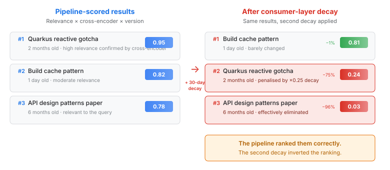
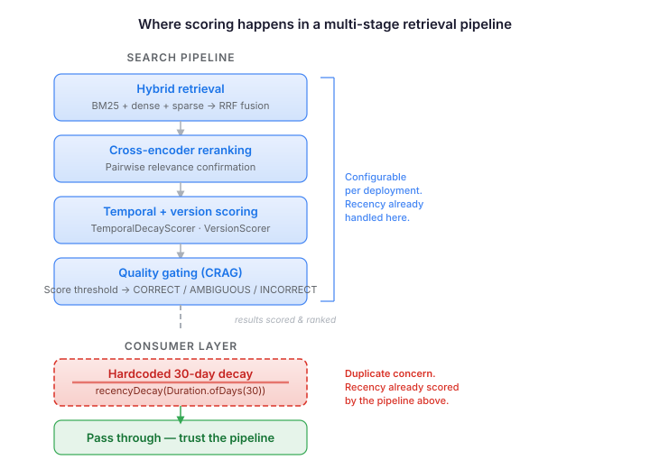

# The Score That Counted Twice

A six-line removal that fixed a retrieval pipeline silently ranking the wrong documents first.

`CognitiveMemoryRetriever.queryCorpora()` applied a hardcoded 30-day exponential decay to every corpus search result. The search pipeline — the one that actually knows about document relevance — had already scored them. Relevance matching, cross-encoder reranking, version-aware scoring, quality gating. Configurable per deployment, tuned to the corpus. The results arrived ranked and ready.

Then the consumer layer applied its own recency decay on top, and nobody noticed.

## The compound penalty

Exponential decay with a 30-day half-life sounds harmless. A document from yesterday loses 2% of its score. A document from last week loses about 16%. Barely visible. But the penalty compounds with time, and a second decay layer multiplies with the first.

A Quarkus gotcha written two months ago — confirmed by the cross-encoder as highly relevant, scored at 0.95 by the pipeline — drops to 0.24 after the consumer layer's decay. A six-month-old API design paper that the pipeline ranked at 0.78 drops to 0.03. Effectively zero.

The pipeline ranked them correctly. The consumer layer inverted the ranking. Recent-but-mediocre documents floated above old-but-relevant ones — not because they were better answers, but because they happened to be newer, and recency was being counted twice.

## Where scoring belongs

A multi-stage retrieval pipeline is a chain of scoring layers. Each layer owns a concern:

- **Retrieval** (BM25 + dense + sparse) handles term matching and semantic similarity
- **Cross-encoder reranking** confirms pairwise relevance
- **Temporal and version scoring** handles recency where it's configurable and context-aware
- **Quality gating** (CRAG) filters by confidence threshold

The consumer layer — the code that calls the search API and presents results — has a different job. It might modulate results by the agent's cognitive state: mood-congruent recall, goal-relevant boosting, personality-weighted retrieval. These are concerns the search pipeline knows nothing about. That's where consumer-layer scoring earns its place.

Recency is not one of those concerns. The pipeline already handles it, with configuration knobs and deployment-specific tuning. Adding a second decay at the consumer layer doesn't add safety. It adds a compound penalty that's invisible in normal operation — the pipeline still returns results, they're just worse. The kind of bug you only notice when you ask "why did the agent ignore a relevant document it retrieved six weeks ago?" and trace through two independent decay calculations.

## The practical lesson

If you're building a RAG pipeline with multiple scoring stages, audit where each concern lives. The test: for any scoring factor, can you find exactly one layer that owns it? If recency is scored in the search pipeline *and* in the consumer code, one of them is a duplicate. If relevance is scored by the retriever *and* re-scored by the consumer, the compound effect isn't "extra safety" — it's noise that degrades ranking quality.

The fix was removing six lines of code. The principle is that scoring layers compose by multiplication, not by intention. Two layers that each "slightly prefer recent documents" don't produce a slight preference. They produce a steep penalty curve that eliminates anything older than a few weeks — regardless of relevance, regardless of what the cross-encoder confirmed, regardless of what the deployment's own scoring configuration intended.

Trust the pipeline. Score each concern once, in the layer that has the context to score it correctly.
