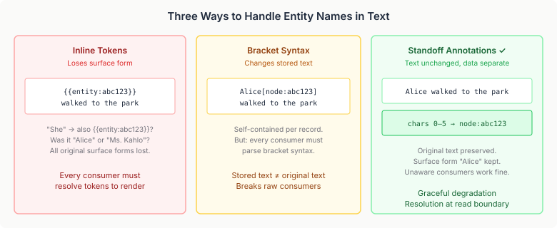
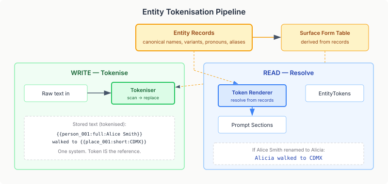

# Names Are Not Identity

Every cognitive system that stores memories about people hits the same problem eventually: names are baked into the text.

"Frida painted a self-portrait." That string lives in a memory store, gets retrieved by embedding similarity, gets rendered into an agent prompt. Everything works. Until Frida changes her name. Or until you want to reuse the same cognitive profile in a different context where that entity is called something else. Or until two entities share a name and the system can't distinguish them.

The string "Frida" is a surface form — a rendering of identity at a point in time. The entity is the thing behind the name: a node in a knowledge graph, a persistent identity with properties, relationships, and history. Conflating the two seems harmless at first. It becomes structural debt the moment you need to rename, merge, or recontextualise anything.

## The Practical Damage

This isn't a theoretical elegance concern. In a cognitive AI system like neocortex, literal names leak through every layer of the pipeline:

**Memory storage.** When an agent records "Alice told Bob about the project," those literal strings are stored as the memory's text. Embedding retrieval finds it. But no part of the system knows that "Alice" in this memory refers to the same entity as "Alice" in a separate knowledge graph node, or that "Alice" in one tenant context is a different entity from "Alice" in another.

**Prompt rendering.** Cognitive prompt sections render entity knowledge into the agent's system prompt. Edge relationships come through as raw node UUIDs — `"knows → 7f3a2b1c-..."` — because the prompt section has a node ID but no mechanism to resolve it to a human-readable name. The agent sees gibberish where it should see "knows → Bob."

**Biography import.** Character biographies use bracket syntax for some entry types — `Guillermo[Guillermo] taught photography` — but only life events and beliefs were processed. Cultural contexts, relationships, activities, projects, and goals all passed through with literal names, creating a patchwork where some text was annotated and most wasn't.

## Standoff Annotations: Separating Name from Identity

The representation choice matters more than the implementation. I considered three approaches:

**Inline tokens** — replace "Alice" with `{{entity:abc123}}` everywhere. Self-contained, but you lose the original surface form permanently. Was it "Alice" or "Ms. Kahlo" or "she"? Gone. And every consumer of that text must now understand token syntax.

**Bracket syntax** — store `Alice[node:abc123]` in the text itself. The surface form survives, but the stored text is no longer the original text. Every consumer needs a bracket parser.

**Standoff annotations** — store the text unchanged. In a parallel index, record that characters 0–5 of memory `mem-42` correspond to entity node `abc123`. The text reads normally. Consumers that don't know about annotations see the original text. Resolution happens at the boundary where text becomes prompt content.

Standoff annotations won. The key insight: graceful degradation. Any part of the system that doesn't know about entity references keeps working exactly as before. The annotation layer is additive, not invasive.

Neocortex already had the annotation infrastructure — `EntityAnnotationIndex`, `AnnotationSpanResolver`, lifecycle observers that automatically repoint annotations when entities are merged and clean them up when entities are erased. The biography import pipeline was using it for two entry types. The infrastructure was mature; the wiring was incomplete.

## The Architecture: Write Side and Read Side

The entity reference pipeline splits cleanly into two independent halves.

**Write side** creates annotations at every ingestion point. Three paths:

1. **LLM extraction** — when the MindMap extractor processes conversation text, it already extracts entity mentions with surface forms. The observer now writes those mentions to the annotation index. This was the simplest change — the data existed, it just wasn't being persisted.

2. **Biography import** — the preprocessor now processes bracket syntax in all biography entry types, not just life events and beliefs. Cultural contexts, relationship BDI values, activity notes, project descriptions, goal sub-goals — every text field that might contain entity references.

3. **Memory events** — a post-store CDI observer watches for experience, relationship, and reflection recordings. After a memory is stored, it scans the text against known entity names from the knowledge graph. Longest-match-first prevents "Alice" from matching inside "Alice Johnson." Entity candidates come from entity-carrying subgraph types only — person, project, organisation, place — excluding cognitive/behavioral/type-system nodes that would be false matches.

**Read side** resolves at the prompt boundary. A batch utility in `annotation-api` queries all annotations for a set of source documents in one call, resolves each entity node ID to its current canonical name via a `Function<String, String>` parameter (keeping the module dependency-free), and applies substitutions right-to-left to preserve character offsets.

The prompt sections that render memory text or entity edges now accept an optional node-name resolver function. If Alice was renamed to Alicia since the memory was stored, the prompt reads "Alicia walked to the park" — the stored text is unchanged, the annotation still points to the same entity, and the resolution happens fresh each time the prompt is composed.

## Why This Matters Beyond Renaming

Entity references are the foundation for three capabilities that literal names make impossible:

**Profile reuse.** A cognitive profile — personality weights, mood baseline, drive configuration, CAPS topology — describes *how* an agent thinks, not *who* it thinks about. With entity references, the same profile can operate in different contexts where entities have different names. A character profile built for one scenario transfers to another without search-and-replace across thousands of stored memories.

**Entity merging.** Knowledge graphs merge entities as understanding evolves. "Dr. Smith" and "Professor Sarah Smith" turn out to be the same person. The merge operation updates the graph node, and the annotation repoint observer automatically updates every annotation that pointed at the absorbed node. No text is modified. No memories are rewritten.

**Cross-tenant entity mapping.** In a multi-tenant cognitive system, the same real-world entity might exist as different nodes in different tenants. Entity references let you map between them — "node A in tenant 1 is the same entity as node B in tenant 2" — without requiring that the stored memories use identical surface forms.

## What This Doesn't Solve (Yet)

Existing content — memories stored before annotation wiring was added — contains literal names with no annotations. A backfill migration (#797) would scan existing memories through the same entity-name matching pipeline used by the memory observer, but it's a separate piece of work. The write side ensures all *new* content gets annotations. The read side gracefully returns original text when no annotations exist.

Several prompt sections render LLM-generated text (strategy guidelines, mental model descriptions, goal proposals) that passes through no annotated write path. These have bounded staleness — the text is periodically regenerated, so name drift self-corrects over time. Full coverage would mean adding annotation observers for every cognitive store that generates text.

There's also query-time entity-aware retrieval (#796) — boosting search results that mention a specific entity. That operates on the annotation index as a retrieval signal rather than a rendering transform. A related but distinct problem.

Each of these gaps has a clear path forward because the infrastructure exists. The annotation index, the resolution utility, and the lifecycle observers are all in place. Extending coverage is mechanical work, not architectural work. That's the value of getting the representation right.
