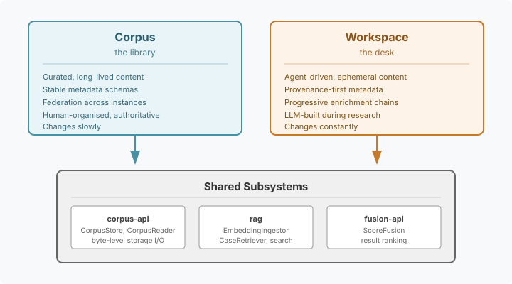
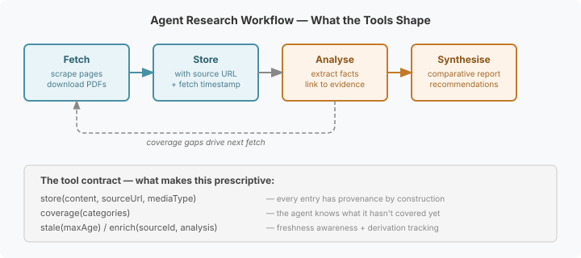

# The Library and the Desk — Why LLM Platforms Need Both

We extracted our corpus management module from Hortora's knowledge garden engine six months ago. The extraction was clean mechanically — the SPIs compiled, the tests passed, the wiring worked. But I had a nagging question: was it actually generic, or had we just moved Hortora's assumptions into a new package?

I ran a formal audit this week — walking the code through eight diverse use cases to find where the abstractions force or leak. Clinical guidelines. Legal precedents. Game NPC knowledge bases. Research literature. Software documentation. And then the one that changed my thinking: market research.

## What the audit found

The storage layer is genuinely domain-neutral. `CorpusStore`, `CorpusReader`, `ChangeSource` — byte-oriented SPIs with no content assumptions. The RAG pipeline is clean too: `MetadataExtractor` is pluggable, `CorpusIngestionService` delegates to it, any document format works if you provide the right extractor.

The management layer is where Hortora bled through. `CorpusType.KNOWLEDGE_GARDEN` as a constant in the API. `GardenMetadataExtractor` hardcoded to `.md` files with YAML frontmatter. `FederationConfig.gardenId`. Column names like `ge_id` in the database schema. `InteractionType.SELF_REFLECTION` and `ActivityType.DEBUGGING` baked into the SPI — concepts that make sense for a Claude session transcript corpus, but mean nothing to a clinical guideline library.

Thirteen leaks total. Some cosmetic (naming), some structural (String-only body, closed enums), some architectural (scoring strategies hardwired to garden freshness tiers). The remediation is straightforward — three phases, from quick renames to a full module extraction — and I've filed issues for each.

But the interesting discovery wasn't the leaks. It was what happened when I stress-tested against the market research use case.

## The question that changed the framing

I asked: what if an LLM's job is "go research the market for product X and tell me where the gaps are?" The agent needs to crawl competitor sites, download pricing PDFs, scrape feature comparison pages, pull analyst reports. All that scraped content becomes a corpus that the agent queries, analyses, and reasons over. Then it writes a competitive analysis, linking its conclusions back to the evidence it gathered.

This is fundamentally different from a clinical guideline corpus or a knowledge garden. Those are libraries — curated, stable, authoritative content that humans organised and a search pipeline retrieves. The market research case is a *desk* — ephemeral, in-progress content that the agent builds iteratively during the research session, with provenance tracking, freshness awareness, and progressive enrichment as it moves from raw scrapes to extracted facts to synthesised analysis.

Trying to serve both with one API is the wrong instinct. A library and a desk share the same shelves and the same index, but the workflow on top is different in kind.

## Why this matters for how LLMs work

The deeper insight isn't about storage — it's about research discipline. LLMs are powerful but undisciplined researchers. They satisfice: find the first plausible answer and stop. They confabulate sources. They lose track of what they've already covered. They can't tell when their information is stale.

The platform can fix this. Not by constraining the agent, but by giving it tools whose affordances naturally produce disciplined research. This is the same insight that drives the cognitive architecture: we don't just give agents memory — we give them *structured* memory (MindMap, CBR, experience recording) that shapes how they think.

The research workspace applies the same pattern. The tools have opinions:

- `store(content, sourceUrl, mediaType)` — every entry has provenance by construction. The agent can't store something without saying where it came from.
- `coverage(categories)` — the agent knows what it hasn't covered. "I've researched pricing for six of eight competitors, still missing Acme and Beta."
- `stale(maxAge)` — the agent knows when its information needs refreshing. A pricing page scraped three months ago is unreliable. The tool tells it so.
- `enrich(sourceId, analysis)` — analysis links to its evidence. The derivation chain is tracked, not hoped for.

The tools don't make the agent smarter. They make it systematic. The difference between "I'll research competitors" and "I'll systematically cover pricing, features, market share, and customer sentiment across all eight competitors, tracking what I've covered and what I haven't" — that difference comes from the tool affordances, not from a better prompt.

## The multi-agent case

Where this really earns its keep is multi-agent research. Three agents researching competitors simultaneously. Without a shared workspace, the coordinator reads three folders and hopes for consistent formats. With a workspace:

- Semantic search across all agents' findings, not per-agent grep
- Coverage gaps visible across the whole research effort
- One agent's finding enriches another's search — agent A discovers a competitor that agent B should include
- Provenance chains let the coordinator trace any claim back to its source

No explicit coordination protocol needed. One agent stores a finding; another agent's `coverage()` call sees the gap shrink. The coordination is emergent from shared state with good affordances. Prescriptive and repeatable, whether it's one agent or five.

## What we're actually building

Two sibling systems. Shared subsystems underneath.

**Corpus** stays focused on curated content — knowledge gardens, clinical guidelines, legal precedents, research literature. The remediation work (three issues filed) makes it genuinely generic by removing the Hortora-specific constants, moving agent-interaction types out of the API, and extracting garden-specific implementation code to its own module.

**Workspace** gets its own API, focused on agent-driven research — provenance tracking, progressive enrichment, content-type dispatch for heterogeneous scrapes, and lifecycle management for ephemeral content. The shared subsystems (`corpus-api` for storage, RAG for search, `fusion-api` for ranking) are already domain-neutral and serve both.

There's a site capture question too. LLMs need to capture web pages for offline reference, but raw HTTP fetches miss JavaScript-rendered content. A `curl` of a React app returns an empty div. We need Playwright-based rendering — headless Chromium captures the page as it actually appears, extracts the text for embedding, and stores a screenshot as a visual reference. Individual pages or small curated sets, not full site crawls.

The audit started as a question about naming leaks. It ended as a platform design insight. Sometimes the best thing a code review can do is show you the thing you haven't built yet.
