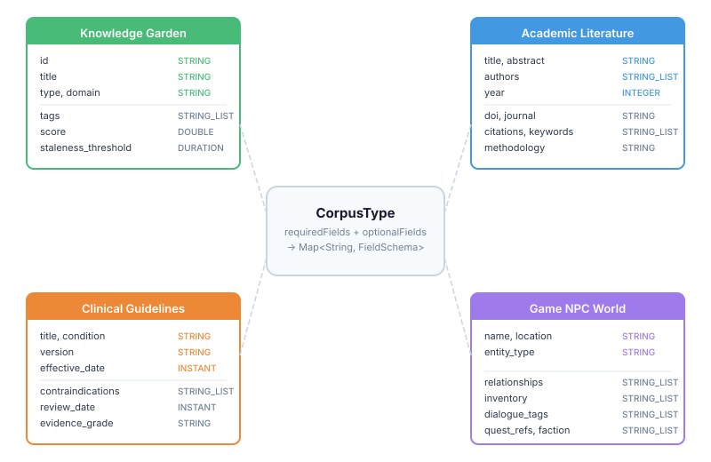
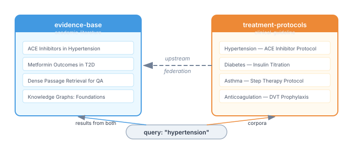

# Four Schemas, One API — Proving Corpus Management Is Domain-Neutral

Last week I audited our corpus-management module and found thirteen places where Hortora's knowledge garden assumptions had leaked into what was supposed to be a general-purpose API. We renamed five of them, filed issues for the rest, and wrote a design doc separating "corpus" from "workspace" as distinct platform concepts.

That's the theory. This week I wanted the proof.

## The test: four domains with nothing in common

If corpus-management is truly domain-neutral, it should handle a knowledge garden and a game NPC world with the same code path. Not similar code — identical code. The API should neither know nor care what's inside the entries.

We built four working examples, each defining its own `CorpusType` with genuinely different field schemas:



A knowledge garden has `staleness_threshold` (a `DURATION`) and `score` (a `DOUBLE`). An academic paper has `authors` (a `STRING_LIST`) and `year` (an `INTEGER`). A clinical guideline has `effective_date` and `review_date` (both `INSTANT`). A game NPC world has five different `STRING_LIST` fields — relationships, inventory, dialogue tags, quest references, factions.

Seven of the eight `FieldSchema` types appear across the four domains. No two domains share the same required-field shape.

## Why CorpusType as a record works

The key design decision — now validated — is that `CorpusType` is a Java record with two `Map<String, FieldSchema>` fields (required and optional), not a class hierarchy with domain-specific subclasses.

```java
public record CorpusType(
    String name,
    Map<String, FieldSchema> requiredFields,
    Map<String, FieldSchema> optionalFields,
    String coverTemplate
) {}
```

This means defining a new domain is a one-liner. No inheritance, no registration, no framework extension point:

```java
public static final CorpusType CLINICAL_GUIDELINE = new CorpusType(
    "clinical-guideline",
    Map.of("id", STRING, "title", STRING, "version", STRING,
           "effective_date", INSTANT, "condition", STRING),
    Map.of("supersedes", STRING, "evidence_grade", STRING,
           "contraindications", STRING_LIST, "review_date", INSTANT),
    null
);
```

The metadata lives in a `Map<String, Object>` on `CorpusEntry`, with typed accessors — `stringField()`, `intField()`, `stringListField()`. The store serialises the map to JSON. The search layer doesn't interpret it. The lifecycle (`create → archive → revive`) doesn't touch it. Each layer does one job and ignores the content shape.

This is the opposite of what most Java frameworks do. The instinct is to build a type hierarchy — `GardenEntry extends CorpusEntry`, `ClinicalEntry extends CorpusEntry` — and push domain knowledge into the inheritance tree. That path gives you compile-time safety at the cost of coupling every consumer to every domain. A clinical guideline library shouldn't need Hortora's garden types on its classpath.

## Federation across domains

The most practically interesting result was cross-domain federation. We set up a clinical guideline corpus with the academic literature corpus as an upstream source — the idea being that clinical protocols should be grounded in the research that supports them.



A single query for "hypertension" returns results from both corpora, ranked by tier — the clinical protocol first (tier 0, the starting corpus), the meta-analysis second (tier 1, reached via upstream federation). The federation walker handles this: it searches the starting corpus, walks upstream via `FederationRef`, and merges results by tier then by score.

The practical implication: a platform that manages both research literature and clinical guidelines doesn't need a separate search service to span them. It builds two corpora with different `CorpusType` schemas, connects them via federation, and the walker does the rest.

## No CDI, by design

One thing the examples surfaced is that corpus-management has no CDI wiring. No `@ApplicationScoped` beans, no `@Inject` points. Everything is plain Java with constructor injection — `SqliteDataSourceFactory.create(":memory:", 1, 3000)` gives you a `DataSource`, and from there you wire the catalogue, entry store, and search manually.

This was a deliberate choice that predates this work, but the examples validate it. A game studio using corpus-management for NPC world knowledge doesn't need Quarkus on the classpath. A research tool managing literature corpora can wire everything in a Spring context, or a plain `main()` method, or a unit test. The framework-neutral layer is a feature, not a gap.

## What this means for the platform

corpus-management now has a concrete answer to "does this work outside Hortora?" — four working examples that anyone can run with `mvn test -Pexamples-smoke`. Each one exercises the full lifecycle: create a corpus, ingest entries, search, inspect via catalogue, archive, revive. The federation scenario crosses two of them.

The audit found the leaks. The renames patched the surface. But the examples are the proof that the abstraction holds — and the blueprint for anyone adopting it for a domain we haven't imagined yet.
