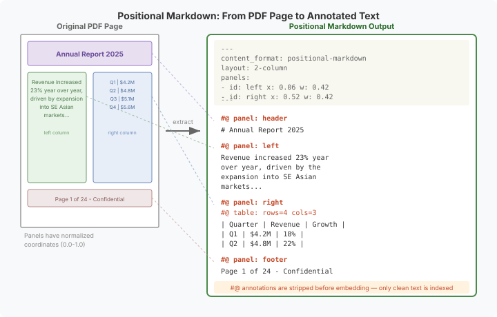
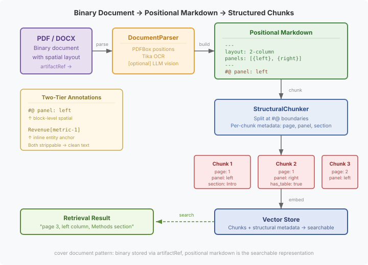

# The Text That Remembers Where It Was

Every RAG system has the same dirty secret: it throws away the document.

You feed it a PDF — a two-column academic paper with figures, tables, margin annotations, a header, a footer. Tika extracts the text. The chunker splits it into 512-token blocks. The embedding model maps each block to a vector. The retrieval engine returns the most similar chunks.

And when your agent tells the user "according to the study, revenue grew 23%," nobody can point to *where* in the document that number came from. The left column? The table? A footnote? The text was extracted, the structure was discarded, and the provenance was lost at ingestion time.

This is the gap we're closing with **positional markdown** — a text format that preserves the spatial structure of the source document. The text remembers where it was on the page.

## Why flat text extraction fails

The problem isn't that text extraction is inaccurate. Tika, PDFBox, Tesseract — these tools extract text faithfully. The problem is that extraction collapses a two-dimensional spatial layout into a one-dimensional character stream.

Consider a two-column academic paper. PDFBox extracts the text in reading order — left column first, then right column. But the chunker doesn't know where the column boundary was. A 512-token chunk might span from the end of the left column into the beginning of the right column — two completely unrelated sections of the paper, now fused into one "semantic" unit for retrieval.

Or consider a form. A KS2 English worksheet has instruction boxes, answer fields, word banks, example panels. Each region carries different meaning. Extract it as flat text and the distinction between "write your answer here" (an instruction) and "the cat sat on the mat" (a fill-in example) vanishes. An LLM looking at the image understands instantly which box is which. Flat text gives it nothing to work with.

The spatial structure of a document isn't decoration — it's semantics. Position carries meaning.

## The format: panels, presets, and `#@` annotations

Positional markdown is standard markdown with two additions: YAML frontmatter that declares the page layout, and `#@` block annotations that map text to spatial regions.



The frontmatter declares **panels** — named regions with normalised coordinates:

```yaml
---
content_format: positional-markdown
source_format: pdf
layout: 2-column
panels:
  - id: left
    x: 0.06
    y: 0.13
    w: 0.42
    h: 0.76
  - id: right
    x: 0.52
    y: 0.13
    w: 0.42
    h: 0.76
artifact_ref: /corpus/papers/smith-2025.pdf
---
```

Coordinates are normalised to 0.0–1.0, making them format-independent — a PDF user unit, a DOCX page, and a scanned image all map to the same coordinate space.

**Layout presets** handle common structures without explicit coordinates. `single`, `2-column`, `3-column`, `header-body-footer`, `grid-2x2` — the system knows what panels each preset defines. You only need explicit coordinates for `ad-hoc` layouts.

The body uses `#@` annotations — ytt-style block directives that map text to panels:

```markdown
#@ panel: left
Revenue increased 23% year over year, driven primarily
by the expansion into Southeast Asian markets...

#@ panel: right
#@ table: rows=4 cols=3
| Quarter | Revenue | Growth |
|---------|---------|--------|
| Q1      | $4.2M   | 18%    |
```

The `#@` prefix is unambiguously a directive — it's not a markdown heading (CommonMark requires a space after `#`), never looks like content, and follows an established convention from the ytt templating tool. A simple regex (`^#@\s*(\w+):\s*(.*)$`) matches every annotation.

## Two-tier annotations: spatial meets semantic

The interesting design choice was composing `#@` with the existing `word[alias]` annotation syntax. The result is a two-tier annotation model:

**Block level** (`#@`) maps text to spatial panels. "This paragraph came from the left column on page 3."

**Inline level** (`word[alias]`) maps individual words to entity aliases. "This mention of 'revenue' refers to the revenue metric tracked by the knowledge graph."

Both are strippable. The processing pipeline strips `#@` lines first (extracting spatial annotations), then strips `word[alias]` brackets (extracting entity anchors), leaving clean text for chunking and embedding. The annotations travel alongside the text as structured metadata — they don't pollute the embedding space.

```
Raw:     #@ panel: left\nRevenue[metric-1] increased...
Strip #@: Revenue[metric-1] increased...    + {panel: "left"}
Strip []:  Revenue increased...              + {alias: "metric-1"}
Embed:    "Revenue increased..."             (clean text, both annotations preserved)
```

This matters because spatial and semantic annotations serve different downstream consumers. The spatial metadata tells a UI where to highlight in the original document. The entity annotations tell the knowledge graph which concepts were mentioned. Neither should interfere with the other, and neither should corrupt the embedding.

## Why not just let the LLM look at it?

A fair question. Claude can look at a PDF page image and understand the layout instantly — it sees the columns, the headers, the figures, the tables. It identified my son's KS2 worksheet boxes perfectly: instruction panel, answer field, word bank, example. It reads spatial structure as naturally as a human.

So why build all this machinery?

**Scale.** An LLM can read one page. A corpus has ten thousand. You can't send ten thousand page images per query. Positional markdown is extracted once, embedded once, searched at corpus scale without an API call per document.

**Persistence.** The LLM's understanding of a page exists for one conversation turn. Positional markdown is persistent — stored, indexed, searchable, annotatable. The spatial structure survives beyond the session that extracted it.

**Chunk provenance.** When RAG returns a chunk, the metadata says `page: 3, panel: left, section: Methods`. The agent can tell the user exactly where to look. No LLM inference needed — the provenance was captured at ingestion time.

**Cost.** A vision API call per page of a 200-page PDF at current pricing is $20–50 per document. Programmatic extraction with PDFBox is free. The optional LLM pass is there for when heuristics aren't good enough — complex layouts, ambiguous panel structures — but it's config-gated and off by default. Programmatic extraction handles 80% of documents; the LLM handles the remaining 20% when you choose to pay for it.

The LLM is the best *reader*. Positional markdown is the best *index*. They're complementary — the LLM can assist extraction (layout classification, image description), and the index makes the extracted content searchable at scale.

## Structure-aware chunking

Once you have spatial annotations in the text, the chunker can use them. Standard chunkers split by character count — they'll happily cut a chunk in the middle of a table or across a page boundary. Structure-aware chunking splits at `#@` boundaries:

1. **Hard split** at `#@ page:`, `#@ panel:`, and `#@ layout:` annotations — these are semantic boundaries that should never be crossed
2. **Heading split** within a panel if the text exceeds the chunk size — markdown headings are natural section boundaries
3. **Character fallback** for oversized sections — same splitting as before, but only after structural and heading boundaries are exhausted
4. **Small chunk merging** within the same panel and page — a three-word footer doesn't need its own embedding

Each chunk carries its structural context as metadata: page number, panel ID, section heading, whether it contains a table or figure. This metadata is stored in the vector database alongside the embedding and travels with every retrieval result.



The practical effect: retrieval results carry provenance. "This answer comes from page 3, left column, under the Methods heading, in a section that contains a table." A UI can highlight the exact region in the original PDF. An agent can cite its source with precision instead of "according to the document."

## The cover document pattern

Positional markdown doesn't replace the original document — it represents it. The binary PDF lives in the corpus storage layer (which already handles `byte[]`), referenced via `artifactRef`. The positional markdown goes into `CorpusEntry.body` as the searchable text representation. This is the same pattern the system already uses for conversation transcripts: the original exchange is the artifact, the cover document is the searchable representation.

This means `CorpusEntry.body` stays `String`. The audit's L1 identified "String body blocks non-text corpora" and proposed a `Content` sealed hierarchy (`TextContent`, `BinaryContent`, `StructuredContent`). We resolved L1 differently: instead of making the body polymorphic, we made the text representation rich enough to carry spatial structure. The binary is still accessible via `artifactRef` for re-extraction with improved parsers.

The advantage of this approach over a type hierarchy: zero API-breaking changes. Every existing consumer of `CorpusEntry` continues to work. The positional markdown is valid markdown — a consumer that doesn't understand `#@` annotations just sees them as inert text. The structural metadata is additive, not disruptive.

## What this enables

The immediate practical use cases are the ones the audit identified: clinical guidelines (PDF), legal case filings (PDF), research papers (PDF with figures and tables), product documentation (DOCX with images). In each case, the spatial structure carries information that flat text extraction destroys.

But the deeper enablement is about **corpus annotations** — the next issue in the queue. Once text has spatial coordinates, you can attach annotations to specific locations in the original document. A reviewer leaves a note: "This finding on page 3, left column, contradicts the conclusion on page 7." The annotation anchors to a panel coordinate, not a character offset that shifts every time the text is re-extracted. The spatial coordinate system is stable because it comes from the document's physical layout, not from the extracted text's character positions.

Positional markdown is the bridge between "searchable text extracted from a document" and "a faithful representation of a document that preserves enough structure for spatial annotation, provenance tracking, and layout-aware retrieval." The text remembers where it was — and that memory makes everything downstream more precise.
