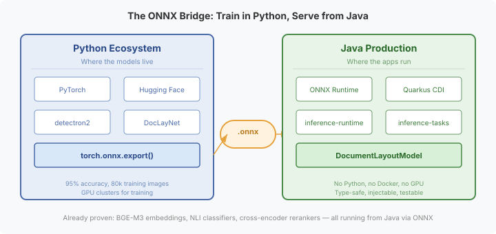
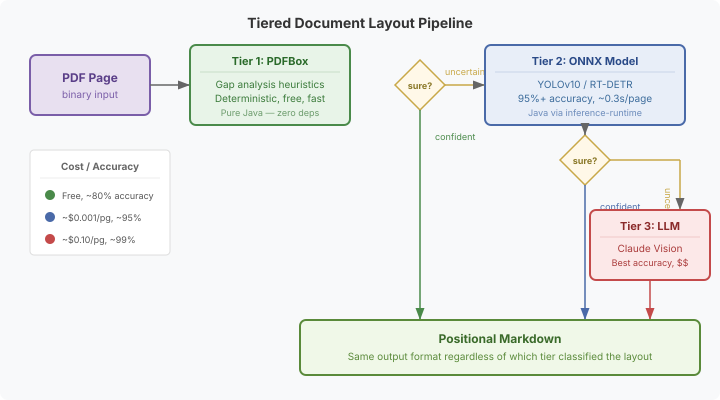

# The Model Gap — Why Java Can't Read Documents Like Python Can

I spent this afternoon building document parsers for our positional markdown pipeline. PDFBox extracts text from PDFs. Apache POI handles Word documents. Tika does OCR on images. Standard Java tools, doing what Java tools do.

Then I went looking for what the state of the art actually looks like.

HURIDOCS — a human rights documentation organisation — published a document layout analysis service earlier this year. Their VGT model scores 95.4% accuracy on layout classification, outperforming Marker, Docling, and MinerU. It correctly identifies columns, headers, footnotes, tables, and figures in documents of arbitrary complexity. It runs at 0.34 seconds per page on a mid-range GPU.

It's written in Python.

Not because Python is a better language for this problem, but because the entire machine learning ecosystem — PyTorch, Hugging Face, detectron2, the DocLayNet training dataset, the pre-trained model weights — lives in Python. The model was trained on 80,000 annotated document pages. No amount of Java code can replicate what 80,000 labelled examples teach a neural network.

## What Java actually has

PDFBox gives you text blocks with x/y coordinates. That's powerful — you know where every character sits on the page. From those coordinates, you can write heuristics: "if there's a consistent vertical gap at the horizontal midpoint, this is a two-column layout." Gap analysis, whitespace detection, font-size-based heading classification.

These heuristics work well for standard documents. A single-column report, a simple two-column academic paper — PDFBox handles them correctly. The rules are precise, deterministic, and inspectable. You can trace exactly why the parser classified a page as two-column: "there were 14 text blocks left of x=0.48 and 12 blocks right of x=0.52, with a consistent gap between 0.48 and 0.52."

But give it a KS2 English worksheet — instruction boxes, answer fields, word banks, example panels, all at different positions on the page — and the heuristics fall apart. There is no rule you can write that handles arbitrary panel layouts. The rules don't generalise. That's not a limitation of Java; it's a limitation of rules. The same heuristics written in Python would fail in the same way.

The gap isn't Java vs Python. It's **rules vs learned models**. And right now, the learned models only ship in Python.

## The landscape

I surveyed the current state of document layout analysis tools. The pattern is consistent:

HURIDOCS uses VGT (Vision Grid Transformer) — a two-stream architecture combining visual features with grid-level text positioning. Trained on DocLayNet. 95.4% accuracy. Python, PyTorch, Docker.

IBM's Docling uses RT-DETR and RT-DETRv2 — single-stage object detectors trained on 150,000 documents. Open-source models on Hugging Face. Python.

Microsoft's DiT (Document Image Transformer) applies vision transformer pretraining directly to document images. Strong results on PubLayNet. Python.

There are newer entries too — LayoutMamba from October 2026 combines Mamba's state-space mechanism with transformers. HybriDLA unifies autoregressive and diffusion approaches. All Python. All trained on large annotated datasets that don't exist in the Java ecosystem.

The common thread: document layout analysis is a **computer vision** problem. You're looking at a page image and classifying regions. The tools for this — convolutional networks, vision transformers, object detectors — were built in Python and stayed there.

## But Java CAN run the models

Here's where it gets interesting. The gap isn't about inference — it's about packaging.

ONNX Runtime has a Java API. We use it extensively. Our inference-runtime module runs ONNX models on the JVM via JNI. NLI classifiers, text classifiers, SPLADE sparse embeddings, cross-encoder rerankers, BGE-M3 three-head embeddings — all running from Java, with zero Python at runtime. The model was trained in Python, exported to ONNX via `torch.onnx.export()`, and served from Java.

The bridge already exists. We've crossed it for NLP models. Nobody has crossed it for document layout models.

And the best part: some models are already exported. Oblix published YOLOv10 trained on DocLayNet in ONNX format on Hugging Face. You can download the weights right now. YOLO models are architecturally simple — image in, bounding boxes and class labels out. No complex post-processing, no NMS headaches. The inference wrapper would be straightforward.

RT-DETR (the architecture IBM's Docling team uses) is specifically designed for easy deployment — single-stage detector, no non-maximum suppression. Clean ONNX export path. DiT and LayoutLM can be exported via Hugging Face's `optimum` library.

The engineering work is: download the weights, write a `DocumentLayoutModel` wrapper in inference-tasks (same pattern as `NliClassifier` and `CrossEncoderReranker`), wire it into the `LayoutClassifier` SPI that our document parsers already accept.

That's a Maven module and a test suite. Not a research project.

## The tiered pipeline

The practical architecture isn't "choose one approach." It's a pipeline that uses each tool where it's strongest:

**Tier 1: PDFBox heuristics.** Free, fast, deterministic. Handles standard layouts correctly. When the heuristics are confident — clear column boundaries, consistent structure — use the result. This covers 60-70% of real-world documents.

**Tier 2: ONNX model.** When heuristics are uncertain — complex layouts, overlapping regions, unusual structures — escalate to the neural model. YOLOv10 on DocLayNet runs at ~0.3 seconds per page and correctly classifies 95% of layouts. The model runs locally via ONNX Runtime. No API call, no Docker container, no Python. Cost is essentially the model file size (~200MB) and a few hundred milliseconds of CPU/GPU time.

**Tier 3: LLM vision.** When even the ONNX model is uncertain — severely degraded scans, layouts that don't match the training distribution, documents where semantic understanding matters more than geometric analysis — send the page image to Claude or another vision model. This is the most accurate tier (~99% for document understanding) but also the most expensive (~$0.10 per page). Config-gated, off by default.

All three tiers produce the same output: a layout classification with panel definitions. The `DocumentParser` doesn't know or care which tier answered. The `LayoutClassifier` SPI abstracts the source of the classification. A pure-Java deployment gets Tier 1 only. Add the ONNX model weights and you get Tier 2. Enable the LLM flag and you get Tier 3.

The tiers also validate each other. PDFBox heuristics serve as a test oracle for the ONNX model on simple documents — if the model gets a single-column report wrong, the heuristic result catches it. When you upgrade the ONNX model (new architecture, new training data), you can run both and diff the results. The deterministic baseline makes the probabilistic model auditable.

## Why this matters for Java platforms

The Java ecosystem has excellent production infrastructure — CDI, type safety, compile-time checking, CDI decorators, SPI contracts, Maven dependency management. It has terrible ML tooling. Python has the opposite profile. This isn't going to change. The research community publishes in Python and the engineering community deploys in Java.

The bridge is ONNX. But someone has to walk across it. For NLP, Hugging Face's `optimum` made ONNX export easy enough that model publishers started shipping ONNX alongside PyTorch. For document layout analysis, nobody has done the packaging work for the Java side. The models exist. The export tools exist. The Java inference runtime exists. The gap is just integration.

A Java-native document layout analysis capability doesn't exist today. Not because it's impossible — because nobody has assembled the pieces. We've filed the issue. The `DocumentParser` SPI is ready. The `LayoutClassifier` hook point is tested with stubs. The inference-runtime module has run dozens of ONNX models successfully. The next step is downloading YOLOv10 DocLayNet weights and writing the wrapper.

When we do, it'll be the first time a Java application can classify document layouts with neural-network accuracy — no Python, no Docker, no external service. Just a Maven dependency and a model file.

The model gap is real. But it's a packaging problem, not a capability problem. And packaging problems have solutions.
