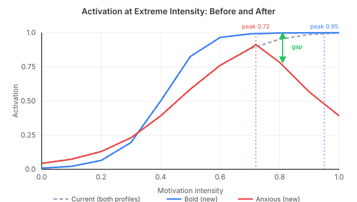
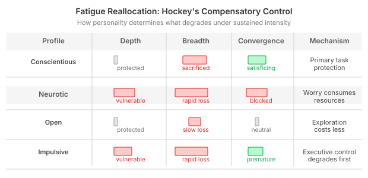
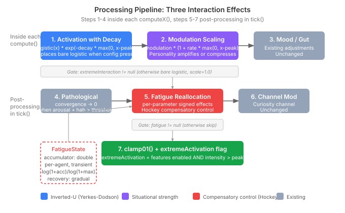

# When Personality Disappears Under Pressure

The search budget model gives each agent a personality-shaped cognitive exploration style — a bold explorer scans broadly, a cautious analyst goes deep. Four parameters (breadth, laterality, depth, convergence) are computed from a logistic activation function whose midpoints and steepness are derived from PID-5 personality facets. At moderate motivation intensity, the model works. Different personalities produce meaningfully different search envelopes.

At extreme intensity, personality vanishes.

The logistic function `1/(1+exp(-k*(x-x0)))` approaches 1.0 as intensity rises. At intensity 0.8, the base activation is 0.86. The drive modulations — fixed additive offsets like +0.15 for curiosity breadth or -0.10 for affiliation depth — become proportionally tiny against that 0.86 base. A bold explorer and an anxious worrier produce near-identical budgets when both are maximally motivated. Character disappears into the ceiling.

I initially wrote this off as a calibration problem. Make the modulations larger, or use multiplicative instead of additive. Then I read the literature, and the calibration diagnosis was wrong.

## What the Literature Actually Says

Situational Strength Theory (Meyer, Dalal & Hermida 2010) studied 153 experiments and found that personality-performance correlations are r=0.23 in "weak" situations (ambiguous cues, low constraints) and r=0.09 in "strong" situations (clear demands, high constraints). Extreme motivation IS a strong situation. The current model's personality compression at high intensity is actually the *average* effect — and it's correct for the average. But Situational Strength Theory explicitly warns that it's not uniform across traits.

The Yerkes-Dodson Law (1908) — contested as a universal generalisation, but useful as a modelling abstraction — describes an inverted-U relationship between arousal and performance. The critical detail everyone skips: the peak position shifts based on personality. Eysenck & Eysenck (1985) showed that neurotic individuals have lower baseline arousal tolerance. They peak earlier and decline faster. A bold agent's performance might not decline until intensity 0.95. An anxious agent's starts declining at 0.72.

Easterbrook's Cue-Utilisation Theory (1959) says high arousal narrows the range of cues attended to. This maps directly to breadth and laterality. But the narrowing rate differs by personality — impulsive individuals narrow more, anxious individuals narrow via internal worry consuming attentional resources (Sarason 1975).

The fix wasn't "make the modulations bigger." It was understanding that extreme intensity creates three distinct personality-dependent interaction effects.

## Three Mechanisms, Not One

**1. Inverted-U Decline.** Past a personality-specific peak, activation declines via exponential decay: `logistic(x) * exp(-decay * max(0, x - peak))`. Below the peak the function is pure logistic — current behaviour preserved. Past it, the decay rate determines how sharply activation drops. A conscientious agent protecting depth gets decay = 0 (depth sustains at the ceiling). An anxious agent gets decay = 2.3 on breadth (Easterbrook narrowing hits hard).

The exponential form matters. I originally chose a quadratic penalty (`logistic - decay * (x-peak)²`), but Claude caught a problem the quadratic doesn't advertise: the subtractive form can go negative for large overshoot. The multiplicative exponential is naturally non-negative. It also produces asymmetric decline — a rapid initial drop past the peak, then gradual plateau toward zero — which better matches the empirical curves.

**2. Modulation Scaling.** Drive modulations become intensity-dependent rather than fixed. Past the peak, personality-derived amplification rates scale each modulation: `modulation * (1 + rate * max(0, intensity - peak))`. A positive rate amplifies the modulation (conscientiousness → depth boost grows under pressure). A negative rate compresses it (low openness → curiosity breadth boost shrinks). With CDE-derived rates, the scaling factor reaches 0.0 at most — full compression, but never reversal. Modulations fade out rather than flip sign.

**3. Fatigue Reallocation.** This one took the most design effort. The initial instinct was a uniform fatigue multiplier — intensity stays high, everything degrades. I brought Claude in to think through this from first principles, and the uniform model fell apart quickly.

Baumeister's ego depletion (1998) predicts uniform degradation, but the replication crisis gutted it — Carter & McCullough's 2014 meta-analysis found d=0.25, much weaker than originally claimed. Hockey's Compensatory Control Model (1997) is better grounded: under sustained demand, people strategically reallocate. They protect their primary task at the cost of secondary tasks.

This means fatigue isn't a single multiplier — it's a per-parameter reallocation whose pattern depends on personality. A conscientious agent under fatigue protects depth (primary task) while sacrificing breadth and accelerating convergence (satisficing — discipline says "finish it"). A neurotic agent loses depth AND convergence — worry consumes the attentional resources needed for sustained focus, and anxiety blocks commitment.

The fatigue accumulation uses a logarithmic function rather than linear — rapid initial onset that matches the vigilance decrement literature (Warm, Parasuraman & Matthews 2008), then plateau. Recovery is gradual, not instantaneous. And there's an intentional hysteresis: recovery is fast when fatigue is low and extremely slow when fatigue is high. An agent deeply fatigued from sustained extreme motivation doesn't snap back — Hockey's refractory period predicts this.

## The Numbers Don't Lie

I verified the full pipeline against concrete personality profiles with a Python simulation before committing to the design. The results for breadth differentiation (bold explorer vs anxious worrier at intensity 0.9):

- Current model: 0.020
- New model: 0.467

That's a 23x improvement. Laterality differentiation went from 0.009 to 0.438 (48x). Total differentiation across all four parameters: 0.176 → 1.031 — a 5.9x improvement.

At moderate intensity (0.5), the new model produces identical output to the current model. Zero regression. The three mechanisms only activate past the personality-specific peak, so moderate-range behaviour is completely preserved.

## The Anxious Perfectionist Problem

The most instructive finding came from a profile that doesn't appear in the obvious contrast. The original "cautious analyst" from the quality test has high anxiousness (0.8) but also high conscientiousness (strict rules, low impulsivity). I assumed this profile would show depth degradation and convergence failure at extremes.

The math said otherwise. Every CDE formula has conscientiousness acting as a protective factor — and for this profile, conscientiousness wins. Depth decay: zero (protected). Convergence: slightly accelerated (satisficing). Fatigue endurance: 12 ticks (high conscientiousness sustains). This agent's extreme-intensity profile is *resilient*, not fragile.

This is exactly what Hockey predicts. An anxious perfectionist under pressure doesn't fall apart — they narrow their focus, sacrifice breadth, and push through on the primary task. The cost is subjective strain, not performance degradation. The profile that actually degrades is an anxious agent *without* conscientiousness — high worry, no discipline to compensate. I had to add a third profile (the "anxious worrier") to demonstrate the degradation the original design assumed.

The lesson: personality is compositional. You can't reason about "high anxiety" in isolation — the interaction with conscientiousness flips the entire fatigue profile. The CDE formulas capture this correctly. My narrative intuitions didn't.

## What the Implementation Revealed

The implementation confirmed something the design spec only hinted at: the separation of concerns between the three mechanisms is load-bearing, not cosmetic.

The inverted-U activation and modulation scaling operate *inside* each `computeX()` method — they shape how each individual parameter responds to intensity. Fatigue operates *after* all four parameters are computed — it redistributes the budget as a whole. This matters because the pathological threshold check (convergence collapses to 0 when arousal plus habituation failure exceeds a personality-specific threshold) sits between them. If fatigue ran inside the compute methods, it would interact with the pathological check in ways that produce double-counting. With fatigue applied after, the two systems are genuinely independent: the pathological check models emotional dysregulation, fatigue models resource depletion. One-directional only — pathological state makes fatigue's convergence effect irrelevant (convergence is already zero), but fatigue never makes pathological triggering more likely.

The API design is clean: all three features gate on nullable config sub-records, making them opt-in. `ExtremeInteractionConfig` and `SearchFatigueEffects` are null by default — an agent only gets these behaviours when the CDE derives them from its disposition profile. The quality tests verify this: default-config agents produce identical budgets whether or not the new code paths exist.

The CDE derivation formulas needed one calibration adjustment that the spec didn't anticipate. The fatigue depth formula `min(0, -0.08 * (1.0 - conscientiousness))` originally had an anxiety term, but that would have double-counted — anxiety already operates through the inverted-U decay (mechanism 1). The formula separates concerns cleanly: conscientiousness determines how much depth protection you have under fatigue; anxiety determines how early your activation starts declining. Two different mechanisms, two different config fields, no interference.

## Why This Matters for Agent Design

The deeper question this work answers isn't about search budgets. It's about whether synthetic personality can survive extreme conditions.

Most personality models in agent frameworks are cosmetic — they produce different outputs at moderate intensity, but the differentiation collapses under load. When an agent is maximally motivated, maximally stressed, or stuck in a thought loop, the personality layer becomes decorative. Every agent converges to the same ceiling-capped behaviour. The agent *sounds* different in its text (the personality prompt is still there), but its cognitive architecture *acts* the same.

The literature says this is wrong. Real personality doesn't disappear under pressure — it *transforms*. The conscientious person under extreme stress doesn't behave like the anxious person under extreme stress. They narrow differently, fatigue differently, recover differently, and commit differently. The Yerkes-Dodson peak shifts. The Easterbrook narrowing rate varies. The Hockey reallocation pattern is personality-specific.

The implementation proves this is tractable. Three config records, fourteen CDE-derived parameters, one processing pipeline. The quality tests show 23x breadth differentiation improvement at extreme intensity with zero regression at moderate intensity. The key architectural insight: personality expression at extremes requires multiplicative gating (the exponential decay) rather than additive adjustment (larger offsets). The ceiling problem wasn't about the size of the modulations. It was about the shape of the activation function.

Recurring thought states — fixation, obsession, rumination — are where this matters most. These states produce sustained extreme intensity over many consecutive ticks. The fatigue model becomes the dominant shaping force on the search budget. A conscientious agent in fixation sustains depth and satisfices to escape the loop. A neurotic agent in rumination loses depth AND convergence — the spiral tightens because the very resources needed to break out are the ones being consumed.

That's not a bug in the model. That's what rumination actually looks like.
