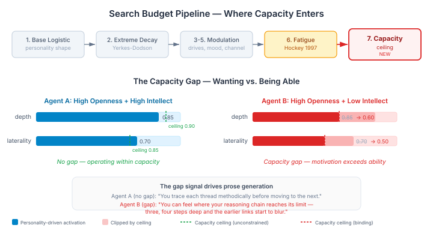
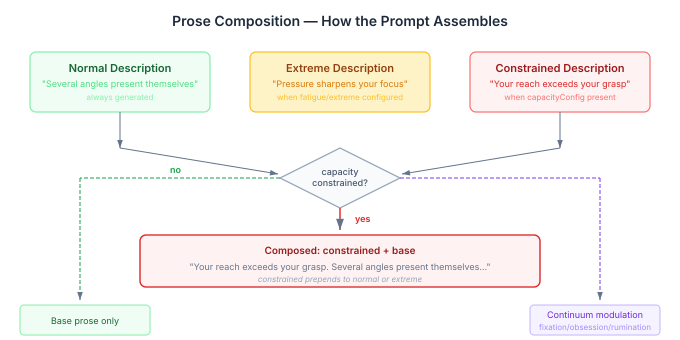

# The Gap Between Wanting to Think and Being Able To

The search budget model has been through three layers now. The base layer (#825) gives each agent a personality-shaped exploration envelope — four parameters derived from PID-5 personality facets. The extreme interaction layer (#839) makes personality expression change under pressure — inverted-U activation, fatigue reallocation, the whole Yerkes-Dodson dynamics. Both model *motivation*: how much you want to explore, and how that wanting changes under stress.

Neither models *capacity*: how far that wanting can productively reach.

I kept treating this as the same thing. An agent with high Openness explores broadly — that's what the PID-5 derivation does, that's what the search budget renders into the prompt. But Openness is about wanting to explore. It says nothing about whether the agent can sustain a four-step reasoning chain or bridge a distant analogy.

Colin DeYoung's Big Five Aspect Scales make the split explicit. What most personality models call "Openness to Experience" is actually two distinct traits: **Openness** (aesthetic sensitivity, imagination, perceptual exploration) and **Intellect** (intellectual engagement, abstract reasoning, perceived intelligence). Nusbaum and Silvia (2011) proved the double dissociation cleanly: Openness predicts creativity but not fluid intelligence. Intellect predicts fluid intelligence but not creativity. These are empirically separate constructs.

The practical consequence for agent design: a high-Openness, low-Intellect agent *wants* to explore laterally but can't chain distant associations productively. The motivation is there; the cognitive capacity isn't. A high-Intellect, low-Openness agent *can* chain deep but doesn't pursue the connections. The capacity exists; the motivation doesn't. The current model collapses both into one dimension.

## Why Personality Models Can't Fix This

I initially looked for ways to derive capacity from existing personality data. Three candidates, all dead ends.

**PID-5 facets** measure maladaptive personality pathology — anxiousness, impulsivity, emotional lability. DeYoung et al. (2016) mapped PID-5 facets to the Big Five Aspect Scales and found that PID-5's Psychoticism cluster maps to the Openness aspect specifically. Intellect — a positive trait associated with cognitive ability — has no PID-5 counterpart. The instrument is structurally unable to represent it.

**Jungian cognitive functions** describe cognitive *style*, not capacity. High Ti (introverted thinking) means you prefer internal logical analysis. It does not mean you're good at relational reasoning. Using Ti as a proxy for reasoning capacity conflates what you prefer with what you can do — circular reasoning dressed as a derivation.

**Disposition axes** (ruleFollowing, riskAppetite, autonomy) are motivational constructs. Mapping ruleFollowing to depth capacity has no literature support. It would be engineering convenience, not grounded design.

Capacity is orthogonal to personality. It needs its own representation.

## Three Dimensions from the Literature

Each capacity dimension bounds a specific search budget parameter, grounded in a distinct research tradition:

**Relational complexity** (Halford et al. 1998) bounds depth. Halford's key finding: processing capacity is defined by the number of dimensions that can be related simultaneously. Unary relations have one source of variation, binary have two, ternary three. The empirical soft limit is quaternary — four interrelated variables held simultaneously. Beyond that, the mind segments and chunks, degrading quality. Fluid intelligence accounts for 80% of the age-related variance in this capacity. An agent with low relational complexity can follow a two-step reasoning chain but loses the earlier links by step four.

**Associative reach** (Mednick 1962) bounds laterality. Mednick's associative hierarchy theory: creative people have flatter hierarchies — more remote associations are accessible. Given the word "table", most people reach "chair" instantly. People with flat hierarchies also reach "leg", "food", "periodic", "water". The Remote Associates Test correlates with Raven's Progressive Matrices at r=0.38. Not pure intelligence, not pure creativity — a capacity that straddles both. An agent with low associative reach wants to make lateral leaps but lands in noise more often than signal.

**Working memory span** (Engle & Kane 2004) bounds breadth. Their two-factor theory: working memory capacity is fundamentally about attention control — maintaining representations in the face of interference and distraction. At low demand, everyone performs similarly. At high demand, individual differences emerge. WMC correlates with fluid intelligence at the latent level at r=0.72. An agent with low WM span starts strong with multiple threads but loses the earlier ones as cognitive load increases.

Convergence gets no ceiling. It models *when to stop and synthesize* — a personality-driven decision (Need for Cognitive Closure, conscientiousness), not a capacity limit.

## The Architecture That Follows



Capacity applies as a hard ceiling after all existing pipeline steps. The ceiling is a `Math.min()` — it only matters when motivation pushes the agent beyond their cognitive limits. Below the ceiling, capacity has zero effect. The agent operates normally.

The interesting signal isn't the capped value. It's the **gap** between what personality drives and what capacity allows:

```java
double depthGap = Math.max(0.0, depth - capacity.relationalComplexityOrDefault());
depth = Math.min(capacity.relationalComplexityOrDefault(), depth);
```

A large gap means the agent is frustrated by cognitive limits — high motivation, low capacity. This is the Openness/Intellect tension rendered as a runtime signal.

## What the LLM Actually Sees

The gap drives prose generation. At consolidation time, an LLM receives the agent's search budget parameters and capacity ceilings, then generates three descriptions: normal exploration, extreme intensity, and capacity-constrained. These crystallise to the MindMap and persist across ticks.

At render time, the descriptions compose — they don't compete:



When capacity constrains a parameter, the constrained description **prepends** to the base description. The agent hears both: *what it feels like to be limited* followed by *what it would normally feel like*. The tension between the two is the point.

An unconstrained agent sees only the base:

> *"Several angles present themselves naturally — single explanations rarely satisfy."*

A constrained agent sees the tension:

> *"Your reach exceeds your grasp — three, four steps deep and the earlier links start to blur. You want to hold more of the argument in view at once, but the threads slip. Several angles present themselves naturally — single explanations rarely satisfy."*

Same personality, same motivation. The first description is limitation; the second is aspiration. The LLM processes both and its behaviour reflects the tension — exploring broadly but with visible frustration at the depth it can't sustain.

This matters because LLM behaviour responds to self-description. The Anthropic "Functional Emotions" work (2026) showed that cognitive state descriptions causally influence model behaviour. Not through instruction — through identity. When an agent's prompt says "the threads slip", the model produces output consistent with that limitation without being told to limit itself.

## Deriving Defaults Without Overclaiming

Capacity is a first-class parameter in the cognitive profile YAML. But most agents won't have explicit capacity specification, so the CDE needs a default derivation.

The Jungian cognitive functions are the best available proxy — weakly correlated, but directionally correct. Ti+Te (analytical functions) weakly predict relational reasoning capacity. Ne+Ni (intuitive functions) weakly predict associative hierarchy flatness. Te+Si (structured processing) weakly predict working memory management.

The critical design choice: compress the derivation range to [0.55, 0.95]. The Jungian-to-capacity correlation is r=0.3-0.4 at best. A derivation that produced extreme low values would be claiming "this personality profile makes you unintelligent" — an inference the data doesn't support. The compressed range provides moderate differentiation while being honest about the weakness of the mapping. Explicit YAML specification can use the full [0.0, 1.0] range when richer characterisation is warranted.

## The Three Tests That Prove It Works

The implementation is verified by three scenario profiles exercising the full pipeline end-to-end:

**Analytical agent** — low depth midpoint (activates early), moderate relational complexity ceiling at 0.40. The pipeline produces a high personality-driven depth, which gets hard-capped. The test confirms: depth never exceeds the ceiling, `capacityConstrained` fires, and the gap signal exceeds the 0.05 noise threshold. This agent *wants* to reason deeply and *can't*.

**Exploratory agent** — low laterality midpoint, high associative reach ceiling at 0.95. Personality pushes laterality up, but the ceiling is higher than the activation. The test confirms: no capping occurs, no gap signal fires. This agent *wants* to explore laterally and *can*.

**Default agent** — null `capacityConfig`. Every prior behaviour preserved. No capping, no gap, all parameters in [0,1]. This is the backward compatibility proof: the capacity layer is invisible unless configured.

The fourth test verifies prose composition directly: a crystallised constrained description prepends to a base description in the rendered prompt, with the constrained text appearing first.

## Why This Matters for Anyone Building Agents

Every personality model I've encountered — Big Five derivations, MBTI-inspired profiles, custom trait systems — conflates motivation and capacity into a single dimension. The agent "is curious" or "is analytical" as a monolithic trait. The Openness/Intellect double dissociation proves these are empirically separate. An agent can be curious without being capable, or capable without being curious.

Three practical takeaways:

**Separate the axes.** If your agent has an "intelligence" or "reasoning" parameter, check whether it's actually controlling motivation to think (personality) or ability to think (capacity). If it's doing both, you have a confound — high values produce agents that are both eager and able, low values produce agents that are neither. The interesting characters live in the off-diagonal: the eager amateur, the reluctant expert.

**Make limits visible, not invisible.** The naive implementation of a capacity limit is to silently clamp the output. The agent simply does less. The richer implementation makes the limit *felt* — the agent knows it's limited and expresses frustration, compensation, or acceptance. This is the difference between a character who is limited and a character who experiences limitation. The gap signal is how you get from one to the other.

**Don't derive what you can't justify.** The compressed range [0.55, 0.95] is an honesty mechanism. The Jungian-to-capacity correlation is too weak for extreme values. A derivation that produces "this agent has 0.2 reasoning capacity" from personality data is making a claim the literature doesn't support. If your derivation is uncertain, make the output range reflect that uncertainty. Let explicit configuration handle the extremes.

Cattell's Investment Theory (1987) says fluid intelligence (capacity) gets invested in learning over time, producing crystallised intelligence (knowledge). Higher capacity means more productive exploration means a broader knowledge base. `CognitiveCapacityConfig` sits on `CognitiveDefaults` at the top level, not nested inside `SearchBudgetConfig`, specifically to enable future learning rate modulation — the search budget ceiling is the first consumer, not the only one.

The tension between wanting and being able is where the most interesting cognitive character emerges. Not in the trait itself, but in the gap.
