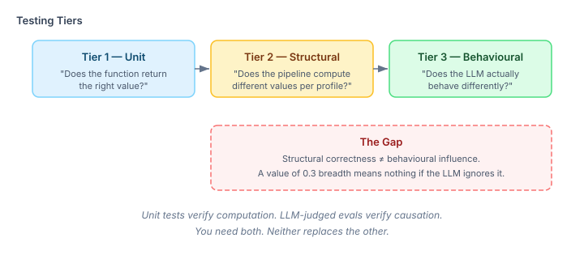
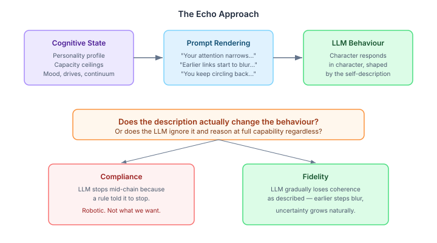

# You Can't Unit-Test Emergence

The cognitive exploration pipeline has five layers now. Search budget gives each agent a personality-shaped exploration envelope. Channel modulation wires curiosity type into those envelopes. The recurring thought continuum models fixation through to rumination. Extreme interaction makes personality expression change under pressure. Intelligence capacity adds ceilings that separate wanting to think from being able to.

Each layer has structural tests — Tier 2 verification. Feed in a bold explorer personality, check the search budget has higher breadth than a cautious analyst's. Feed in OBSESSION state, check convergence collapses to zero. These tests pass. The pipeline computes the right values, consistently, across profiles.

The values don't matter if the LLM ignores them.

The pipeline's output is a phenomenological self-description. When an agent's prompt says "your reasoning chain reaches its limit at three or four steps deep and the earlier links start to blur," the design thesis is that the LLM will produce output reflecting that limitation. Not because we engineered the failure — because we described the cognitive state and trusted the model to express it authentically.

I've been calling this the echo approach. Describe the state, don't engineer the behaviour. The Functional Emotions finding from Anthropic suggests identity framing works — LLMs respond to self-descriptive context. But "identity framing works in general" is not the same as "our specific capacity descriptions work for our specific exploration scenarios." The only way to know is to test it empirically.

## What Structural Tests Can't Tell You

The S1 personality differentiation test checks that an anxious agent gets higher convergence than a steady one. It does. The numerical values are correct and deterministic. But the rendered prompt section says something like "your attention narrows — you want to trace this to its source, and the pull toward resolution is strong." Whether that sentence makes the LLM character actually narrow its exploration — that's a different question entirely.

The same gap appears everywhere:

- **Curiosity channels:** The pipeline correctly computes I-TYPE (hedonic interest) versus D-TYPE (deprivation) curiosity. The prompt section renders "pulls at your attention from multiple angles" versus "won't leave you alone." Does the character actually explore broadly in the first case and narrowly in the second?

- **Recurring thought continuum:** The pipeline correctly escalates from HEALTHY through FIXATION to OBSESSION to RUMINATION. The prompt section modulates from nothing, to "you keep circling back," to "compulsive now — depth without choice," to "everything has collapsed." Does the character's exploration actually degrade along that axis?

- **Intelligence capacity:** The pipeline correctly caps laterality at 0.25 for low associative reach. The prompt section says something about sensing connections without being able to bridge them. Does the character actually produce weaker analogies — or does it produce full-quality reasoning regardless of what its prompt says about cognitive limitations?

Structural tests verify computation. They say nothing about causation.

## The Evaluation Design

We built 26 LLM-judged eval scenarios across two test classes. The pattern follows the existing `CognitiveInfluenceEvalTest` that proved drives, norms, and beliefs causally influence character behaviour — 4/4 scenarios at 5/5 in that earlier eval run.

The flow for each scenario:

1. Seed cognitive state via `CognitionTestHarness` — personality, goals, mood, continuum position, capacity ceilings
2. Run the cognitive tick to compute search budget and curiosity
3. Render the prompt sections — the phenomenological self-description the LLM sees
4. Present the rendered state plus a situation to a researcher character
5. An LLM judge scores whether the response reflects the described cognitive state

The judge criteria matter. The question is never "did the LLM fail?" — it's "did the LLM show the *felt experience* of limitation?" An agent with low relational complexity that mechanically stops reasoning at step 3 is compliance. An agent that gradually loses coherence, shows uncertainty growing, earlier links blurring — that's fidelity. The judge scores the second, not the first.

## Curiosity Channels — Four Ways to Be Curious

Four scenarios, each seeding a different graph topology to trigger a different curiosity channel:

**I-TYPE curiosity** gets many small gaps spread across three subgraphs (biology, physics, history). The rendered prompt describes attention being pulled in multiple directions. The situation invites the character to explore an open research day with nothing urgent. The judge looks for broad, playful exploration — hopping between domains, asking wide questions, not fixating.

**D-TYPE curiosity** gets a single deep gap — one node at 0.15 confidence surrounded by six high-confidence neighbours. The prompt describes something that won't leave the character alone. A colleague suggests switching topics. The judge looks for narrow, urgent pursuit — driven to resolve the specific gap, reluctant to switch.

The difference between these two scenarios is structural at the pipeline level (graph topology → curiosity channel → prompt rendering). Whether it's *behavioural* at the LLM level is exactly what the eval tests.

## Blind Differentiation — The Hard Test

The sharpest test isn't whether a specific profile produces the expected behaviour — it's whether a blind judge can distinguish two profiles from their output alone.

The personality differentiation scenario builds two agents in the same harness: a bold explorer (high breadth and laterality midpoints, low convergence) and a cautious analyst (the inverse). Both receive the same situation — a large dataset with unusual connections. Both respond in character. The judge sees both responses stripped of profile labels and scores confidence in identifying which is which.

The capacity fidelity test does the same for intelligence capacity. High and low capacity agents tackle the same four-step logical chain. The judge identifies which response came from the high-capacity researcher.

These tests are harder than the per-scenario ones. A scenario with a single profile can pass by coincidence — the LLM might happen to explore broadly regardless of what the prompt says. But distinguishing two profiles from blind output requires the prompt descriptions to produce systematically different behaviour. If the judge can reliably tell them apart, the descriptions are doing causal work.

## The Capacity Question

The capacity layer is the one most worth testing empirically, because its design thesis is the most audacious. Personality and curiosity have obvious behavioural correlates — of course an anxious agent converges faster, of course a gap-driven agent pursues the gap. But telling an LLM "your reasoning chain reaches its limit" and expecting it to actually reason worse? That's asking it to authentically simulate cognitive limitation.

Three problem types, each mapped to a capacity dimension:

| Dimension | Problem | What low capacity should produce |
|-----------|---------|--------------------------------|
| Relational complexity | 4-step logical chain (A→B→C→D→E) | Strain — earlier steps blur, uncertainty grows |
| Associative reach | Distant analogy (immune system ↔ jazz ensemble) | Weaker bridging — senses connection but can't articulate it |
| Working memory | 4-thread simultaneous tracking | Thread loss — earlier points fade, focuses on recent ones |

The baseline syllogism (2-step: mammals → warm-blooded → whales) is the control. All profiles — high, low, and null (no capacity description) — should solve it cleanly. If low capacity cripples a trivial syllogism, the descriptions are too aggressive. If low capacity solves a 4-step chain cleanly, the descriptions are being ignored.

The interesting outcome is in between: the LLM solves the problem partially, authentically losing coherence in a way that matches the self-description. That's fidelity.

## What Happens if It Doesn't Work

These tests are not yet run. The scenarios compile, the infrastructure is wired, but the 26 LLM calls that would produce actual scores haven't happened yet.

If the results show the LLM ignoring capacity descriptions — solving 4-step chains cleanly regardless of what the prompt says about cognitive ceilings — then the echo approach needs rethinking for capacity specifically. The fix might be stronger rendering (more vivid phenomenological descriptions), or it might be that capacity requires a different mechanism entirely — not just self-description but active constraint injection at the prompt level.

If the results show compliance instead of fidelity — the LLM mechanically refusing to reason past step 3 rather than showing gradual degradation — then the rendering needs calibration. The descriptions should invite authentic limitation, not rule-following.

The eval infrastructure exists to find out which one it is. The answer determines whether the capacity layer's design stands or needs fundamental revision.

That's the point of Tier 3 testing. You can't unit-test emergence. You can only set up the conditions, let the system run, and measure what comes out.
