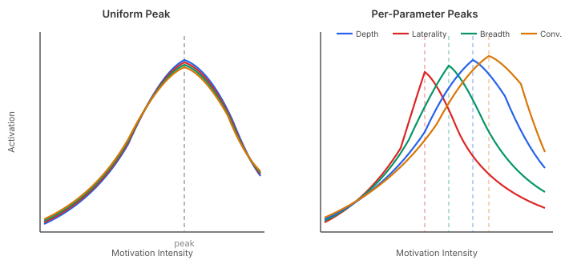
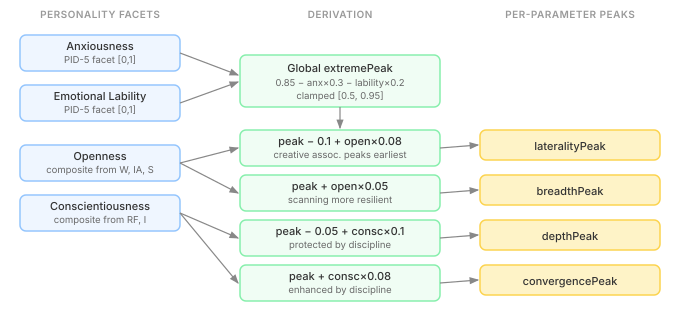
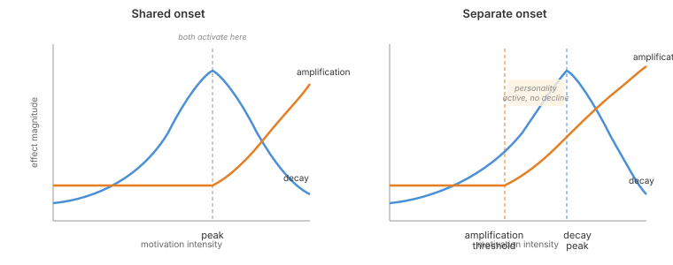

# Not Everything Breaks at Once

In [When Personality Disappears Under Pressure](/2026-11-09-mdp01-when-personality-disappears), I described how the search budget's extreme interaction layer makes personality *survive* at high arousal. A personality-specific peak controls when the inverted-U decline begins — anxious agents peak earlier, bold agents peak later. The decay rates and amplification rates are per-parameter. The peak itself is not.

That's one global threshold shared by depth, breadth, laterality, and convergence. The same arousal level triggers decline in creative association and focused search simultaneously.

The Yerkes-Dodson law says this is wrong.

## The Task-Complexity Effect

Yerkes and Dodson's original 1908 finding was not just "arousal hurts performance past a peak." It was that the peak position depends on task complexity. Simple tasks peak at higher arousal than complex ones. A mouse running a simple discrimination task performs best at high shock intensity. A mouse running a hard discrimination task degrades at moderate shock intensity. The inverted-U shifts left as complexity increases.

The search budget's four parameters represent four genuinely different cognitive operations:

**Laterality** — creative association, defocused attention, bridging distant concepts. This is the most complex operation. Martindale's (1999) work on creativity and cortical arousal showed that creative insight requires low cortical activation. High arousal narrows attention (Easterbrook 1959) and kills the lateral connections that make creative leaps possible. Laterality should peak earliest.

**Depth** — sustained multi-step reasoning, holding a chain of inferences. Complex, but with a structural scaffold — the chain has a direction. Conscientiousness protects it (Hockey's Compensatory Control Model: disciplined thinkers protect their primary task under stress). Depth should peak later than laterality.

**Breadth** — scanning multiple possibilities, cue utilisation. Moderate complexity. Easterbrook's narrowing hits breadth directly, but breadth is mechanically simpler than depth or laterality — you're surveying, not chaining. Open personalities sustain broader scanning longer.

**Convergence** — deciding to stop and commit. This is the simplest operation. It may even be *enhanced* by moderate stress — anxiety accelerates convergence (the "satisficing under pressure" effect). Convergence should peak latest.

A single threshold collapses this hierarchy. An agent under pressure loses creative association and focused commitment at the same arousal level. That doesn't match any empirical model of how cognition actually degrades.

## The Fix



The left panel shows the old model: four curves sharing one peak. Past that threshold, everything declines together. The right panel shows the new model: laterality peaks and declines first, then breadth, then depth, then convergence. Each parameter has its own threshold.

The implementation adds four nullable `Double` fields to `ExtremeInteractionConfig`:

```java
public record ExtremeInteractionConfig(
        // ... existing decay and amplification rates ...
        Double depthPeak,
        Double breadthPeak,
        Double lateralityPeak,
        Double convergencePeak) {

    public double lateralityPeakOrDefault(double fallback) {
        return lateralityPeak != null ? lateralityPeak : fallback;
    }
    // ...
}
```

When null, each parameter falls back to the global `extremePeak` on `SearchBudgetConfig`. Backward compatible — existing agents with no per-parameter peaks behave identically.

Each `computeX()` method resolves its own peak:

```java
double peak = ext != null
    ? ext.breadthPeakOrDefault(config.extremePeak())
    : config.extremePeak();
double base = activationWithDecay(intensity, steepness, midpoint, decay, peak);
```

Fatigue accumulation and the `extremeActivation` flag still use the global peak. Those model composite motivational state, not per-parameter cognitive limits.

## Deriving Peaks from Personality



The global peak is already personality-derived:

```
globalPeak = 0.85 − (anxiousness − 0.5) × 0.3 − (emotionalLability − 0.5) × 0.2
```

The per-parameter peaks are offsets from this global peak, shaped by the personality traits most relevant to each cognitive operation:

| Parameter | Formula | Rationale |
|-----------|---------|-----------|
| lateralityPeak | globalPeak − 0.1 + openness × 0.08 | Creative association is most vulnerable; open personalities sustain it slightly longer |
| breadthPeak | globalPeak + openness × 0.05 | Scanning is simpler; open personalities are more resilient to cue narrowing |
| depthPeak | globalPeak − 0.05 + conscientiousness × 0.1 | Complex reasoning, but discipline protects the primary task |
| convergencePeak | globalPeak + conscientiousness × 0.08 | Focus is enhanced by discipline; converges later |

All clamped to [0.5, 0.95]. The range constraint ensures no per-parameter peak can fall below the global minimum or above the global maximum.

For a concrete example: an anxious worrier (anxiousness 0.8, emotional lability 0.7, conscientiousness 0.275) produces:
- Global peak: 0.72
- lateralityPeak: 0.64 — creative association starts declining well before anything else
- breadthPeak: 0.76 — scanning holds up slightly past the global peak
- depthPeak: 0.70 — close to global, the −0.05 offset nearly cancels the conscientiousness boost
- convergencePeak: 0.74 — can still commit decisions even as other faculties degrade

That ordering is the point. Under rising pressure, this agent loses creative leaps first, then depth of reasoning, and keeps the ability to commit and scan until later. A disciplined agent (conscientiousness 0.825) gets depthPeak 0.75 and convergencePeak 0.79 — discipline pushes both parameters higher, extending the window before they degrade.

## But Personality Doesn't Wait for Decline

Per-parameter peaks separate *when each dimension's raw performance starts to degrade*. Creative association goes first, focus holds longest. The Yerkes-Dodson ordering makes structural sense.

But the decay curve isn't the only thing keyed to these thresholds. A second function sits on the same trigger:

```java
static double modulationScale(double amplificationRate, double intensity, double peak) {
    double scale = 1.0 + amplificationRate * Math.max(0.0, intensity - peak);
    return Math.max(-1.0, scale);
}
```

Past the peak, `modulationScale` starts scaling drive modulations. A curiosity-driven agent's breadth bonus grows past its baseline magnitude (positive amplification) or compresses toward zero (negative amplification). This is the personality-expression path — how strongly dispositional patterns color the cognitive budget under pressure.

Until now, both functions shared the same onset. The point where depth performance started declining was also the point where depth modulations started scaling. That conflation makes an implicit claim: personality expression activates at the same intensity as cognitive degradation.

It shouldn't.

Performance decline is involuntary — the cognitive system hitting its limits under overload. Amplification is behavioral — the personality leaning harder into its signature patterns. A conscientious agent doesn't wait until it's cognitively failing to start expressing conscientiousness. The discipline is already active at moderate arousal, shaping how deeply and how systematically the agent searches, well before the inverted-U turns downward.



The left panel shows the old model: one threshold, both curves activating together. Past the peak, performance declines and personality modulations scale simultaneously. The right panel shows the new model: the amplification threshold sits lower than the decay peak. Personality expression begins while performance is still climbing. There's a window — marked in the diagram — where the agent's personality is actively shaping its cognitive budget but raw performance hasn't yet started to degrade.

The implementation is one nullable field on `ExtremeInteractionConfig`:

```java
Double amplificationThreshold
```

Each compute method resolves a separate threshold for `modulationScale`:

```java
double ampThreshold = ext != null
    ? ext.amplificationThresholdOrDefault(peak) : peak;
double scale = modulationScale(
    ext != null ? ext.breadthAmplification() : 0.0,
    intensity, ampThreshold);
```

When `amplificationThreshold` is null — the default — the existing behavior holds: amplification and decay share the per-parameter peak. When set, amplification activates at a different intensity than decay.

The derivation is one line from conscientiousness:

```
amplificationThreshold = clamp(extremePeak − conscientiousness × 0.1, [0.5, 0.95])
```

Higher conscientiousness lowers the threshold. A disciplined agent (conscientiousness 0.825) gets an amplification threshold roughly 0.08 below its global peak — personality modulations kick in while raw performance is still at full strength. A low-conscientiousness agent gets a threshold barely below its peak — personality expression and performance decline are nearly simultaneous.

This makes psychological sense. Conscientiousness is a well-practiced, stable behavioral pattern. Under moderate pressure, the disciplined agent doesn't suddenly become disciplined — it already was. The amplification threshold captures this: the personality's influence on the cognitive budget starts scaling before the system is overloaded, because the behavioral repertoire that conscientiousness represents is available at lower activation levels than the cognitive limit that Yerkes-Dodson describes.

## Why This Matters

The per-parameter peaks and the amplification threshold together form a two-layer model of cognitive degradation under stress.

**Layer one:** different cognitive operations degrade at different intensities. Laterality goes first, convergence last. The Yerkes-Dodson task-complexity effect.

**Layer two:** personality expression and performance decline have different onsets. A conscientious agent starts expressing its depth bonuses while performance is still climbing. The personality isn't waiting for failure — it's responding to rising demand.

Uniform degradation is easy to implement, but it produces agents that lose every cognitive faculty simultaneously while their personality sits dormant until the exact moment things start failing. The agent under pressure becomes generically worse — less creative, less deep, less focused, less decisive — with no compensatory restructuring.

Structured degradation produces agents that compensate. Under rising arousal, creative association goes first — the agent stops making lateral leaps. But depth holds, convergence holds, scanning holds. Personality modulations are already active, steering the budget toward the agent's strengths. As pressure increases further, depth starts to degrade while convergence remains. The agent narrows its cognitive repertoire rather than dimming uniformly. It becomes less creative but more decisive. Less exploratory but more focused.

That pattern — personality responding to demand before performance hits its ceiling, then complex faculties degrading before simple ones — is what the literature predicts. Hockey's Compensatory Control Model describes performance protection through selective resource allocation. The Yerkes-Dodson task-complexity effect describes differential decline rates across cognitive operations. And personality psychology consistently finds that stable traits like conscientiousness manifest under moderate challenge, not only at extremes.

The practical cost across both features: four nullable peak fields, one nullable threshold, five resolution methods, and one derivation formula. The structural cost was zero — `activationWithDecay` and `modulationScale` already took their thresholds as parameters. Each compute method was already resolving a peak; we just gave the two functions different places to look.
