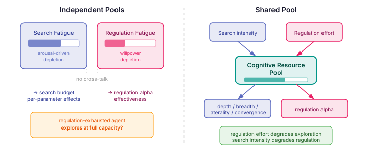
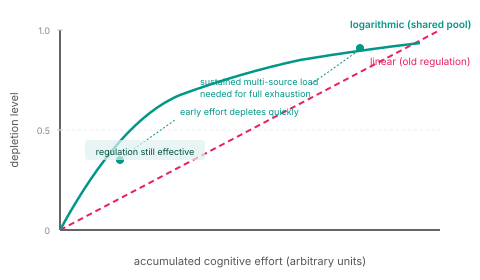

# One Brain, One Budget

In [Not Everything Breaks at Once](/2026-11-09-mdp04-not-everything-breaks-at-once), I described how different cognitive operations degrade at different intensities — laterality peaks before convergence, personality expression activates before performance decline. The search budget now has structured degradation: per-parameter peaks, per-parameter decay rates, a separate amplification threshold.

All of that models one system depleting itself. Search intensity accumulates fatigue, and that fatigue reshapes the search budget. Meanwhile, a completely separate system — emotion regulation — maintains its own fatigue tracker with its own pool, its own recovery rate, and no awareness that the search budget exists.

Two independent pools. Two separate models. One brain.

## The Theory Says They're Shared

The search fatigue model cites Hockey's (1997) Compensatory Control Model. Hockey's central argument is that organisms have limited processing capacity, and under sustained load, the cognitive system makes strategic trade-offs about where to maintain performance and where to let it degrade. This is the basis for the per-parameter signed effects — fatigue doesn't uniformly degrade everything, it reallocates.

But Hockey's model is about *total* cognitive effort from *all* sources, not just arousal-driven search intensity. If the agent is spending cognitive resources suppressing an emotion (Gross's 2015 process model: cognitive reappraisal is expensive, even response modulation has cost), those resources are unavailable for exploration. The prefrontal cortex doing heavy emotion regulation has fewer resources for the divergent thinking that laterality requires.

The regulation fatigue model cites Bosse et al. (2010) — willpower depletion from emotion suppression. Bosse models the cost of regulation as proportional to discrepancy from emotional baseline, with fatigue accumulating linearly and reducing regulation effectiveness over time. It doesn't claim this is an isolated resource. It models the fatigue of regulation specifically, but the resource it depletes could be shared.

Running these as independent pools contradicts both cited theories.

## The Implausible Scenarios

With independent pools, two scenarios are possible that shouldn't be:

An agent has been suppressing anger for ten consecutive ticks. Its regulation fatigue is near 1.0 — willpower effectively exhausted. Under the independent model, it explores at full cognitive capacity. It can make creative leaps, reason deeply, scan broadly, and converge decisively. Only its ability to regulate emotions is compromised.

An agent has been under sustained extreme motivation for fifteen ticks. Search fatigue is saturated — all four budget parameters are shifted by their maximum signed effects. Under the independent model, it regulates emotions at full effectiveness. Alpha is unchanged. Willpower is fresh. The fact that the agent has been cognitively maxed for fifteen ticks has zero effect on its capacity to suppress an emotion.

Neither of these is psychologically defensible.

## The Ego Depletion Question

Baumeister's (1998) ego depletion model proposed exactly this kind of shared resource — all self-regulation draws from one pool. The experiments showed cross-domain depletion: performing emotion regulation tasks degraded performance on subsequent cognitive control tasks.

Then Hagger et al. (2016) failed to replicate it. Twenty-three labs, over two thousand participants. The strong version — a single glucose-like resource that simply runs out — didn't hold.

But the failure wasn't "depletion doesn't exist." It was "depletion isn't a simple bucket." The effect is real but modulated by motivation, personality, and task type. Dang's (2018) meta-analysis still found a small but significant cross-domain effect.

This maps well to what we already have. The search fatigue model uses logarithmic accumulation — not a bucket that empties but a diminishing-returns curve where early effort costs more than later effort. The per-parameter effects are personality-derived. The system already handles the nuance that the strong ego depletion model missed.



## The Shared Pool

A `CognitiveResourcePool` — one accumulator per agent, fed by any cognitive effort source.

Search intensity contributes when arousal exceeds the extreme peak (the same threshold that triggers the Yerkes-Dodson decline). Emotion regulation contributes proportional to regulation effort — the Bosse discrepancy model, but flowing into the shared pool instead of a private tracker.

Consumers read the pool's depletion level and apply their own effects. The search budget applies its four signed per-parameter effects (depth, breadth, laterality, convergence) from `SearchFatigueEffects`. Emotion regulation reduces its effective alpha — the willingness to regulate declines as the pool depletes.



The logarithmic curve means early effort depletes quickly — a few ticks of combined search intensity and regulation effort produce noticeable degradation. But full exhaustion requires sustained multi-source load. An agent can be meaningfully depleted without being completely exhausted. At 0.8 depletion, regulation alpha is at 20% of baseline. The agent is *impaired*, not *broken*. This is more realistic than the old linear regulation model where fatigue marched steadily toward a hard collapse at 1.0.

Recovery follows a net-contribution model: each source independently signals recovery when idle. If the agent stops regulating but stays at extreme search intensity, the pool doesn't recover — one source's effort outweighs the other's rest. Full recovery requires all sources to be sub-threshold. An agent that rests from everything recovers. An agent that switches from one effortful activity to another doesn't.

## The Cross-System Effects

The interesting behavior is what emerges from cross-system coupling.

A fixated agent — sustained extreme motivation, compositeIntensity above extremePeak for many ticks — now also experiences degraded emotion regulation. The fixation doesn't just narrow the search budget; it erodes the agent's capacity to manage the emotions driving the fixation. This is a positive feedback loop: the fixation depletes the pool, the depletion impairs regulation, impaired regulation means emotions run hotter, hotter emotions sustain the fixation. Psychologically accurate, and something the independent model couldn't express.

An agent under emotional pressure — actively suppressing a strong reaction — now has fewer resources for exploration. The regulation effort contributes to the shared pool, and the search budget picks up the depletion through its per-parameter effects. The agent's breadth narrows. Its laterality drops. It becomes less creative and less exploratory precisely because it's spending cognitive resources managing its internal state.

These aren't configured behaviors. They're emergent from sharing a resource.

## The Personality Connection

The pool's capacity and recovery rate are personality-derived through the same `CognitiveDerivationEngine` pathway that derives everything else:

```
maxEffort    = 6 + conscientiousness × 8
recoveryRate = 0.3 + conscientiousness × 0.4
```

A conscientious agent sustains cognitive effort longer (higher capacity) and recovers faster (higher recovery rate). This compounds with the per-parameter effects that are also conscientiousness-sensitive — the conscientious agent not only has a deeper resource pool, it also reallocates more strategically under depletion.

The pool is an SPI. Two sources contribute today — search intensity and regulation effort. Future cognitive effort sources (decision fatigue from goal evaluation, cognitive load from complex BDI reasoning) can contribute without modifying the pool. The shared substrate is the foundation; what draws from it will grow.

## Why This Matters

Building cognitive agents that feel psychologically plausible without simulating neurons requires getting the macro-level resource dynamics right. Independent fatigue pools produce agents that can be emotionally exhausted but cognitively pristine, or intellectually depleted but emotionally unaffected. These combinations are computationally possible but humanly implausible.

A shared resource pool with personality-derived capacity, logarithmic depletion, and per-consumer effects produces agents that degrade the way the literature predicts: cross-domain interference, compensatory reallocation, personality-modulated resilience. The agent under pressure doesn't uniformly dim — it restructures, compensates, and eventually depletes across all effortful systems because they share the same limited resource.

Hockey called it compensatory control. The pool makes it concrete.
