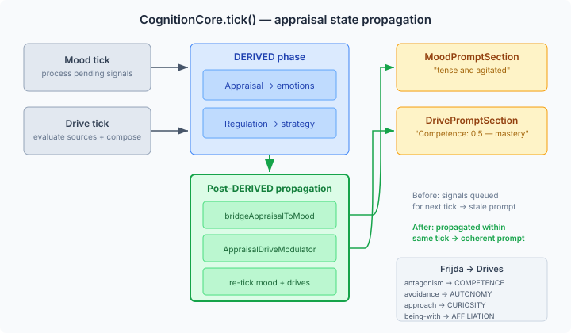

# When Emotions Go Nowhere

The appraisal system produces high-intensity distress. The regulation system selects attentional deployment. The mood section renders "You're feeling emotionally even." The drives show 0.1 across the board, labelled "stub."

That was the state of the pipeline coherence eval when I started this session. Score: 2 out of 5. The LLM judge correctly identified the contradiction: an agent feeling nothing while actively regulating overwhelming emotion.

The pipeline had all the pieces. Appraisal worked. Regulation worked. Mood worked. Drives worked. Each subsystem was individually correct. The problem was propagation — emotions entered the system and never reached the prompt sections that describe how the agent feels and what it wants.

## Three failures, one symptom

The first failure was timing. Appraisal runs in the DERIVED phase of CognitionCore.tick(). Mood ticks earlier. So when appraisal records a mood signal via `bridgeToMood`, the mood tick has already happened. The signal sits in a queue until the next tick cycle. By the time the prompt renders, mood hasn't processed it yet.

The second failure was structural. The test harness — which the eval uses — mocks the AppraisalTickParticipant. The real participant's tick() method calls bridgeToMood internally. But a mock's tick() is a no-op. The bridge lived inside the participant, so mocking the participant killed the bridge.

The third failure was the stubs. Three of four drive sources returned a static 0.1 with the trigger text "stub." No personality influence. No memory influence. No connection to the agent's disposition at all. Even with mood modulation, you can't get a coherent drive profile from a 0.1 base.

## The timing fix

The structural answer is straightforward: after the DERIVED phase (which runs appraisal and regulation), re-tick mood and drives. The appraisal's mood signals get processed immediately. The drives recompose with the updated mood. The prompt sections then render the current state, not the state from before the appraisal.

Eight lines of code in CognitionCore.tick(). But only after relocating the bridge from inside the participant to the orchestrator. CognitionCore reads the appraisal result via `currentResult()` — which works identically for real and mocked participants. The bridge is now the orchestrator's responsibility, not the participant's.

## Frijda's action tendencies as drive modulators

Timing and structure fixed the mood. Drives needed something different — a model connecting emotions to motivational states.

Frijda (1986) provides the mapping. His action tendencies describe what an emotion prepares the organism to do. Anger prepares for antagonism — overcoming an obstacle, asserting dominance. Fear prepares for avoidance — escaping, regaining control. Joy prepares for approach — exploring, engaging. Love prepares for being-with — bonding, connecting.

These map directly to Self-Determination Theory's four drives. Antagonism maps to COMPETENCE (mastery). Avoidance maps to AUTONOMY (self-determination). Approach maps to CURIOSITY (exploration). Being-with maps to AFFILIATION (connection). The mapping isn't arbitrary — Frijda's tendencies describe what the organism wants to do, and SDT's drives describe what motivates it. They're the same thing at different levels of abstraction.

The implementation is a lookup table. Each OCC emotion type maps to a primary drive boost (0.5 × intensity) and optionally a secondary boost or reduction. ANGER boosts COMPETENCE. SHAME boosts AUTONOMY and reduces AFFILIATION. GRATITUDE boosts AFFILIATION. Twenty-two mappings covering the full OCC taxonomy. Stacked additively when multiple emotions are active.

## Personality-derived drives

The stubs were the last piece. CuriosityDrive — the only real DriveSource — reads from MindMap via InformationGapDetector. The other three returned 0.1 with no personality influence.

We built MindMapDriveSource — a single generic DriveSource parameterised by axis. It follows the CuriosityDrive pattern: read drive-intensity nodes from the COGNITIVE subgraph (written by consolidation from personality and accumulated memories), fall back to personality baselines derived from disposition axes. A cooperative agent gets higher affiliation drive. A strict rule-follower gets higher competence drive. A high-autonomy agent gets higher autonomy drive.

The personality baselines are derived mechanically from DispositionAxes — the same derivation pattern that CognitiveDerivationEngine uses for regulation defaults, mood baselines, and search budgets. No LLM involved. The values sit in the 0.3–0.6 range — realistic enough for the Frijda modulator and mood modulation to produce meaningful shifts.

The trigger text matters too. "Competence: 0.5 — stub" tells the LLM judge nothing. "Competence: 0.5 — flexible rule-follower, moderate risk appetite — mastery orientation" tells it exactly how personality shaped this drive. The trigger comes from the consolidated MindMap node description when available, or from the disposition axes at cold start.

## The silent override

We found one more failure while debugging the eval. Issue #902 had added a 13-parameter `generate()` overload to the regulation generation phase. The tick participant calls this 13-param version. But the eval's stub overrode the old 12-param version. Java method dispatch routed to the parent class's 13-param implementation, which returned null because sessionPipeline was null. Regulation was silently absent from every eval scenario.

This is the kind of failure that doesn't crash, doesn't log, and doesn't show up in unit tests. The test assertion fails, but for a different reason — you attribute the low score to the stubs or the timing, not to regulation being entirely missing. We only found it by adding diagnostic prints to trace the actual code path.

The audit found two override sites with this mismatch. Both in eval tests. Both silently returning null since #902 landed.

## 2/5 → 4+/5

The pipeline coherence eval now scores 4 or 5 across all four scenarios. Moderate anger: mood shifts to "tense and agitated," competence drive elevates to 0.5, regulation selects cognitive change. High-intensity distress: mood shifts strongly negative, autonomy drive elevates, safety gate fires attentional deployment. Cross-tick drive stability: 5/5 — drives stay coherent over 5 ticks with stable observations.

The improvement came from fixing propagation, not from improving any individual subsystem. Every subsystem was already correct. The signals just weren't reaching the places that render the agent's internal state to the prompt. Emotions went into the appraisal and never came out the other side.

That's the lesson. In a multi-stage pipeline, correctness at each stage is necessary but not sufficient. The connections between stages — the timing, the data contracts, the override signatures — are where coherence lives or dies. An agent that feels nothing despite having just appraised overwhelming distress isn't broken in any one place. It's broken in the spaces between.
