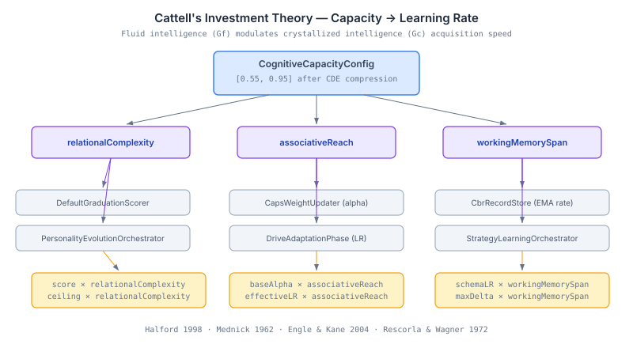
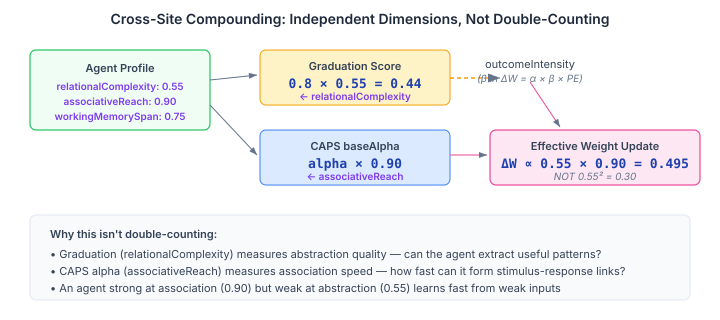

# Smarter Agents Learn Faster (And That's the Point)

In [The Gap Between Wanting to Think and Being Able To](/2026-11-09-mdp02-wanting-to-think-vs-being-able), I added three capacity dimensions — relationalComplexity, associativeReach, workingMemorySpan — that cap how far an agent's personality-driven exploration can productively reach. That gave us ceilings on the search budget: you can *want* to explore broadly, but if your working memory can't hold the context, the search degrades.

Ceilings on exploration are necessary but insufficient. Capacity should also affect what happens *after* the exploration — when the agent is consolidating what it found into lasting knowledge. An agent with higher fluid intelligence shouldn't just search better. It should learn from what it finds more effectively.

That's exactly what Cattell's Investment Theory predicts.

## Fluid Intelligence Invests in Crystallised Knowledge

Raymond Cattell (1971) proposed that cognitive ability has two components that develop asymmetrically. **Fluid intelligence (Gf)** — raw reasoning power — peaks in early adulthood and declines with age. **Crystallised intelligence (Gc)** — accumulated knowledge and skill — grows throughout life as long as Gf "invests" in learning.

The investment metaphor is precise: Gf is the rate of return on learning effort. Two people reading the same book learn different amounts because their Gf differs. The one with higher relational reasoning extracts deeper structure. The one with broader associative reach connects it to more existing knowledge. The one with larger working memory span evaluates its implications across more factors simultaneously.

For agent design, this translates directly: the three capacity dimensions should modulate learning rates, not just search boundaries.

## Six Sites, Three Dimensions, One Theory

The system has six places where agents learn or adapt, each with a numeric learning rate or adaptation ceiling:

| Site | What it learns | Current rate |
|------|---------------|-------------|
| CAPS weight updater | Stimulus-response associations | Rescorla-Wagner alpha |
| CBR outcome recorder | Case confidence from outcomes | EMA learning rate (0.2) |
| Drive adaptation | Motivational intensity | Config learning rate (0.05) |
| Strategy learning | Interaction strategy dimensions | Max delta ceiling (0.2) |
| Experience graduation | When experiences become knowledge | Graduation score |
| Personality evolution | Trait drift tolerance | L2 ceiling (0.15) |

The question is: which capacity dimension modulates which site? The answer comes from matching the cognitive substrate each site requires.



**Relational complexity** (Halford 1998) measures the depth of reasoning — how many relations-between-relations the agent can process simultaneously. It maps to:
- **Graduation scoring** — abstracting general knowledge from specific experiences requires seeing the relational structure across instances
- **Personality drift ceiling** — maintaining a coherent self-model under pressure requires holding the complexity of your own trait profile

**Associative reach** (Mednick 1962) measures the breadth of associative networks — how distant the connections an agent can bridge. It maps to:
- **CAPS weight learning** — Rescorla-Wagner prediction-error learning (`ΔW = α × β × (λ - V)`) is the textbook definition of associative learning. Higher associative reach means faster stimulus-response connection formation
- **Drive adaptation** — connecting drives to outcomes requires bridging motivational state to environmental feedback

**Working memory span** (Engle & Kane 2004) measures executive attention capacity — how many concurrent factors can be tracked. It maps to:
- **CBR outcome evaluation** — assessing whether a case succeeded requires holding the multi-factor outcome in working memory
- **Strategy adaptation** — tracking changes across multiple interaction dimensions simultaneously requires working memory for the parallel state

## The Formula: Simple by Design

Every multiplier site uses the same formula:

```
effectiveLR = baseLR × capacityDimension
```

Two sites (strategy learning and personality evolution) use a ceiling variant:

```
effectiveCeiling = baseCeiling × capacityDimension
```

The capacity range after derivation compression is [0.55, 0.95]. An agent at the floor learns at 55% of the base rate. An agent at the ceiling learns at 95%. The spread is modest — this is deliberate. Cattell's theory predicts proportional advantage, not qualitative threshold effects.

Why not something more sophisticated? Logarithmic scaling, asymmetric novel-vs-routine modulation, composite multi-dimension formulas? Because in the [0.55, 0.95] band, every reasonable function produces nearly the same curve. The choice of function matters less than the choice of dimension mapping. And a linear multiplier is the one formula that matches the existing modulation pattern — regulation scales by `(1 - depletion)`, drive adaptation already scales by `(1 - satisfaction)`. Capacity scales by the dimension value directly. Same mechanism, different semantic polarity.

## Where the Dimensions Cross

One subtlety matters: graduation score and CAPS alpha modulate the same pipeline. Graduation scores flow into the CAPS weight updater as the `outcomeIntensity` parameter (β). An agent with low relationalComplexity produces lower graduation scores, which become weaker β values, which combine with the agent's associativeReach-modulated alpha.



This is not double-counting. The two dimensions measure independent cognitive substrates. An agent with high associativeReach (0.90) but low relationalComplexity (0.55) learns associations quickly from weak inputs — it forms connections fast, but the quality of what it abstracts from experience is lower. An agent with the opposite profile — low associativeReach but high relationalComplexity — produces high-quality abstractions but integrates them slowly. Both profiles are coherent.

The compound effect for an agent uniformly low at 0.55 across both dimensions is `0.55 × 0.55 ≈ 0.30` — about 30% of the weight update of an uncapped agent. In the worst case from derived compression, that's the floor. It's still meaningful learning, just slower. And that's exactly what Cattell would predict: lower Gf means proportionally slower Gc acquisition, not zero learning.

## Why Trait Capacity, Not Dynamic State

The system already has `CognitiveResourcePool` tracking moment-to-moment depletion. Emotion regulation scales by `(1 - depletion)`. Search budget narrows under fatigue. Why doesn't learning rate also scale by depletion?

Because learning effects persist beyond the momentary cognitive state. An agent that's temporarily depleted but has high structural capacity should still produce high-quality learning — the quality of what it *can* learn is a trait, not a state. Depletion already affects input quality (via search budget narrowing) and regulation (via alpha scaling). Adding depletion to learning rate would triple-count it: once at the input gate, once at the regulation gate, once at the learning gate.

Trait-level capacity says: given the same input, how much does this agent learn? Depletion says: how much input reaches the learning process? Keeping them separate preserves the compositional structure. The agent's effective learning in context is the product of both — but each mechanism does its part independently.

## What This Means in Practice

An agent configuration with `relationalComplexity: 0.95, associativeReach: 0.60, workingMemorySpan: 0.85` would:
- Graduate experiences into knowledge at 95% of the base quality (good at abstraction)
- Form CAPS behavioural associations at 60% of the base speed (slow at pattern formation)
- Adjust CBR case confidence at 85% of the base rate (solid outcome evaluation)
- Adapt strategy dimensions within 85% of the base ceiling (good at multi-factor tracking)
- Tolerate personality drift up to 95% of the base ceiling (complex self-model)
- Adapt drive intensities at 60% of the base rate (slow motivational learning)

The profile has a clear character: a deliberate, analytical agent that forms high-quality knowledge but takes longer to develop new behavioural patterns. That's not something the personality model produces — personality drives the *desire* to behave a certain way. Capacity shapes the *ability* to learn from that behaviour.

## The 2-2-2 Balance

Each dimension modulates exactly two sites. This was a design choice, not a coincidence. The original mapping had three sites on relationalComplexity and only one on associativeReach — the CAPS weight updater was initially mapped to relationalComplexity ("cause-effect pattern depth"). A design review caught the mismatch: Rescorla-Wagner learning is associative by definition, not relational. Remapping it to associativeReach fixed the balance and improved the theoretical grounding.

When the system eventually needs composite dimensions — working memory AND relational complexity jointly affecting some site — the single-dimension mapping can extend without API changes. But for a first realization, one dimension per site keeps the theory testable. You can vary each dimension independently and observe exactly two sites change. If three changed, the mapping would be entangled and harder to validate.

---

*Cattell's Investment Theory enters the cognitive architecture. Six sites, three dimensions, one linear multiplier — capacity shapes how fast agents crystallise knowledge from experience. The theory predicted this in 1971. The implementation took six commits.*
