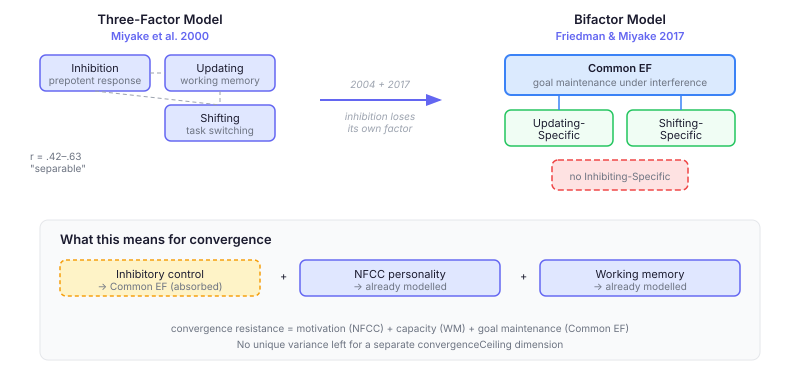
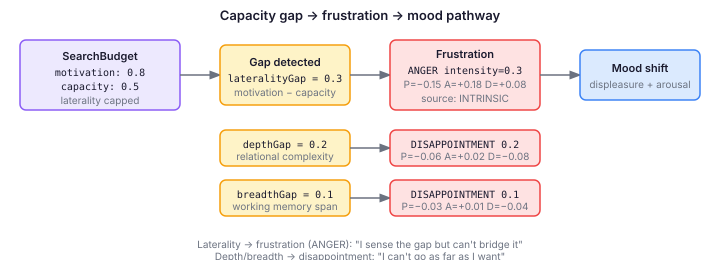

# The Dimension That Wasn't (And What We Built Instead)

In [Smarter Agents Learn Faster](/2026-11-10-mdp02-smarter-agents-learn-faster), I added capacity modulation to six learning sites — three dimensions from the intelligence literature, each scaling how fast an agent crystallises knowledge from experience. Three dimensions map cleanly to three search budget parameters: relationalComplexity → depth, associativeReach → laterality, workingMemorySpan → breadth.

That left convergence without a ceiling. The original plan, tracked since the capacity layer was designed, was to add a fourth dimension: inhibitory control, from Miyake et al. (2000). The rationale was straightforward — convergence resistance is about suppressing premature closure, and inhibitory control is the capacity to suppress prepotent responses. The mapping felt obvious.

I went to the literature to ground the derivation formula. The literature said no.

## The Paper That Changed Its Mind

Miyake et al. (2000) is one of the most cited papers in cognitive psychology. Using confirmatory factor analysis on 137 participants, it established that three executive functions — Inhibition, Updating, and Shifting — are moderately correlated (r = .42–.63) but clearly separable as latent factors. This was the foundation for treating inhibitory control as an independent cognitive capacity.

But Miyake and his colleague Friedman kept testing the model. In 2004, they showed that "inhibition" itself isn't one thing. Prepotent Response Inhibition (stopping yourself from doing the obvious thing) and Resistance to Distractor Interference (ignoring irrelevant input) correlate with each other but are unrelated to Resistance to Proactive Interference (letting go of previously relevant information). The term "inhibition" had been overextended.

Then in 2017, Friedman and Miyake introduced a bifactor model that replaced the original three-factor structure. The new model has a Common EF factor that predicts all nine tasks, plus Updating-Specific and Shifting-Specific residual factors. Inhibition has no unique factor. In multiple independent datasets, they couldn't extract one — Common EF explained all the correlations among inhibition tasks.

The Common EF factor reflects goal maintenance under interference — the ability to hold a task goal active when there's pressure to abandon it. That's what inhibition tasks require, and it's why they load entirely on Common EF without needing their own factor.

## What Convergence Resistance Actually Is

If inhibitory control isn't a separable capacity, what drives an agent's ability to resist premature closure?

Three constructs, all already in the system:

**Need for Cognitive Closure (NFCC)** is motivational, not structural. Kruglanski's research showed that high-NFCC individuals can process deeply when given accuracy incentives — the closure-seeking is a preference, not a capacity limitation. Roets and Van Hiel (2007) demonstrated this by separating the "ability to achieve closure" from the "need for closure" in the NFCS scale — the original Decisiveness subscale had been conflating both. NFCC is already modelled as a personality dimension driving `SearchBudgetConfig.convergence`.

**Working memory span** is structural. Kossowska (2007) found that working memory limitations create difficulty handling complex information, which in turn generates high NFCC as a compensatory mechanism. The causal direction is: capacity constraint → motivation toward closure. Working memory is already modelled via `CognitiveCapacityConfig.workingMemorySpan`, and it already affects convergence indirectly — an agent that can't hold multiple open frames will naturally converge earlier.

**Goal maintenance** is what Friedman and Miyake (2017) call Common EF. In the cognitive pipeline, goal maintenance is expressed through `DriveOrchestrator` (maintaining exploration goals against competing drives) and `CognitiveGoalOrchestrator` (progressive goal management). The agent's ability to maintain the "keep exploring" goal against the pressure to close is already part of the goal-drive interaction.

A fourth capacity dimension would model residual variance that the current consensus framework finds does not exist independently of these three components.

## What We Built Instead: Frustration

Closing the convergence ceiling issue didn't mean doing nothing. The epic's requirement was clear: "A curious agent with low associative reach will hit the laterality ceiling — the information gap is sensed but can't be bridged. This should produce frustration, not silent failure."

The three existing capacity dimensions already cap the search budget. When an agent's motivation exceeds its capacity, a gap value appears — the magnitude of the shortfall. Before today, those gaps were visible to the search budget prompt section but invisible to the emotion system. The agent hit its ceiling silently.

Now `AppraisalTickParticipant` reads the previous tick's `SearchBudget` and generates frustration emotions proportional to gap magnitude:

Laterality gaps produce ANGER (frustration in the OCC model — the information gap is sensed but can't be bridged). Depth and breadth gaps produce DISAPPOINTMENT (can't follow reasoning or pursue angles as far as desired). Both bridge to mood through the same intensity-weighted PAD pathway as observation-based appraisal.

The distinction matters. A laterality gap with associativeReach = 0.5 and motivation = 0.8 produces a 0.3-intensity frustration — displeasure plus arousal plus moderate dominance. The agent doesn't just search less widely. It feels the constraint. That frustration feeds back into the mood system, which feeds into the next tick's drive evaluation, which shapes the next search budget. The ceiling becomes part of the agent's affective experience, not a silent clamp.

## One Thing We're Watching

Friedman and Miyake's 2004 paper identified Resistance to Proactive Interference as dissociated from the other inhibition constructs. RPI is about suppressing previously relevant but now irrelevant information — a different mechanism from resisting closure or ignoring distractors.

In the cognitive pipeline, this would manifest as agents persisting with strategies that worked in earlier contexts but are no longer appropriate. Habituation tracks stimulus familiarity, but not strategy obsolescence. If eval traces surface agents stuck on outdated cognitive structures that habituation doesn't catch, RPI becomes a modelling question worth returning to.

No evidence yet. The issue exists so the signal has a place to land when it appears.

---

*A paper from 2000 grounded a design decision. The same authors' paper from 2017 ungrounded it. Instead of a fourth dimension, the system got frustration — capacity gaps that route through the emotion system and become part of the agent's felt experience. Sometimes the best outcome from engaging with the literature is discovering you don't need what you came for.*
