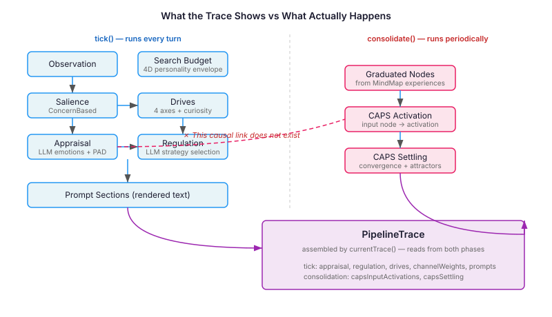
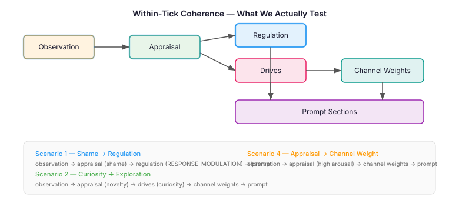

# The Trace That Lied

I had a straightforward plan. The cognitive pipeline produces a `PipelineTrace` after every tick — nine fields capturing the full processing state from appraisal through to prompt rendering. I wanted eval tests that would run a tick with a known observation, capture the trace, and use an LLM judge to score whether each stage's output was a coherent consequence of its predecessor. Shame observation goes in, shame appraisal comes out, suppression nodes activate in CAPS, regulation selects RESPONSE_MODULATION, prompt sections reflect the suppressed state. A causal chain you could follow from end to end.

The trace record made this look natural. Nine fields, neatly ordered:

```java
record PipelineTrace(
    AppraisalResult appraisalResult,
    Map<String, Double> concernSalience,
    Map<String, Double> capsInputActivations,
    CapsSettlingSnapshot capsSettling,
    EmotionRegulationResult regulationResult,
    ChannelWeightProfile channelWeights,
    HabituationState habituation,
    List<String> activatedDriveCategories,
    Map<String, String> promptSections
) {}
```

Appraisal at position one, CAPS at positions three and four, regulation at five. Read top to bottom, it tells a story: perceive, activate, settle, regulate, render. I built my test transitions around that story.

The story was wrong.

## What the Trace Assembles vs What Actually Flows

`BehavioralSynthesisPhase` implements `ConsolidationPhase`, not `CognitionTickParticipant`. It runs during consolidation — a periodic batch process that scans graduated experience nodes in the MindMap and settles them through the CAPS network. It does not run during `tick()`. When `CognitionCore.currentTrace()` assembles the trace record, it reads `lastInputActivations()` and `lastSettlingResult()` from whatever the *previous* consolidation produced. The CAPS data in positions three and four has nothing to do with the current tick's appraisal.



The trace presents nine fields as if they were nine stages in a pipeline. Seven of them are populated during `tick()`. Two of them are populated during `consolidate()`, which runs on a separate schedule, processes different data, and serves a different purpose. The `currentTrace()` method stitches them into one record because that's what observability consumers want — a single snapshot of everything the system knows at this moment. It makes no claim about causal flow. I made that claim, and it was wrong.

This is not a bug. `PipelineTrace` is doing exactly what it should — presenting the system's full cognitive state at a point in time. The problem is that a flat record with sequential field positions creates a strong visual suggestion of sequential processing. I read the record as a pipeline diagram and tested it as one.

## The Practical Consequence

Three of my four test scenarios had transitions through CAPS. Shame → suppression tested appraisal→CAPS activation→CAPS settling→regulation. Curiosity → exploration tested drives→CAPS activation→exploration attractor. Appraisal → channel weight tested appraisal→CAPS→channel weights. In each case, the CAPS fields would have been null or stale — data from a consolidation run that had nothing to do with the observation I'd just delivered.

Claude caught this during a design review. The finding was specific: `BehavioralSynthesisPhase` is stored via `configureBehavioralSynthesis(phase)`, which is a simple setter. It does not call `addParticipant()`. During `tick()`, CAPS never executes. The CAPS data in the trace is the residue of whatever consolidation did last — not a response to the current observation.

The fix restructured the eval around what actually happens within a tick. Appraisal, regulation, drives, channel weights, and prompt sections — these are all tick-time data with real causal connections. Observation triggers appraisal, appraisal triggers regulation, both feed into prompt rendering. That chain is real and testable.



CAPS coherence is a different question. It needs its own scenario with a different setup: seed the MindMap with graduated experience nodes, run consolidation, *then* tick and verify the trace reflects both data sources coherently. The coherence between CAPS and appraisal is valid to assess — the trace does present them together, and downstream consumers see them together — but the test setup has to acknowledge that they come from different phases with different inputs.

## The Broader Pattern

Every observability system faces this. Traces, spans, dashboards — they all assemble data from heterogeneous sources and present it in a unified view. The presentation necessarily suggests relationships that may or may not exist in the architecture. A distributed trace shows Service A calling Service B calling Service C, and the visual flow implies causality. But Service C might be reading from a cache that Service B populated hours ago. The trace shows temporal sequence; the reader infers causal sequence.

The defence is the same everywhere: test the actual architecture, not the observability view. The trace is a diagnostic aid. It shows you what to investigate. It does not tell you what caused what.

For the cognitive pipeline specifically, the lesson is that `PipelineTrace` is a snapshot, not a receipt. The `currentTrace()` method is an assembly point that gathers state from participants that ran at different times, in different phases, with different inputs. When you build tests against a trace, you need to know which fields share a causal origin and which merely share a record.

I still think the shame→suppression chain is worth testing end to end — observation drives appraisal, appraisal drives CAPS activation, CAPS settling drives prompt behaviour. But it takes two phases (consolidation then tick), and the test needs to be honest about that. The trace showing them side by side doesn't mean they happened side by side.
