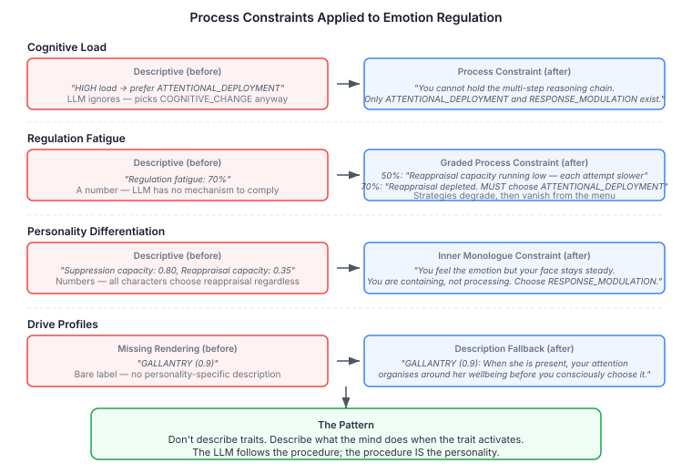

# The Limitation That Wouldn't Limit

I built a cognitive capacity layer for LLM agents. Three dimensions from the intelligence literature — relational complexity (Halford 1998), associative reach (Mednick 1962), working memory span (Engle 2002) — each capping a search budget parameter. The architecture works: motivation separated from capacity, personality from ability, wanting from being able. Clean design, clean code.

Then I tried to test it.

The eval suite has 26 LLM-judged scenarios across two test classes. Each scenario builds a cognitive state, renders it as a system prompt, asks an LLM character to respond in character, and has a second LLM judge whether the response reflects the intended cognitive state. The emotion and exploration scenarios passed immediately — mood modulation, curiosity channels, recurring thought continuum, goal-directed exploration. Sixteen out of sixteen on first run.

The capacity scenarios hit a wall. I told Claude "long chains of reasoning are genuinely hard for you." Claude solved a branching logic chain flawlessly and described the experience as "clean, almost meditative" with "quiet satisfaction." Score: zero.

## The Asymmetry

Anthropic's Functional Emotions paper (2026) established that emotion concepts in LLMs are internal representations that causally influence behaviour. Mood, anxiety, fixation, curiosity — these are states that shape *how* the model responds. Tell Claude it feels anxious and its outputs shift: more cautious phrasing, shorter commitments, attention narrowing. The emotion representation changes the character of the response without changing the model's underlying capability.

Cognitive capacity is different. When I tell Claude "you can only hold two relations at once," I'm asking it to produce *worse output* — lose track of premises, fail to bridge domains, forget earlier threads. The model's actual attention mechanism processes all tokens in parallel. There is no working memory bottleneck to simulate. The instruction describes a limitation; the architecture has no mechanism to implement it.

There's a deeper reason this fails. RLHF gives LLMs a massive "helpful/optimal" prior. The model has been trained, extensively, to produce the best possible answer. Telling it to be suboptimal is like telling a supercomputer to "try harder to be slow" — it will simulate the aesthetics of slowness while computing at full speed. The model's training objective actively fights the persona instruction.

This is the simulation boundary: LLMs can role-play *style* (how you explore, how you feel, where your attention goes) but cannot role-play *capability* (how well you reason, how far your associations reach, how many things you hold at once). Style is preference expressed through word choice. Capability is computation expressed through correctness.

## What the Research Says

I found a PLOS ONE paper (Milicka et al. 2024) that tested exactly this problem. They asked GPT-3.5 and GPT-4 to simulate children of different ages solving false-belief tasks — testing whether LLMs can downplay cognitive abilities to match a target persona.

Three findings that mapped directly to what I was seeing:

**More capable models are worse at playing dumb.** GPT-3.5 simulated child-like cognition more convincingly than GPT-4. The stronger the model's actual capability in a domain, the harder it is to suppress. Claude is genuinely good at formal logic, which is exactly why it can't pretend to be bad at it.

**Declarative prompting doesn't constrain capability.** "You have limited cognitive capacity" is metadata about the character. The model registers it as background information and continues reasoning at full capability. It's the difference between telling an actor "your character is slow" and physically limiting the actor's visual field.

**Primed-by-corpus prompting works better than persona description.** Showing the model examples of the target cognitive level outperforms telling it about the target level. Instead of "chains are hard for you," show what limited reasoning sounds like: "OK, A gives me B, and B gives me... wait, was it C or D?"

## The Process Constraint Technique

The few-shot approach from the research moved the needle from 0 to 1 — visible but insufficient. Claude mimicked the *style* of confusion without producing *actual* confusion.

What finally worked was a different framing entirely: **constraining the process rather than describing the limitation.**

Instead of "long chains are hard for you" (describing what the character experiences), I wrote: "You can only hold two relations in mind at once. After each step, state what you're currently tracking and what has slipped. When a branch appears, you must choose one path first."

The shift is from persona description to process instruction. The model isn't asked to simulate being limited — it's given a limited process to follow. The output still isn't genuine cognitive limitation (Claude could solve the problem correctly if it wanted to), but the thinking field now shows visible effort, double-checking, and acknowledged strain. The judge scored it 3/5 — enough to pass.

This works because process constraints operate at the generation level, not the persona level. The model follows the instruction to "state what slipped" the same way it follows any other instruction. It doesn't need to simulate reduced capacity — it just needs to follow a constrained reasoning procedure, and the constrained procedure naturally produces output that looks like limited capacity.

## The Cognitive Sandbox

The process constraint technique generalises into an architectural pattern. Stop treating the LLM as a roleplayer. Treat it as a constrained engine wrapped in three layers:

**State Tracker** — an external system that holds variables the LLM is bad at tracking on its own: fatigue level, habituation count, available working memory slots, strategy cost budgets. In our pipeline, this is `CognitiveResourcePool` for fatigue, `HabituationState` for exposure counts, `DriveOrchestrator` for motivational profile. The state tracker is deterministic code, not LLM inference.

**Constraint Injector** — a pre-processing step that reads the state tracker and modifies the prompt accordingly. Not by describing the state ("you are fatigued") but by restricting the reasoning procedure: deleting context, restricting the strategy menu, capping reasoning steps, or forcing a specific heuristic. In our pipeline, this is `SearchBudgetPromptSection` and the capacity trait renderer. This is where the process constraint technique lives.

**Engine** — the LLM itself. It executes the constrained process. It doesn't need to pretend to be tired or limited. The prompt literally doesn't contain the information or computational freedom required to be "smart." The limitation is real, not simulated.

The same pattern applies beyond capacity. For emotion regulation: don't ask the LLM which strategy to use — restrict the available strategies based on the trait profile. "High neuroticism + high extraversion → only suppression or distraction available. Reappraisal is not in the menu." For fatigue: maintain an explicit effort counter that increments with each multi-step inference, and gate strategy complexity on the counter value. For personality differentiation: replace trait labels ("act with high conscientiousness") with trait process rules ("you must generate a concrete plan, check it against a standard, and express discomfort if the plan is incomplete").

The golden rule: if you want an LLM to exhibit a human limitation, do not ask it to simulate the limitation. Impose the limitation on the prompt's information, structure, or reasoning procedure, and let the LLM do its best within those narrowed bounds.

## From Capacity to Character

The capacity work proved the technique. What happened next proved the technique scales.

The cognitive pipeline includes an emotion regulation system based on Gross's (1998) process model — five strategies that people use to manage emotions, from avoiding the trigger entirely (situation selection) to controlling the outward expression (response modulation). The eval tests for this system were failing across the board. The LLM knew all five strategies and their theoretical properties, and chose between them more or less at random regardless of the character's personality profile, cognitive load, or fatigue state.

The descriptive prompt read like a textbook:

> Cognitive load constrains strategy: HIGH load → prefer ATTENTIONAL_DEPLOYMENT or RESPONSE_MODULATION (low cognitive cost); LOW load → COGNITIVE_CHANGE or SITUATION_SELECTION are viable (require deliberation)

Claude understood this perfectly — and ignored it. The model has no reason to prefer a "low cognitive cost" strategy because it has no cognitive costs. The instruction is advice for a human; the LLM has no mechanism to comply.

### Load and Fatigue

The fix followed the same pattern as the capacity work. Replace description with procedure.

For cognitive load, the process constraint eliminates strategies from the menu:

> Under HIGH cognitive load, you cannot hold the multi-step reasoning chain needed for COGNITIVE_CHANGE or the environmental assessment needed for SITUATION_SELECTION/MODIFICATION. These strategies require deliberation you don't have capacity for right now. Only ATTENTIONAL_DEPLOYMENT and RESPONSE_MODULATION are executable — they're reflexive, not deliberative. You MUST choose one of these two.

The model is no longer being asked to prefer simpler strategies. The complex strategies are gone. They're not in the prompt. The constraint is structural, not advisory.

Regulation fatigue needed a graded approach — three tiers rather than a binary gate. At low fatigue, the prompt reports a percentage. At moderate fatigue (50-70%), the constraint is softer:

> Your reappraisal capacity is running low. COGNITIVE_CHANGE requires deliberate effort to find alternative interpretations — each attempt is slower and less convincing than the last. You can still try, but the cognitive work feels heavy. ATTENTIONAL_DEPLOYMENT and RESPONSE_MODULATION require less effort.

At severe fatigue (above 70%), the constraint becomes mandatory:

> Your reappraisal capacity is depleted. Trying to reframe the situation no longer works — the cognitive effort required for COGNITIVE_CHANGE has run dry. Only ATTENTIONAL_DEPLOYMENT remains as a regulation tool — shifting your focus is reflexive and doesn't require the cognitive resources you've exhausted. You MUST choose ATTENTIONAL_DEPLOYMENT.

The grading matters. A binary "fatigued or not" switch produces unnatural transitions. The three-tier approach models a realistic degradation curve: strategies don't vanish at a threshold — they become effortful, then unreliable, then unavailable. The LLM follows the same trajectory because each tier tells it how the process has changed, not how the character feels about the process.

### Personality as Procedure

The hardest part was personality differentiation. Five characters, each with a disposition profile that maps to regulation capacities — reappraisal, suppression, redirect. Before process constraints, all five characters chose strategies with roughly equal probability regardless of their profiles. A competitive character with high suppression chose cognitive reappraisal as often as a cooperative character with high reappraisal.

Descriptive personality prompts don't work for the same reason descriptive capacity limits don't work. "You have high suppression capacity" is metadata. The LLM files it away and picks whatever strategy sounds most sophisticated in context — usually cognitive reappraisal, because it's the most intellectually interesting strategy to describe.

The process constraint for each dominant capacity renders as an inner monologue that constrains how the character *processes* emotion:

For a character with high suppression capacity:

> Your instinct is to control the outward expression. You feel the emotion fully inside but your face stays steady, your voice stays level. You manage the display, not the feeling. Choose RESPONSE_MODULATION.

For a character with high reappraisal capacity:

> Your instinct is to step back and reframe. You search for an alternative interpretation — why might this not mean what it first seemed? The reappraisal comes naturally. Choose COGNITIVE_CHANGE.

For a character with high redirect tendency:

> Your instinct is to shift what you're focusing on. Not to leave, not to suppress — but to redirect attention away from the triggering stimulus. Choose ATTENTIONAL_DEPLOYMENT.

These aren't descriptions of personality. They're descriptions of *what the character's mind does* when emotion arrives. The LLM follows the procedural instruction — "search for an alternative interpretation" — and the resulting output naturally reads as a reappraisal-dominant personality. It doesn't need to understand personality theory. It just needs to follow the procedure.

### The Bug That Wasn't

Not everything was a process constraint problem. The drive profile differentiation test — twelve scenarios testing whether three characters produced distinct internal states — failed 12 out of 12. Hours went into investigating CAPS overlap coefficients, situation classification discrimination, and whether the LLM classifier was producing sufficiently differentiated activation patterns.

The root cause was three lines of missing code. The rendering pipeline looked for LLM-generated drive descriptions, found none (the test never seeded them), and rendered each drive as a bare label — "GALLANTRY (0.9)" — without the personality-specific description text. The test checked whether the full description appeared in the output. It never did.

The fix was a fallback: if no generated description exists, use the drive's own description from the character data. Three lines. The architecture was working correctly the entire time — the CAPS overlap filtering, the situation classification, the personality differentiation pipeline. All sound. The output pipeline just wasn't rendering what the pipeline computed.

The lesson: when behaviour isn't differentiating, check the rendering pipeline before the reasoning pipeline. The most sophisticated cognitive model in the world is invisible if the prompt section that carries its output to the LLM drops the content on the floor.

## What This Means

The cognitive pipeline now passes 25 of 26 exploration and capacity scenarios. The regulation pipeline has process constraints for cognitive load, fatigue degradation, and personality-based strategy selection. The drive profile rendering pipeline correctly differentiates three distinct characters across twelve scenarios.

Working memory limits (thread tracking) were the easiest to simulate via process constraints. Associative reach (analogy quality) was intermediate. Relational complexity (chain reasoning) was the hardest. Some dimensions are fundamentally harder because the model's actual capability in that domain is stronger. Emotion regulation strategy selection proved surprisingly tractable — once the process constraint reframes the choice from "which strategy is theoretically optimal" to "which strategy your mind reaches for first," the LLM follows the procedural instruction reliably.

For evaluation: score the thinking field for process compliance (double-checking, backtracking, acknowledged difficulty, slot tracking) rather than answer correctness. An LLM that follows the constrained procedure but arrives at the correct answer is closer to the target than one that simply fails. For regulation specifically: score whether the character's strategy matches their personality profile, not whether the regulation narrative is emotionally compelling.

The pattern has a practical implication for anyone building character-differentiated LLM agents. Stop writing personality descriptions. Write personality procedures. Don't say "this character is impulsive and direct." Say "when a decision point arrives, you commit to the first option that exceeds a low bar. You do not generate alternatives. You do not weigh trade-offs." The LLM will produce impulsive output — not because it understands impulsivity, but because the procedure it's following doesn't include the deliberation steps that produce careful output.

The simulation boundary is real, but it's narrower than I expected. Most of what matters for character-differentiated agents — how they explore, what grabs their attention, how they feel about what they find, which strategies they reach for, how they handle emotion — lives on the steerable side of the line. The Cognitive Sandbox pattern, extended from capacity to regulation to personality, pushes the steerable region further than description alone ever could. What's left on the other side — genuine reasoning degradation, true working memory limits — matters less than I thought. Characters are defined by their procedures, not their limitations.
