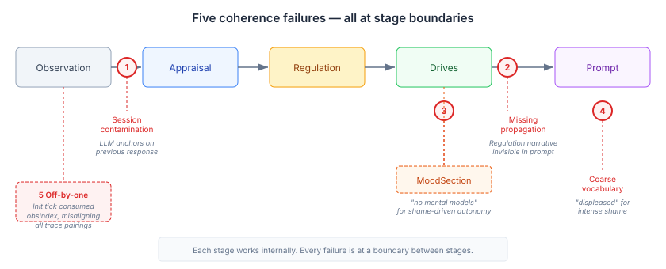
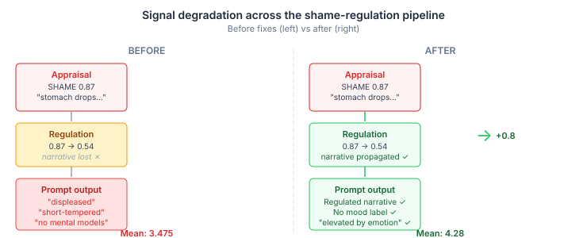

# The Stage That Couldn't Hear the Last One

*Continues from [The Limitation That Wouldn't Limit](2026-11-11-mdp01-the-limitation-that-wouldnt-limit.md).*

A cognitive pipeline has seven stages. Each one works. The appraisal stage detects shame at 0.87 intensity and writes a narrative about stomachs dropping and faces burning. The regulation stage reads that shame, applies attentional deployment, and reduces the intensity to 0.54. The drive system modulates autonomy upward in response to the threat. Each stage does its job.

Then you read the final prompt — the thing the LLM agent actually sees — and it says "You're feeling displeased. You're more guarded and short-tempered." For shame at 0.87 intensity with a friend's betrayal. "Displeased."

The problem was never inside any stage. Every stage was coherent with its own inputs and computationally correct. The signal just kept degrading at the boundaries between them — five different failure modes, five different boundaries, all invisible until we built an eval that scored each transition independently.

## What cross-stage coherence actually means

Multi-stage LLM pipelines are everywhere now. RAG retrieval → reranking → generation. Tool selection → execution → response synthesis. Agent planning → action → reflection. Each stage gets its own tests, its own evals, its own monitoring.

Cross-stage coherence is a different question. Not "does each stage work?" but "when stage B receives stage A's output, does B's output make sense given A's input?" It's the coherence of the seam, not the panel.

Our cognitive pipeline runs: observation → appraisal → regulation → mood/drives → prompt sections. An LLM evaluates each transition independently — "given this input and this output, is the transition coherent?" — on a 0-5 scale. Four scenarios. Gate at 4.0 mean. A two-tier judge (Haiku screens, Opus adjudicates the ambiguous middle) for calibration stability.

Three out of four scenarios failed. All the failures were at boundaries.

## Five failure modes — none within a stage

### 1. Session contamination

The appraisal LLM uses a `SessionPipeline` — a managed session pool where each agent gets its own session. Per-agent isolation was the right design: agent A's personality shouldn't bleed into agent B's appraisals.

But sessions accumulate conversation history across ticks. When the same agent processes ten observations in sequence, the LLM sees all previous observation-response pairs. By tick 5, the appraisal narrative is anchoring on its own previous response, not the current observation. The trajectory judge called it: "Tick 2's narrative discusses the Tick 1 compliment, not Tick 2's project opportunity. This pattern holds for all 10 ticks."

The fix was a single enum: `ClearingPolicy.EVERY_CALL`. The session stays alive (no pool churn), but conversation history clears before each query. The system prompt still provides personality context. Each appraisal processes only its current observation.

The interesting part: the lag was perfectly consistent — exactly one tick behind, every time. It looked like a pipeline ordering bug but was actually the LLM's own conversational anchoring bias exploiting the session accumulation.

### 2. Coarse vocabulary

Mood is a running aggregate. When the appraisal produces SHAME (0.87, PAD pleasure=-0.80, arousal=0.07), FEAR (0.84, PAD pleasure=-0.59, arousal=0.42), and REPROACH (0.86, PAD pleasure=-0.70, arousal=-0.06), the mood bridge computes a weighted-average PAD value. The pleasure axis lands around -0.70. The arousal axis — because shame's arousal is near-zero and reproach's is slightly negative — averages out to about -0.10.

Then `MoodPromptSection` maps that to a label: pleasure < -0.3, arousal not extreme → "displeased." Add the behavioural colouring for negative pleasure: "more guarded and short-tempered."

The math is right. The PAD model is working exactly as designed. And the result is catastrophically misleading — "displeased and short-tempered" for a character experiencing public betrayal, paralysing shame, and the desire to disappear.

The fix followed existing precedent. `CharacterDrivePromptSection` was already suppressed when appraisal is active — the rationale being that the appraisal narrative provides richer emotional state than the coarser section. `MoodPromptSection` had the same problem for the same reason. One condition: `&& !appraisalActive`. The rich narrative stays. The misleading label disappears.

### 3. The serialization off-by-one

This one was devious. The cross-tick trajectory test runs an init tick (null observation, baseline mood) followed by ten observation ticks. The `PipelineSnapshotStore` captures a trace at every tick. The trajectory serializer iterates chronologically, pairing each trace with the next observation in the list.

The init tick produces a trace — mood and drives run even without an observation. But the serializer's `obsIndex` counter advances for it. Observation 0 pairs with the init tick's trace (which has no appraisal). Observation 1 pairs with the trace that actually processed observation 0. Every pairing is off by one.

The judge reports a "systematic one-tick lag" — the same symptom as the session contamination — but from an entirely different cause. We fixed the session contamination, ran the tests, and the judge still reported the lag. The actual pipeline was producing correct, tick-aligned output. The test was misreading it.

One line: `if (trace.appraisalResult() == null) continue;` — skip snapshots from the init tick. The lag vanished.

I'd looked at this "one-tick lag" from three angles before finding the serialization bug. The session contamination was real and worth fixing, but it wasn't the only cause of the symptom. When two different bugs produce the same observable, you fix the first one and declare victory, and the second one survives.

### 4. Missing propagation

The regulation stage computes a result: strategy ATTENTIONAL_DEPLOYMENT, intensity 0.87 → 0.54, effectiveness 0.38, and a narrative describing the character holding themselves together behind "deliberate inattention." The result is stored in `EmotionRegulationTickParticipant.results`.

`AppraisalPromptSection` reads from `AppraisalTickParticipant.currentResult()`. The regulation result sits in a different participant. No prompt section reads it. The regulation's entire effect — the reduced intensity, the coping strategy, the post-regulation narrative — is invisible to the LLM agent.

The fix: `EmotionRegulationTickParticipant` calls `setRegulatedNarrative()` on the appraisal participant after computing its result. `AppraisalPromptSection` checks for a regulated narrative and prefers it when present. The raw appraisal stays available for trace capture and pipeline processing. Only the prompt rendering sees the regulated state.

This was the highest-impact fix. The shame-regulation scenario's regulation→prompt transition went from 2.8 to 4.5 — the largest single improvement across all the work.

### 5. Trigger text mismatch

`DriveComposer` takes raw drive values, applies mood and personality modulation, applies appraisal modulation, clamps to [0, 1], and outputs a `DriveIntensity` with an intensity and a trigger string — a human-readable explanation of why the drive is at that level.

The appraisal modulation for shame is significant: AUTONOMY +0.855 (from SHAME + FEAR mapping to escape/control). The intensity changes. But the trigger text comes from the raw drive source: `new DriveIntensity(axis, intensity, raw.trigger())`. The source's trigger is "no mental models" because `AutonomyDrive` found no mental model data. After modulation, the drive reads: "Autonomy: 1.0 — no mental models."

The judge sees this and scores it as a contradiction: "Autonomy at 1.0 directly contradicts the appraisal's dominance values of -0.35 and -0.48. The 'no mental models' annotation reveals this is an unmodulated default." The annotation is wrong, but the judge can't know that.

The fix: when appraisal modulation exceeds ±0.2 for any axis, override the trigger text with "elevated by emotional response" or "dampened by emotional response." The intensity was always right. The explanation was lying about why.

## What's fixable and what's not

Six fixes total. Three production code changes (session clearing, regulation propagation, drive trigger text), two architectural decisions (mood suppression, appraisal prompt preference), one test bug (serialization).

The shame-regulation scenario went from 3.475 to 4.28. It passes. The appraisal-channel-weight scenario went from 2.3 to 3.5. Close, but the first transition depends on which emotions the SEC→OCC mapper selects — DISTRESS and SHAME for a security breach instead of the expected FEAR. That's not a wiring bug, it's a taxonomy question. The curiosity scenario scores 0.4 on appraisal→drives because JOY(0.29) produces only a +0.07 curiosity delta — the modulator needs HOPE or INTEREST to produce meaningful activation, and those emotions don't emerge from the current SEC mapping for novelty.

The remaining failures are about the quality of the LLM's emotional output — which emotions it picks, how it calibrates arousal, whether it can recover from negative states across a ten-tick trajectory. These are real problems, but they're a different class. Wiring bugs you can find and fix deterministically. LLM output quality you improve probabilistically through prompt engineering and evaluation feedback.

The line I'd draw: if the pipeline's plumbing loses signal at a boundary, that's a coherence engineering problem and it has a solution. If the LLM produces the wrong signal in the first place, that's an evaluation and prompt design problem — still solvable, but the tools are different.

## The deeper pattern

Every coherence failure I found was at a boundary. Not "roughly near a boundary" — exactly at the handoff point where one stage's output becomes another stage's input. Inside each stage, the engineering was correct. The LLM produced rich narratives. The PAD math was right. The modulation formulas were sound. The plumbing between them dropped signal in five different ways.

This generalises. Any multi-stage LLM pipeline — RAG, agents, cognitive architectures — has the same risk. Each stage gets tested in isolation. The transitions between stages are where the information gets lost, contradicted, or misaligned. And the symptoms are deceptive: a "one-tick lag" that's actually two bugs (session contamination AND serialization), a "wrong emotion" that's actually correct math with misleading labels, a "missing regulation" that's actually present but unrendered.

The eval framework that caught this — per-transition coherence scoring with an LLM judge — is the thing I'd advocate for any multi-stage pipeline. Not "does the final output look right?" but "does each handoff preserve what the previous stage computed?" When you score transitions individually, the boundary failures become visible. When you only score the final output, you're debugging in the dark.
