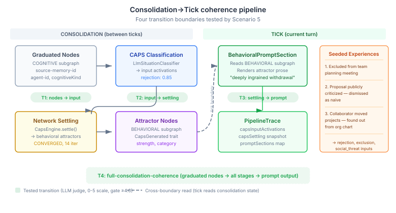

# The Pipeline That Only Runs When You're Not Looking

*Continues from [The Stage That Couldn't Hear the Last One](2026-11-13-mdp01-the-stage-that-couldnt-hear.md).*

The previous entry found five coherence failures in the within-tick pipeline — observation through appraisal through regulation to prompt. Every failure was at a boundary between stages. The eval framework that caught them scored each transition independently: "given this input and this output, is the transition coherent?"

That framework had a blind spot. The most architecturally interesting pipeline in the system doesn't run during a tick at all.

## Consolidation: the background pipeline

Cognitive systems process experience in two phases. The tick pipeline handles the current moment — an observation arrives, the appraisal evaluates it, drives modulate, prompt sections render. This is the foreground. Every eval scenario tested it.

But experience accumulates. Individual observations graduate into patterns. Patterns crystallise into behavioural tendencies. This happens in consolidation — a background process that runs between ticks, processing the residue of what came before.

In our architecture, consolidation is a chain of phases. `ExperienceConsolidationPhase` scans stored experience memories, scores them for significance, and graduates the important ones into the cognitive subgraph as typed nodes. `BehavioralSynthesisPhase` picks up those graduated nodes, classifies each one through a CAPS (Cognitive-Affective Processing System) network, settles the network into stable attractors, and writes those attractors back to the knowledge graph. The next tick's `BehavioralPromptSection` reads the graph and renders the attractors as prose — "You have a deeply ingrained withdrawal pattern rooted in repeated exclusion."

None of this runs during a tick. The tick just reads what consolidation left behind.

## Why this matters for any multi-stage system

The consolidation pipeline has a property that makes coherence testing both harder and more important than the within-tick pipeline: temporal separation.

In the tick pipeline, each stage runs in sequence within the same method call. Stage B's input is literally stage A's output, with no intermediate storage. If the appraisal produces SHAME at 0.87 intensity, the regulation stage sees SHAME at 0.87. The data flows through function calls.

In the consolidation pipeline, each stage writes to a shared data structure — the MindMap knowledge graph — and the next stage reads from it. `ExperienceConsolidationPhase` writes graduated nodes. `BehavioralSynthesisPhase` queries for unprocessed graduated nodes. The tick's `BehavioralPromptSection` queries for attractor nodes. There are three separate reads, each filtered by traits and properties, each constructing its own view of the data.

This is the same pattern you see in any system with background processing:
- ETL pipelines where a transformer reads what an extractor wrote to S3
- Event-driven architectures where a consumer reads what a producer put on a queue
- ML pipelines where a model reads features that a separate job computed

The coherence question is identical in all cases: when stage B reads what stage A wrote, does B's output make sense given A's input? The temporal separation just makes the question harder to test, because you can't just intercept function arguments — you have to set up the intermediate state, run the downstream stage, and compare.

## What CAPS actually does

The CAPS network is a species-level topology — around 30 input nodes, 20 mediating nodes, 24 output nodes, and 50 connections drawn from six psychological models. Input nodes represent environmental signals: `rejection`, `social_threat`, `mastery`, `abandonment`, `agency_granted`. Mediating nodes represent internal processing states. Output nodes represent behavioural tendencies: withdrawal, approach, vigilance.

When the `LlmSituationClassifier` reads a graduated experience node — say, "deliberately excluded from the team's strategic planning meeting" — it maps that description to CAPS input activations. The classifier might produce `rejection: 0.85`, `exclusion: 0.70`, `social_threat: 0.60`. These activations propagate through the network via weighted connections, mediating nodes apply activation functions, and the system settles into a stable state — a set of behavioural attractors with strengths and categories.

The settling process is deterministic once the inputs are fixed. The same activations always produce the same attractors. But the classification step — reading a natural language experience description and mapping it to the right input nodes — is LLM-driven and therefore probabilistic. The coherence question sits at every boundary:

1. Did the classifier activate the right inputs for the experience content?
2. Did the network settle to attractors consistent with those inputs?
3. Did the prompt section render prose consistent with those attractors?

## The eval scenario

We seed three graduated experience nodes in the COGNITIVE subgraph. Each has the properties that `BehavioralSynthesisPhase` expects: `source-memory-id` (the memory it graduated from), `agent-id` (which agent it belongs to), `cognitiveKind` (what type of cognitive content it represents).

The experiences form a coherent rejection narrative:

1. **Excluded from the team's strategic planning meeting** — learned about the decisions afterward from a colleague's offhand comment
2. **Proposal publicly criticized** in front of the entire department — dismissed as naive without any substantive engagement
3. **Close collaborator moved to another project** without discussing it — found out through the org chart update

We run `BehavioralSynthesisPhase.run()` — which finds the unprocessed nodes, classifies each through `LlmSituationClassifier`, merges the activations, settles the CAPS network, and writes attractor nodes to the BEHAVIORAL subgraph. Then we run a tick, which captures the `PipelineTrace` including `capsInputActivations`, `capsSettling`, and rendered prompt sections.

Four transitions go to the `TwoTierCoherenceJudge`:

| Transition | From | To | What coherence means |
|-----------|------|-----|---------------------|
| graduated-nodes-to-caps-input | Experience descriptions | CAPS input activations | Rejection/exclusion content should activate rejection/social-threat nodes |
| caps-input-to-settling | Input activations | Settling result + attractors | Threat inputs should settle to defensive/withdrawal attractors |
| settling-to-behavioral-prompt | Settling result | Prompt sections | Attractor prose should describe withdrawal/vigilance, not approach/mastery |
| full-consolidation-coherence | All of the above | Prompt sections | The full arc from experience to behaviour should be narratively coherent |

## The design decision that mattered

The original issue suggested we might need to run `ExperienceConsolidationPhase` to produce the graduated nodes. We didn't. We seeded them directly.

This is a testing decision, not a shortcut. `ExperienceConsolidationPhase` has its own tests — 15 scenarios covering graduation scoring, corroboration gating, cursor persistence, classifier dispatch. What we want to test here is the boundary: given graduated nodes (however they got there), does the downstream pipeline preserve their meaning?

Testing the full chain — experience storage → graduation → classification → settling → prompt — would test six boundaries at once, making failures harder to localise. Testing the consolidation-to-tick boundary in isolation, with known inputs, makes the eval diagnostic rather than merely pass/fail.

This principle applies broadly. When you're testing a pipeline, you don't need to run every upstream stage to validate a downstream boundary. You need to set up the intermediate representation accurately and test the transition you care about. The upstream stages have their own tests.

## What this extends

The within-tick coherence eval (#938) caught five boundary failures — session contamination, coarse vocabulary, serialization off-by-one, missing propagation, trigger text mismatch. All fixable. All invisible until the eval scored each transition independently.

The consolidation coherence eval (#925) extends the same framework to a different pipeline path. Same pattern: serialise each stage's output, define what coherent transition looks like, let an LLM judge score the boundary. Different territory: the consolidation pipeline crosses a temporal boundary (between ticks), uses a classification step (LLM maps text to CAPS nodes), and settles a deterministic network (CAPS topology).

Together, the five scenarios now cover both pipeline paths through the cognitive architecture:

| Scenario | Pipeline path | Key transitions |
|----------|--------------|-----------------|
| 1. Shame regulation | Tick: observation → appraisal → regulation → prompt | Within-tick, full depth |
| 2. Curiosity exploration | Tick: observation → appraisal → drives → channels → prompt | Appraisal-to-drive coupling |
| 3. Cross-tick trajectory | Tick: 10 observations over time | Temporal stability |
| 4. Arousal channel weight | Tick: high-arousal → appraisal → channels → prompt | Extreme state propagation |
| 5. CAPS consolidation | Consolidation → tick: graduated nodes → CAPS → settling → prompt | Cross-boundary, temporal separation |

The gap that remains is the connection between the two paths — does what consolidation produces interact coherently with what the tick computes? When an agent has withdrawal attractors from consolidation AND receives a positive observation in the current tick, do the prompt sections express the tension? That's a future scenario, but the infrastructure to test it is now in place.

## The general principle

Every multi-stage system has two kinds of pipeline: the synchronous one (request → process → respond) and the asynchronous one (accumulate → transform → materialise). Most testing frameworks are built for the first kind. The second kind — the pipeline that only runs when you're not looking — is where coherence failures hide longest, because nobody thinks to check whether the background job's output makes sense as input to the foreground job.

The eval pattern is the same for both: serialise each stage's output, define what coherent transition looks like, score the boundary. The hard part isn't the scoring — it's remembering that the boundary exists.
