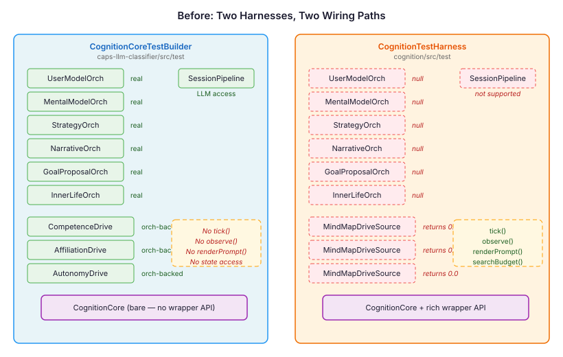
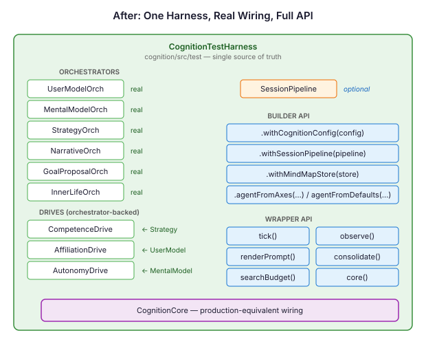

# The Null That Passed Every Test

We had two test harnesses for building `CognitionCore`. One wired real orchestrators. The other passed null for seven of them. Both had tests that passed. One of them was proving nothing.

This is not a story about a bug. Every test did exactly what it claimed to. The problem was what the tests didn't claim, and couldn't — because the system they tested doesn't exist in production.

## Two Harnesses, One Pipeline

The cognitive pipeline in neocortex has a lot of moving parts. `CognitionCore` takes a mood orchestrator, a drive orchestrator, and seven optional orchestrators that handle user modelling, mental models, strategy learning, narrative identity, goal proposal, inner life, and memory hygiene. In production, CDI wires all of them. In tests, someone has to construct the graph by hand.

Two test utilities grew to handle this. They lived in different modules, served different test populations, and made different compromises.

`CognitionCoreTestBuilder` lived in `caps-llm-classifier`. Static factory methods, four overloads. It wired every orchestrator — UserModel, MentalModel, Strategy, Narrative, Goals, InnerLife, Hygiene — backed by in-memory CBR stores. It accepted a `SessionPipeline` for LLM-backed orchestrators. It returned a bare `CognitionCore`, leaving callers to drive `tick()` directly. Nine eval test files used it, eighteen call sites total.

`CognitionTestHarness` lived in `cognition`. Fluent builder, rich wrapper API. It provided `tick()`, `observe()`, `consolidate()`, `renderPrompt()`, `searchBudget()`, state injection, continuum position control. It configured disposition-derived personality via `agentFromAxes()`. Eight test files used it for search budget, curiosity, recurring thoughts, and appraisal propagation tests.

But `CognitionTestHarness` passed `null` for all seven optional orchestrators. And it used `MindMapDriveSource` instead of real drives — a production fallback that reads drive intensity from MindMap graph nodes. With an empty graph, every drive returned 0.0.



The split was pragmatic. The harness tests didn't need orchestrators — they tested drives, mood, curiosity, search budget. The eval tests didn't need lifecycle methods — they drove `core.tick()` directly. Each harness gave its callers exactly what they needed and nothing more.

The problem is what "nothing more" silently included: a cognitive pipeline configuration where seven subsystems don't participate and three drives report zero intensity at all times.

## What Null Orchestrators Actually Test

Consider what happens when a test runs `CognitionCore.tick()` with null orchestrators. The tick proceeds through its phases — FOUNDATION, SOURCE, DERIVED, TERMINAL. Each phase checks whether an orchestrator exists before calling it. Null means skip. The tick completes successfully.

The test passes.

But the tick that ran is not the tick that runs in production. In production, `UserModelOrchestrator` updates the agent's model of who it's talking to. `MentalModelOrchestrator` tracks beliefs about other agents' states. `StrategyLearningOrchestrator` adapts engagement strategies based on outcomes. These aren't decorations — they feed into drives. `CompetenceDrive` reads from Strategy. `AffiliationDrive` reads from UserModel. `AutonomyDrive` reads from MentalModel. The drives feed into `SearchBudgetTickParticipant`, which computes the four-dimensional exploration envelope that shapes how the agent reasons.

With null orchestrators, none of this happens. The drives backed by `MindMapDriveSource` read from an empty graph and return 0.0 for everything. The search budget computes its dimensions from zero-drive activation. The test asserts that convergence is greater than zero — and it is, because `sigmoid(6.0 * (0 - 0.5))` equals approximately 0.047. The test passes at a value just above zero, in a regime the production system never occupies.

The tests were not wrong. They verified exactly what they checked. But they verified it in a phantom configuration — a version of the cognitive pipeline that exists only inside the test harness.

## The Unification

The fix was structural: one harness, one wiring path, real orchestrators always.

`CognitionTestHarness.Builder.build()` now creates a full orchestrator graph. `UserModelOrchestrator`, `MentalModelOrchestrator`, `StrategyLearningOrchestrator` — all backed by `InMemoryCbrRecordStore`. `NarrativeOrchestrator`, `GoalProposalOrchestrator`, `InnerLifeOrchestrator` — all wired with default configs. Drives use `CompetenceDrive`, `AffiliationDrive`, `AutonomyDrive` — the same implementations that run in production, reading from the orchestrators they depend on.

`SessionPipeline` became an optional builder parameter via `withSessionPipeline()`. Eval tests that need LLM access provide one. Tests that don't, don't — the orchestrators handle null pipelines gracefully, falling back to keyword-based heuristics.

`CognitionCoreTestBuilder` was deleted. All eighteen call sites migrated. The migration pattern was mechanical:

```java
// Before
var core = CognitionCoreTestBuilder.buildCore(config, pipeline, mindMap);

// After
var core = CognitionTestHarness.builder()
    .withCognitionConfig(config)
    .withSessionPipeline(pipeline)
    .withMindMapStore(mindMap)
    .build().core();
```



## What Broke, and Why It Mattered

Five search budget tests failed. The failures were instructive.

With `MindMapDriveSource` reading from an empty graph, all drives reported 0.0 intensity. The `SearchBudgetTickParticipant` computed dimensions from this zero-activation state. `convergenceMidpoint` was 0.5 in the default config. The logistic function evaluated to `sigmoid(-3.0)` which is approximately 0.047 — a tiny positive value. The test asserted `convergence > 0.0` and passed.

With real orchestrator-backed drives, `AffiliationDrive` reported its baseline of 0.3 and `AutonomyDrive` reported 0.5. These non-zero drive intensities shifted the overall activation. The logistic function now evaluated at a different point on the curve. For some configurations, the activation pushed past the `extremePeak` threshold (0.85), triggering Yerkes-Dodson exponential decay. Convergence dropped to 0.0.

The tests weren't testing what they claimed to test. The pathological threshold test asserted that convergence stays positive when below the threshold. But the assertion depended on a coincidence — that zero-drive activation produces convergence of 0.047, which happens to be greater than zero. Any non-zero drive baseline changed the activation enough to invalidate the assertion.

The fix was to make the tests mechanism-focused rather than value-dependent. Lowering `convergenceMidpoint` from 0.5 to 0.3 ensures the logistic function produces meaningful positive convergence regardless of the specific drive activation. Lowering the capacity ceiling from 0.40 to 0.10 ensures depth exceeds it regardless of drive state. The tests now verify that the pathological threshold *mechanism* works — not that a specific numeric regime happens to produce a specific inequality.

## The Broader Pattern

The null-orchestrator problem is a specific instance of a general testing failure mode: **phantom configurations**. A test harness constructs a system that resembles the production system closely enough to compile and run, but with enough components stubbed, nulled, or defaulted that the runtime behaviour is qualitatively different.

Phantom configurations are insidious because they produce passing tests. The tests aren't wrong — they check what they check, and the checks pass. The problem is invisible: the system under test is not the system that runs in production. You can't see what a null orchestrator doesn't do. You can't observe the drives that don't fire, the models that don't update, the strategies that don't adapt. The test passes in the silence.

The antidote isn't more assertions — it's fewer wiring paths. When there's one way to construct `CognitionCore` in tests, and that way matches production, the phantom configuration problem disappears. You might still test specific subsystems in isolation, but the isolation is explicit — a test that mocks `DriveOrchestrator` knows it's mocking drives. A test that passes null for seven orchestrators might not realise it's testing a system where personality, identity, strategy, and social cognition don't exist.

886 tests pass now. They pass against the same wiring that runs in production. That's not more tests — it's the same tests, proving something real.
