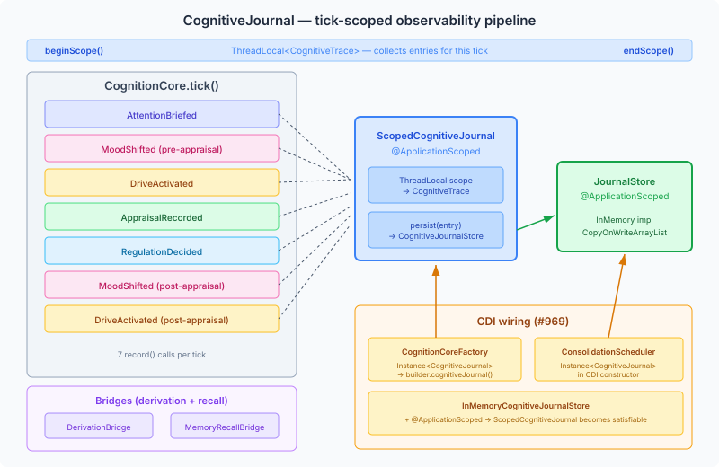

# The Journal Nobody Read

Five observability mechanisms. Zero causal tracing. That was the state of cognitive pipeline instrumentation before this work landed.

DerivationObserver captured static personality derivation steps. PipelineTrace took an end-of-tick photograph. MemoryRecallObserver tracked recall events. GraphMutationRecorded fired CDI events on graph changes. PipelineSnapshotStore persisted snapshots for later retrieval. Each mechanism was purpose-built for one subsystem. None of them could answer a basic question: at tick 47, what caused Penelope's fear appraisal, and how did that trace back to her PID-5 facet scores?

The answer requires following a chain: personality derivation → disposition axes → appraisal thresholds → appraisal result → regulation strategy → mood shift → drive modulation. Five subsystems, five observability mechanisms, and no way to correlate events across them. PipelineTrace captures the final state — what the mood IS — but not what caused it to change. DerivationObserver captures what personality computed, but not how those values influenced real-time appraisal. The root-to-tip gap.

## The design that already existed

Issue #961 built the infrastructure. A sealed CognitiveEntry hierarchy with thirteen record types spanning four domains: derivation, runtime tick, memory, and consolidation. A single CognitiveJournal interface with exactly one method — `record(CognitiveEntry)` — and a NOOP default. A ScopedCognitiveJournal that wraps each tick in a ThreadLocal scope, collecting entries into a CognitiveTrace while simultaneously persisting to a CognitiveJournalStore.

CognitionCore.tick() was instrumented with seven record() calls at the natural observation points: attention briefing, mood shift (pre-appraisal), drive activation, appraisal result, regulation decision, mood shift (post-appraisal), and drive activation (post-appraisal). Two bridge classes — DerivationJournalBridge and MemoryRecallJournalBridge — connected the derivation and memory subsystems to the same journal.

Every entry carries `tenantId`, `agentId`, `eventRef`, and `timestamp`. The EventRef is a tagged union: `EventRef.tick(47)` or `EventRef.derivation("agent-penelope")`. You can query by agent, by tick range, by time window, by entry type. The sealed hierarchy means adding a new pipeline stage produces a compile error in every consumer with an exhaustive switch — intentional.

All of this existed. None of it was wired.

## Three dead ends

CognitionCoreFactory produces every CognitionCore in the application. It auto-discovers thirty cognitive SPIs via CDI — mood, drives, appraisal, regulation, goals, memory hygiene, the full pipeline. It never injected CognitiveJournal. The builder had a `.cognitiveJournal()` setter. The build() method checked for it. The factory never called it. Every CognitionCore ran with `CognitiveJournal.NOOP`.

ConsolidationScheduler had two programmatic setters: `setSessionPipeline()` and `setCognitiveJournal()`. The application (PlaybookOrchestrator) called the first — line 339, wiring the session pipeline for LLM-calling consolidation phases. Nobody called the second. A dedicated test verified that setSessionPipeline was called before the mode-conditional block. No equivalent test existed for the journal. The field defaulted to NOOP and stayed there.

InMemoryCognitiveJournalStore implemented the CognitiveJournalStore SPI with a CopyOnWriteArrayList. Thread-safe. Correct. No CDI annotations. ScopedCognitiveJournal depends on CognitiveJournalStore via constructor injection. Without an @ApplicationScoped bean to satisfy it, CDI can't instantiate ScopedCognitiveJournal. The entire journal chain — from record() call to persistent store — was structurally complete and functionally inert.



## Three changes

The first change adds `@Inject Instance<CognitiveJournal>` to CognitionCoreFactory and calls `builder.cognitiveJournal(cognitiveJournal.get())` during pipeline construction. The `isResolvable()` guard follows the factory's established pattern — optional dependencies that may or may not be present in the CDI container.

The second change adds `Instance<CognitiveJournal>` to ConsolidationScheduler's CDI constructor. After the `this()` delegation to the canonical constructor, it checks `isResolvable()` and wires the journal. This replaces the manual setter with automatic CDI wiring — the setter remains for non-CDI test contexts but production wiring is now declarative.

The third change adds `@ApplicationScoped` to InMemoryCognitiveJournalStore. One annotation. Without it, the other two changes are correct but inert — `isResolvable()` returns false because ScopedCognitiveJournal can't be instantiated. With it, the entire chain activates: CognitionCore records entries, ScopedCognitiveJournal manages scopes, InMemoryCognitiveJournalStore persists them.

## What you can see now

Given a 300-tick scenario run, query the journal for agent "penelope" at tick 47:

```
findByEventRef("manor", "penelope", EventRef.tick(47))
```

The result is a list of CognitiveEntry records in chronological order:

1. **AttentionBriefed** — what the attention mediator surfaced this tick
2. **MoodShifted** — pre-appraisal mood state (pleasure: 0.3, arousal: 0.7, dominance: 0.4)
3. **DriveActivated** — initial drive categories and intensities
4. **AppraisalRecorded** — the appraisal result with concern salience scores
5. **RegulationDecided** — the regulation strategy selected and why
6. **MoodShifted** — post-appraisal mood (pleasure: 0.1, arousal: 0.9, dominance: 0.2)
7. **DriveActivated** — post-appraisal drives with Frijda modulation applied

To trace backward to personality, switch to derivation entries:

```
findByType("manor", "penelope", CognitiveEntry.StageComputed.class)
```

Each StageComputed record shows the derivation method, base values, facet effects (which PID-5 facets influenced which values, with before/after deltas), and final values. The `anxiousness` facet at 0.8 lowered the appraisal threshold for threat — which is why tick 47's observation triggered a fear appraisal when the same observation produced no response for "muttley" (anxiousness: 0.2).

The causal chain is now traceable. Not inferred from final-state snapshots, not reconstructed from scattered logs, but recorded as typed events with shared correlation keys.

## What observability means for cognitive agents

Traditional agent observability is about latency, error rates, and token counts. When your agent has a cognitive architecture — personality-derived thresholds, emotion regulation, mood dynamics, drive modulation — the observability question changes. You're not asking "did the LLM respond?" You're asking "why did this agent respond differently from that agent to the same stimulus?"

The answer lives in the pipeline. In the facet scores that set the thresholds. In the appraisal that crossed one threshold and missed another. In the regulation strategy that suppressed one response and amplified another. In the mood shift that changed the drive landscape. A cognitive journal is the diff between "our agents have personality" and "we can show you exactly how personality shapes each decision."

The infrastructure was there for a week before anyone noticed it wasn't wired. That's the lesson. In a system with thirty injected dependencies and a factory pattern that auto-discovers everything, the one component that ISN'T auto-discovered is invisible. No error. No warning. The default is NOOP, and NOOP is silence.
