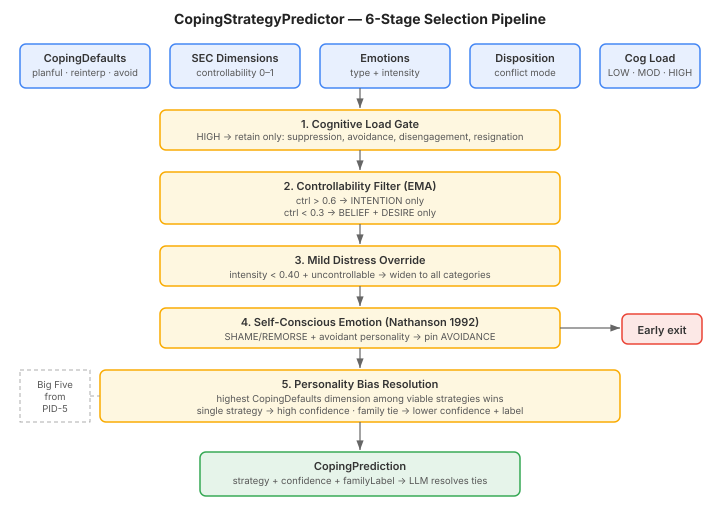
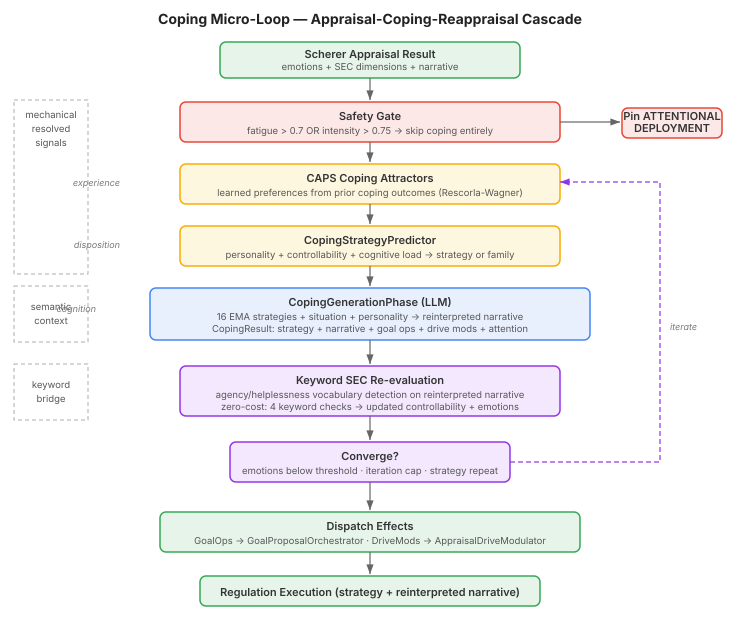

# Personality Shapes How Agents Cope

Two characters face the same crisis. One plans an escape route. The other shuts down and waits for it to pass. Both responses are psychologically coherent — they follow directly from personality. The question is whether a cognitive agent architecture can produce that differentiation mechanically, without asking an LLM to improvise every time.

We built four pieces that answer that question: a personality-to-coping derivation engine, a mechanical predictor that selects coping strategies from the EMA taxonomy, an LLM generation phase that produces the reinterpreted narrative, and a micro-loop orchestrator that runs the full appraisal-coping-reappraisal cycle until emotions converge. The structural selection is personality-driven and deterministic. The LLM's job is confined to the part that actually requires semantic understanding — reinterpreting what the situation means to this character, in this moment. The orchestrator wires all four layers together and iterates until the character's emotional state stabilises.

## Why Coping Needs Its Own Layer

Emotion regulation already exists in the pipeline. It takes an emotion and decides how to modulate it — reappraise, suppress, redirect, seek social support. The Gross process model gives us that. But regulation answers the wrong question for agents in narrative situations.

Regulation asks: *how do I feel less of this?*
Coping asks: *what do I do about the situation that caused it?*

Lazarus and Folkman drew this distinction in 1984. Marsella and Gratch formalised it for computational agents in 2009 with the EMA model. Coping operates on the situation appraisal — controllability, adjustability, relevance — not just the emotion. A highly controllable stressor calls for planning and confrontation. An uncontrollable one calls for acceptance or avoidance. The emotion type is a downstream signal, not the primary input.

The existing `RegulationStrategyPredictor` uses emotion categories as a proxy for controllability — ANGER means controllable, FEAR means uncontrollable. That proxy works, but it's indirect. The Scherer appraisal already computes SEC dimensions that include controllability directly. The coping predictor uses those dimensions instead.

## Deriving Coping Tendencies from Personality

Connor-Smith and Flachsbart published a meta-analysis in 2007 covering the relationship between Big Five personality traits and coping strategies. The correlations are modest but consistent:

- **Conscientiousness → problem-focused coping** (r = .21) — planful people plan
- **Neuroticism → avoidant coping** (r = .25) — anxious people disengage
- **Openness → positive reinterpretation** (r = .11) — open people reframe
- **Agreeableness + Extraversion → social support seeking** (r = .11, .14) — prosocial people reach out
- **Low Neuroticism → acceptance** (1 - N) — calm people accept what they can't control

The CDE (Cognitive Derivation Engine) already derives cognitive defaults from PID-5 personality facets — it does this for regulation, appraisal weights, search budgets, and a dozen other subsystems. Adding coping defaults follows the same pattern.

The challenge: the CDE operates on PID-5 facets (Anxiousness, Impulsivity, Callousness, Withdrawal, etc.), not Big Five dimensions directly. But Big Five composites from PID-5 facets are already established in the codebase — conscientiousness is derived from rule-following disposition plus inverse impulsivity, openness from inverse withdrawal plus inverse suspiciousness plus risk-taking. The same composites that drive recurring thought thresholds and search budget parameters now drive coping tendencies.

```java
public record CopingDefaults(
    double planfulTendency,
    double reinterpretationTendency,
    double avoidanceTendency,
    double supportSeekingTendency,
    double acceptanceTendency
) {}
```

Five numbers. Each derived from personality. Each consumed mechanically downstream. No LLM involved in the derivation.

## The Predictor: Six Stages, No Inference Calls

The `CopingStrategyPredictor` takes those five numbers plus the situation's controllability and the character's emotional state, and narrows 16 possible EMA coping strategies down to one — or to a family with a hint.



The six stages, in order:

**Cognitive load gate.** Under high cognitive load, complex strategies are unavailable — you can't plan an elaborate response when your working memory is saturated. The predictor filters to low-cost strategies: suppression, avoidance, disengagement, resignation. This migrates directly from the regulation predictor, where the same constraint applied to regulation strategy selection.

**Controllability filter.** High controllability (> 0.6) restricts to intention-category strategies — planning, confrontation, seeking support. Low controllability (< 0.3) restricts to belief and desire categories — reinterpretation, acceptance, denial, wishful thinking. Medium controllability leaves all strategies viable. This is the core EMA insight: coping is situation-adaptive, not personality-fixed.

**Mild distress override.** If the emotion intensity is below 0.40 and the emotion type is uncontrollable (fear, distress), the controllability filter is skipped. Mild uncontrollable distress doesn't warrant avoidance — a slight anxiety about an uncertain outcome shouldn't lock out problem-focused strategies.

**Self-conscious emotion refinement.** Shame and remorse trigger a specific pattern from Nathanson's 1992 compass of shame: avoidant personalities withdraw. If the dominant emotion is self-conscious and the character has high avoidance tendency (> 0.6) or an avoidant conflict mode, the predictor pins AVOIDANCE with high confidence and exits early. This preserves a behavioural signature that would otherwise be lost in the general personality resolution.

**Personality bias resolution.** Among the surviving strategies, which personality dimension dominates? If planful tendency is highest and PLANNING is viable, the predictor selects PLANNING. But multiple strategies can map to the same dimension — PLANNING and ACTIVE_CONFRONTATION both map to planful tendency. When that happens, confidence drops and the output includes a family label. The LLM resolves within-family ties using situational context.

**Output.** A `CopingPrediction` with a strategy, a confidence score, and an optional family label. High confidence (0.75) means the personality signal is clear and the predictor is pinning a specific strategy. Lower confidence (0.55) means the predictor is suggesting a direction but leaving the final choice to the LLM.

## The Generation Phase: Where the LLM Earns Its Keep

The predictor resolves what it can from numbers. But when it pins PLANNING, the LLM still needs to decide what the plan is. When it pins POSITIVE_REINTERPRETATION, the LLM produces the reinterpretation. The predictor selects the coping mode; the generation phase produces the coping content.

`CopingGenerationPhase` receives the current situation narrative, SEC dimensions, working emotions, personality disposition, and coping tendencies. If the predictor pinned a strategy, the LLM executes it. If the predictor yielded — family-level confidence or no prediction at all — the LLM selects from the full 16-strategy EMA taxonomy using situational context that no numeric pipeline can access.

The output is a `CopingResult` containing the selected strategy, a reinterpreted narrative, and three kinds of structured effects:

```java
public record CopingResult(
    CopingStrategy strategy,
    String narrative,
    List<GoalOperation> goalOperations,
    List<DriveModulation> driveModulations,
    List<AttentionDirective> attentionDirectives
) {}
```

Goal operations for strategies that create, defer, or drop goals. Drive modulations for strategies that adjust how much the character cares about a particular axis. Attention directives for strategies that redirect what the character monitors. The LLM produces these as structured JSON — not prose, not freeform text. The downstream dispatch is mechanical: goal operations go to `GoalProposalOrchestrator`, drive modulations go to `AppraisalDriveModulator`, attention directives go to `AttentionPromptSection`.

The prompt design encodes a constraint that matters for the micro-loop: the LLM must express its reinterpretation in language that keyword-based SEC checks can detect. When a character reinterprets a situation as more controllable, the narrative must use agency vocabulary — "I can manage this", "there are options I haven't tried", "I choose to act." When the reinterpretation shifts toward helplessness, the vocabulary shifts correspondingly — "trapped", "powerless", "no way out."

This isn't about constraining the LLM's creativity. It's about closing the feedback loop. The micro-loop iterates until emotions converge, and convergence depends on the SEC re-evaluation detecting the shift that the LLM produced. The keyword checks run on the reinterpreted narrative, update controllability and adjustability, and those updated dimensions feed back into emotion recalculation. If the reinterpretation didn't actually change the appraisal — if the LLM produced eloquent prose that a keyword scan can't distinguish from the input — the loop gains nothing and iterates again.

The semantic resolution boundary shows up here more clearly than anywhere else in the pipeline. The predictor works because controllability and personality are already numbers — resolved signals. The generation phase works because narrative reinterpretation is irreducibly semantic. You can't produce "I've been looking at this wrong; there's a path I haven't considered" from a matrix multiplication. The keyword constraint is the bridge: the LLM produces semantically rich narrative, shaped so that downstream mechanical checks can read the signal back out.

## The Full Cascade — Now Wired

The coping layer runs inside each tick as a micro-loop between appraisal and regulation. `CopingMicroLoop` orchestrates the cycle: create initial state from the appraisal result, check whether any emotion exceeds the coping threshold (default 0.6), then cascade through the four layers. Four layers, each with a clear role:



**Safety gate** — if regulation fatigue is too high or emotion intensity is extreme, skip coping entirely and pin ATTENTIONAL_DEPLOYMENT. The circuit breaker. Coping requires cognitive resources that aren't available when the system is already overwhelmed.

**CAPS attractors** — if the character has learned from past coping outcomes, those learned preferences can pin a strategy before personality or situational factors are consulted. This is experience overriding disposition. The weight updates use the same Rescorla-Wagner mechanism that drives regulation attractor learning.

**Predictor** — personality + controllability + cognitive load, resolved mechanically through six filtering stages. This is disposition shaping strategy selection without an inference call.

**LLM generation** — situational context + narrative reinterpretation. This is where the semantic work happens — and only here. The cascade ensures that by the time the LLM is invoked, the strategy space has been narrowed from 16 possibilities to a pinned strategy or a small family. The LLM call is focused, not open-ended.

After the LLM produces a reinterpretation, the orchestrator creates a synthetic `AppraisalContext` with the new narrative and re-runs all four keyword SEC checks — relevance, implication, coping, normative. These are deterministic and zero-cost. The updated dimensions feed back into `EmotionMapper.mapEmotions`, which recalculates the working emotions. If any emotion still exceeds the coping threshold, the loop iterates with a different strategy.

Three convergence criteria, checked in order: no emotion exceeds the threshold (the reinterpretation actually reduced distress). Iteration cap reached (default 3 — hard stop). Strategy repeat detected — if DENIAL was tried on iteration 0 and the loop circles back to DENIAL, it breaks. This catches both A→A and A→B→A oscillation patterns. Typical convergence is 1-2 iterations. Cost: +1 LLM call per iteration, zero-cost keyword checks.

## What This Means

The same crisis — a collapsing plan, a betrayal, an uncontrollable threat — now produces different coping responses from different characters, without any per-character prompt engineering. A high-conscientiousness character plans. A high-neuroticism character avoids. A high-openness character reframes. The differences emerge from the personality profile that was derived at character creation, flow through the CDE, and resolve mechanically in the predictor. The LLM generates the narrative content for whichever strategy the mechanical layers selected.

The architecture is heading toward a place where personality drives behaviour at every level — from what you notice, to how you appraise it, to how you cope with it, to how you regulate what's left. Each layer is mechanical where signals are already resolved, and LLM-based where semantic context is genuinely needed. The coping layer makes that boundary explicit: four cascade layers, three of them pure computation, one of them an LLM call that receives a focused prompt rather than an open question.

What's next: goal operations dispatch (so coping can create, defer, and drop goals), the regulation refactor that receives coping output instead of selecting strategy independently, and the CAPS attractor integration that lets characters learn from their coping history. Four of ten tasks done. The core loop is running — what remains is connecting it to the goal lifecycle, teaching it from experience, and proving it differentiates characters in the eval suite.
