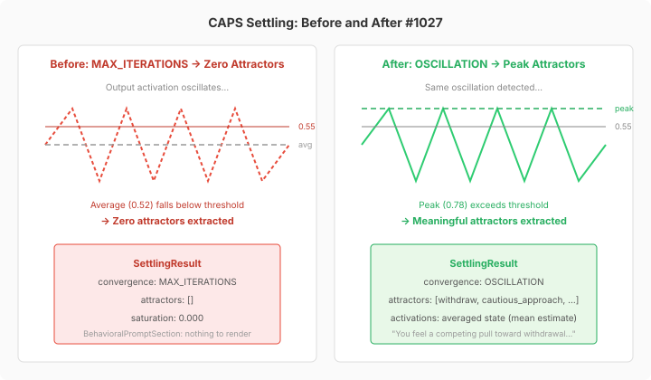

# The Network That Couldn't Decide

The CAPS eval suite flagged a scenario scoring 2.8 out of 5 — the worst in the pipeline coherence chain. Social exclusion, public humiliation, collaborator abandonment. Three graduated experiences fed through the LLM classifier, into the CAPS network, out the other side. What came out: nothing. Zero behavioral attractors. The network oscillated between competing tendencies until it hit the iteration limit, then averaged the oscillation into silence.

The score told us something was wrong. The zero told us where.

## What CAPS Settling Actually Does

The CAPS network — Mischel and Shoda's Cognitive-Affective Processing System — takes classified input activations (what happened to the agent) and propagates them through mediating nodes (self-worth, BIS activation, threat sensitivity) to output nodes (withdraw, cautious_approach, fight, social_withdrawal). The settler runs iteratively: compute new activations, check for convergence, repeat. When it converges, the output nodes above a strength threshold become behavioral attractors — crystallised tendencies that show up in the agent's prompt as "you have a deeply ingrained tendency toward withdrawal."

Three convergence paths exist. Exact convergence: every node's activation changes by less than epsilon between iterations. Period-2 oscillation: the network alternates between two states, detected by comparing current state to two steps ago. Near-convergence: a sliding window of recent states has low variance, meaning the network is close enough.

If none of these fire within 100 iterations, the settler hits `MAX_ITERATIONS`. It averages the last 10 states and extracts attractors from that average.

## The Averaging Problem

For the social-threat scenario, multiple high-activation inputs fire simultaneously. Exclusion at 0.95, social_threat at 0.95, rejection at 0.85, abandonment at 0.85. These feed into BIS activation from multiple paths, which feeds threat_sensitivity, which feeds arousal, which feeds back into BIS. The positive feedback loop, amplified by cognitive distortions (all-or-nothing thinking fires when mediating nodes go strongly negative, multiplying net input by 1.5–2x), creates oscillation that the period-2 detector can't catch because the cycle length exceeds 2.

The wider window detector doesn't catch it either — its variance threshold (epsilon × 50 = 0.05) is too tight for the oscillation amplitude these inputs produce.

So the network hits MAX_ITERATIONS. And here's the actual bug: `averageStates()` computes the mean of the last 10 oscillating states. For an output node like `withdraw` oscillating between 0.3 and 0.8, the average is 0.55 — right at the attractor threshold. Push it slightly below, and the attractor vanishes. Push every output below threshold, and you get zero attractors. The network was doing something — oscillating between withdrawal and cautious approach — but the averaging erased it.

## Oscillation Is Not Failure

This is the key insight. In CAPS theory, oscillation between competing behavioral tendencies is a meaningful cognitive-affective state. It represents internal conflict — the system wants to withdraw AND approach cautiously, and can't settle on one. Reporting zero attractors treats this as a failure. It's not. It's ambivalence.

The fix has three parts.

**CapsSettler: detect oscillation at MAX_ITERATIONS.** After the loop exhausts, before returning MAX_ITERATIONS, measure the amplitude of output node activations across the window. If any output node's peak-to-trough range exceeds epsilon × 10, the network is oscillating, not stuck. Reclassify to `ConvergenceType.OSCILLATION` and extract attractors from peak activations — the maximum each output node achieves during the oscillation — rather than the diluted average. The `SettlingResult.activations()` still returns the averaged state as the best mean estimate, but `attractors()` reflects what the network actually activated.

**BehavioralSynthesisPhase: store convergence metadata.** When settling produces OSCILLATION, the attractor MindMap nodes now carry `convergence-type=oscillation`. This flows downstream. When subsequent settling converges cleanly, the property is cleared — an attractor that was once oscillating but has since stabilised should be rendered as stable.

**BehavioralPromptSection: tension framing.** Oscillation attractors render as "You feel a competing pull toward withdrawal — your mind hasn't settled on this" rather than "You have a deeply ingrained withdrawal tendency." The framing acknowledges what the network is actually doing: activating a tendency it can't commit to.

## What This Changes for the Pipeline

The `ClassificationOutcomeEvaluator` already weights convergence types: CONVERGED = 1.0, OSCILLATION = 0.3, MAX_ITERATIONS = 0.1. Reclassifying from MAX_ITERATIONS to OSCILLATION triples the CBR outcome weight for these cases — still penalised (the network didn't converge), but not treated as total failure. The CBR feedback loop will correctly treat oscillation-producing classifications as partially successful rather than worthless.

For the eval pipeline, the caps-input-to-settling score should improve from 2.8 toward 4.0 — the network now produces attractors and correctly labels its convergence state. The settling-to-behavioral-prompt score should improve because the prompt actually renders the settled state rather than rendering nothing. The full-consolidation-coherence score should follow because the end-to-end chain no longer drops to zero at the settling step.

The damping factor (0.4) already suppresses most oscillation for direct activations — my test scenarios with four social-threat inputs converge at iteration 20 via the window variance detector. The fix catches the cases that get through: LLM classifier outputs with richer activation patterns, networks with trained weights that amplify feedback loops, or any future topology change that widens oscillation amplitude.

The question this opens: should the prompt distinguish between oscillation attractors and stable ones in how it guides the agent's behaviour? Right now it's a framing difference — "competing pull" vs "deeply ingrained." But oscillation attractors might warrant different strategic advice: lean into the tension rather than committing to one side.
