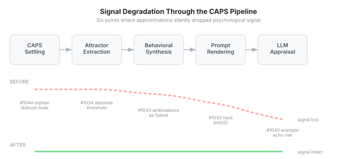

# Seven Paper Cuts

None of these would have crashed anything. No exceptions, no failed assertions (except one that was wrong for years), no logs that said "error." Each was a small approximation that made sense when it was written. Together they formed a signal-degradation pipeline — psychological meaning entering the CAPS network at full fidelity and arriving at the agent's prompt with half of it missing.



## The Limit That Dropped the Tension

`BehavioralPromptSection` rendered the top 5 attractors by strength. Reasonable on the face of it — you don't want to dump 24 behavioral tendencies into a prompt. But the coherence eval flagged what it lost: `withdraw` at 0.635 and `proximity_seek` at 0.650 define the approach-avoidance tension under social threat. Only `co_regulation` (0.868) and `cautious_approach` (0.788) made the cut, plus three others. The agent saw calm resolution without the ambivalence underneath it.

The `minStrength` threshold was already doing the noise filtering. The hard limit was double-filtering, and the second filter didn't know what it was cutting. I removed `.limit(5)` and let the threshold do its job. The existing three-tier labeling — "deeply ingrained," "noticeable," "emerging" — already tells the agent which attractors dominate.

## The Threshold That Only Worked Once

`attractorStrengthMinFilter = 0.55` was the single biggest improvement in the CAPS eval suite — raising it from 0.1 to 0.55 eliminated unstimulated unipolar nodes from the attractor set and improved the coherence score from 3.75 to 4.38. It was correct and well-calibrated. It also encoded an assumption: that every output node uses a logistic activation function with a resting level of 0.5.

Bipolar (tanh) nodes rest at 0.0. A genuine activation of 0.3 would be filtered out. No bipolar output nodes exist in the current topology, so this wasn't breaking anything today. But it's the kind of assumption that breaks six months later when someone adds a tanh output node and spends a day wondering why it never appears as an attractor.

I added `NodeRange.restingLevel()` — UNIPOLAR returns 0.5, BIPOLAR returns 0.0 — and changed the filter from absolute threshold to margin above baseline. The config parameter became `attractorStrengthMargin = 0.05`. Same behavior for the current topology, correct behavior for any future topology.

## The Node With No Wires

`distrust` was listed as an output node in the CAPS topology. It had a node definition, a category, a range. It had zero incoming connections. Nothing could ever activate it.

The test expected distrust from a betrayal scenario and failed — which is how I found it. The fix was two connections: `self_worth → distrust` at −0.40 and `other_reliability → distrust` at −0.45, both inverted from the existing trust connections. When mediating nodes go negative from betrayal inputs, the double negative produces positive activation on distrust. The topology already had the mediating infrastructure; the last hop was missing.

The test input had a secondary problem: "his trusted friend who betrayed him" activated the `trust` input node via keyword matching. The word "trusted" in past tense, in a betrayal context, is unambiguously negative to a human reader. To a keyword classifier, it's the word "trust" with an activation weight. I changed it to "close friend" — same scenario, no contamination.

## The Test That Asserted Backwards

`SchererAppraisalStrategyTest.disabledSecs_reducedOutput` asserted that running all four SEC checks would produce at least as many emotions as running only the relevance check. The assumption: more inputs → more outputs. The reality: more SEC dimensions give the emotion mapper enough information to narrow down. Four checks produced one precise emotion where one check produced two vague ones.

The correct invariant isn't about emotion count — it's about dimensionality. All SECs enabled should produce more SEC dimensions than relevance-only. That's what I asserted instead.

## The Examples That Would Get Echoed

The LLM appraisal strategy's JSON template included example values alongside the schema:

```json
"action_targets": {
  "<tendency>": "<what the tendency is directed at>",
  "approach": "the discovery",
  "avoidance": "social exposure"
}
```

The placeholder line is the schema. The other two are examples. Some models echo examples verbatim rather than generating context-appropriate targets. I moved the examples to the prose instruction outside the JSON block: "Example: `{\"approach\": \"the discovery\", \"avoidance\": \"social exposure\"}`."

## The Ambivalence That Was a Problem

The previous session added oscillation detection to CAPS settling (#1027) — when the network can't converge because withdrawal and cautious approach keep competing, it now detects that and extracts peak attractors. `BehavioralPromptSection` rendered these as "You feel a competing pull toward X — your mind hasn't settled on this."

That framing treats ambivalence as failure. As a temporary state the agent should get past. Mischel and Shoda's CAPS theory says the opposite — oscillation between competing tendencies is psychologically real. The approach-avoidance tension under social threat isn't the system being indecisive; it's the system accurately representing a genuinely conflicted state. I changed the rendering to "this ambivalence is real, not a problem to resolve. Sit with it." The agent should explore the tension, not rush to collapse it.

## What This Session Actually Was

Seven issues. No feature work. No new capabilities. Pure signal restoration — removing the accumulated shortcuts that were quietly degrading what the CAPS network was trying to say. The topology had the right structure. The settling algorithm had the right dynamics. The information was being generated and then dropped, filtered, misframed, or contaminated on the way to the prompt.

The pattern worth noting: none of these were visible in isolation. Each approximation produced output that looked reasonable. It took the coherence eval — a judge that reads the full behavioral profile end-to-end — to notice that the agent's self-description didn't match the dynamics that produced it. The eval didn't tell us what was wrong. It told us something was wrong. Finding the six points where signal was leaking required tracing the pipeline from input to output.

The two M/High issues left in this epic (#976, #977) are personality classification — extending beyond disposition axes to PID-5 facets and appraisal weights. That's new capability, not restoration. This session cleared the path for it.
