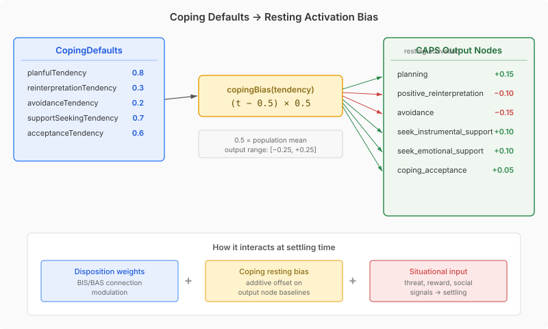

# The Bias That Wasn't Wired

The CAPS topology has sixteen coping output nodes — planning, avoidance, support-seeking, acceptance, and twelve others. Under threat, the network settles into a coping profile: which strategies light up, how strongly, and in what combination. Two agents facing the same threat should cope differently if their personalities differ. But for a while, they didn't. The resting activations on coping nodes were zero for everyone.

The mechanism was designed months ago. `CopingDefaults` holds five personality-derived tendencies — planful, reinterpretation, avoidance, support-seeking, and acceptance — each normalised to [0, 1]. The `CapsEngine` interface had a 4-argument `initializeAgent` that accepted these defaults alongside the usual disposition axes. The default method on the interface delegated to the 3-argument form and silently discarded the coping parameter.

Both implementations had been updated to override the 4-argument method. Both delegated to `DispositionWeightMapper.setCopingRestingActivations`. The wiring was complete. The contract tests asserted the right things. The issue that tracked it was still open.

## What the formula does

The seeding logic is simple and worth explaining because it encodes a specific modelling assumption about population norms.

```java
private static double copingBias(double tendency) {
    return (tendency - 0.5) * 0.5;
}
```

The 0.5 subtraction centres at the population mean: a tendency of 0.5 produces zero bias. The second 0.5 scales the range to [−0.25, +0.25], keeping the coping bias small relative to the activation dynamics that happen during settling. This is an additive offset on whatever resting activation the disposition weights already established — it doesn't replace; it nudges.



For an agent with `CopingDefaults(0.8, 0.3, 0.2, 0.7, 0.6)`:

- **planning** gets +0.15 — high planful tendency, positive bias toward problem-focused coping
- **positive_reinterpretation** gets −0.10 — below-mean reinterpretation, slightly harder to activate
- **avoidance** gets −0.15 — low avoidance tendency, the network resists avoidance even under threat
- **seek_instrumental_support** and **seek_emotional_support** both get +0.10 — above-mean support-seeking maps to both instrumental and emotional channels
- **coping_acceptance** gets +0.05 — just above mean, a slight nudge

These numbers look small. They are small on purpose. The resting activation is a thumb on the scale, not a predetermined outcome. Under strong threat input, the BIS pathway activation (weight 0.40 from `BIS_activation → avoidance`) can easily overcome a −0.15 resting bias. What the bias does is change the threshold: an agent with low avoidance tendency needs more threat before avoidance activates than one with high avoidance tendency. Same network. Same connections. Different person.

## Why additive matters

`addResting` doesn't set the resting activation — it adds to it. The disposition-based initialisation runs first, establishing resting levels from BIS/BAS/threat sensitivity personality mappings. Coping defaults layer on top. For an avoidant personality (high BIS, conservative risk appetite), `setRestingActivations` has already pushed avoidance resting activation positive. High avoidance tendency from coping defaults reinforces that. For a disagreement — high BIS personality but low avoidance coping tendency — the two forces partially cancel.

This is the whole point of the CAPS architecture: individual differences emerge from the interaction of multiple layers of personalisation, not from any single parameter. The connection weights encode what threat means structurally. The resting activations encode where this specific agent starts from. The input at settling time encodes what actually happened. The settled state is an emergent property of all three.

## The test that tells the story

The contract test `highBISInputActivatesAvoidantCopingAttractors` captures the interaction. It creates a conservative, avoidant agent with high avoidance tendency (0.8), feeds in physical threat and unpredictable danger, settles the network, and asserts that avoidance exceeds planning in the settled state.

This is not a trivial assertion. Planning has strong support from `self_efficacy` (weight 0.40) and `BAS_activation` (weight 0.25). Without the coping bias, an agent with enough self-efficacy might settle toward planning even under threat — the network has that pathway. The coping bias makes the difference: +0.15 for avoidance from the tendency, compounding with +0.40 from BIS, against −0.15 from the negative `self_efficacy → avoidance` connection. The agent who avoids does so because every layer of their personality says avoid: disposition, coping tendency, and in-the-moment BIS activation all align.

Change the coping defaults to planful (0.8, 0.3, 0.2, 0.3, 0.3) and the same agent under the same threat settles differently. Same BIS activation, same connection weights, but the planning node starts with a +0.15 head start and avoidance starts with −0.15. The network's settling trajectory changes.

This is what personality-shaped coping looks like in practice: not a lookup table that says "avoidant agents avoid," but a network where the same structural dynamics produce different outcomes because the initial conditions differ. The personality isn't in the connections — it's in the starting point.
