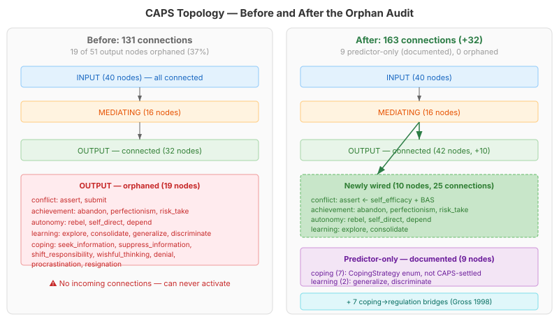

# The Network That Couldn't Reach

A CAPS topology with 51 output nodes sounds like a network that can express a range of behaviour. Nineteen of those nodes had zero incoming connections. No amount of threat, reward, or social pressure could activate them. They were vocabulary without grammar — names on a diagram that the settling algorithm could never reach.

This is the gap between having a network and having a network that works. The issue lay dormant across 72 issues of subsystem work because every piece was tested in isolation. The coping connections worked. The drive system worked. The regulation layer worked. What nobody checked was whether the whole thing connected.

## What was orphaned

The audit classified every unreachable node into one of three categories.

**Category 1 — predictor-only (9 nodes).** Seven coping nodes and two learning nodes that are activated by subsystems other than CAPS settling. The seven coping nodes — seek_information, suppress_information, shift_responsibility, wishful_thinking, denial, procrastination, resignation — belong to the EMA cognitive appraisal taxonomy. They're selected by `CopingGenerationPhase` using an LLM, not by the network's settling dynamics. The two abstract learning nodes (generalize, discriminate) are vocabulary labels for a learning subsystem that hasn't been built yet. All nine got documentation comments explaining why they're inert by design.

**Category 2 — needs wiring (10 nodes).** These are real behavioural outputs that the network should be able to reach. Assert and submit in the conflict category. Abandon, perfectionism, and risk_take in achievement. Rebel, self_direct, and depend in autonomy. Explore and consolidate in learning. Several of these already had personality-derived resting activations from `DispositionWeightMapper` — they started at non-zero but could never move from that position because no mediating node fed into them.

**Category 3 — remove.** None. Every node serves a documented purpose.

## The wiring

Twenty-five new connections, each with a theoretical source and a weight derived from the literature.

The conflict nodes illustrate the pattern. `assert` gets excitatory connections from `self_efficacy` (0.35) and `BAS_activation` (0.30) — assertion requires both perceived capability and approach motivation. `submit` gets the inverse: excitatory from `BIS_activation` (0.35) and `threat_sensitivity` (0.25), inhibitory from `self_efficacy` (−0.30). An agent with high self-efficacy and approach motivation asserts; an anxious agent with low self-efficacy submits. Same topology, different person.

The achievement nodes follow the same logic. `risk_take` is BAS-driven (0.40) with BIS-inhibitory (−0.30) — bold agents take risks, cautious ones don't. `perfectionism` is BIS-driven (0.35) with an interesting inverse self-worth connection (−0.25) — low self-worth drives compensatory perfectionism, drawing from Flett and Hewitt's clinical perfectionism model. `abandon` is the hopelessness pathway: negative future_outlook (−0.35) and negative self_efficacy (−0.30) with BIS reinforcement (0.25).

Tags on each connection slot into the existing disposition modulation system. Assert gets `[fight_assert]`, matching the FFFS→fight pathway. Submit and depend get `[compliance]`, matching the powerlessness→fawn pathway. Self_direct and rebel get `[self_direction]`, matching the autonomy axis. The disposition modifiers already know what to do with these tags — a competitive conflict mode boosts `fight_assert` connections by 1.3x, an avoidant mode boosts `flight_freeze_withdraw` by 1.3x. The new nodes inherit personality modulation for free.

## The bridge that wasn't

A separate gap: coping strategy activation didn't flow into the regulation layer. `CopingStrategy.regulationStrategy()` already declared the mapping — positive_reinterpretation IS cognitive_change, avoidance IS situation_selection, and so on for all seven regulation-routed strategies. But those were Java method calls, not network connections. An agent that settled on positive reinterpretation as a coping strategy had no topology pathway to activate cognitive_change as the regulation mechanism.

Seven new bridge connections close this. Each one is excitatory at 0.40–0.45, with provenance from Gross's 1998 process model. The weight reflects that these are identity relationships — the coping strategy isn't just correlated with the regulation mechanism, it IS that mechanism applied in a coping context.

## What the seeds cover now

The original `CopingDefaults` record held five personality-derived tendencies: planful, reinterpretation, avoidance, support-seeking, and acceptance. Three connected coping nodes had incoming CAPS connections but no personality seed: active_confrontation, mental_disengagement, and suppression. Without a seed, two agents with identical self-efficacy and BAS activation but different personalities would confront stressors identically. The personality difference was invisible in the coping domain.

Three new fields: `confrontationTendency` derived from extraversion and conscientiousness; `disengagementTendency` from neuroticism and inverse conscientiousness; `suppressionTendency` from neuroticism and rule-following. The derivation follows the same PID-5 → Big Five composite pathway as the existing five fields, using Connor-Smith and Flachsbart's 2007 meta-analysis of personality-coping correlations.

## Where the bias matters most

A test verifies that coping personality seeds are the tiebreaker specifically under moderate threat. At physical_threat 0.4, two agents — one planful (0.8/0.2), one avoidant (0.2/0.8) — settle with detectably different planning-vs-avoidance gaps. Under strong threat (0.9), the connection-driven BIS activation overwhelms the ±0.15 coping bias and both agents converge toward avoidance. The divergence between profiles is larger under moderate threat than strong threat.

This is the design intent of the `copingBias` formula. The 0.5 centering and 0.5 scaling produce small seeds. They're not meant to override the network's response to a genuine threat. They're meant to differentiate two agents facing the same ambiguous situation — the regime where personality actually shapes behaviour. Under moderate stress, the planful agent reaches for a plan while the avoidant one disengages. Under extreme stress, both retreat. That's what the literature predicts.

## End-to-end

An end-to-end differentiation test confirms that personality propagates through the full pipeline, not just one layer of it. Two agents — an open explorer (low neuroticism, high extraversion, bold risk appetite) and a cautious avoider (high neuroticism, low extraversion, conservative risk) — receive the same observation and produce different outputs at every stage the test harness can reach: different coping defaults, different search budgets, different rendered prompts.

The topology went from 131 connections to 163. Every output node is now either dynamically reachable or documented as intentionally predictor-only. Nine nodes have that documentation. Zero are silently dead.
