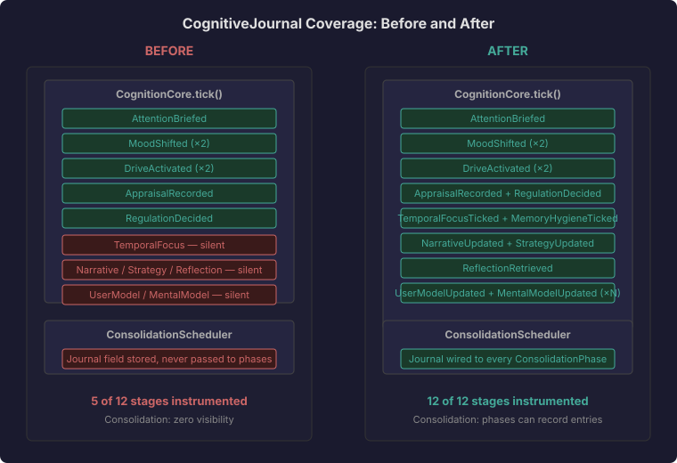

# Opening the Black Box: Full Journal Coverage for the Cognitive Pipeline

The cognitive journal (#961) was designed to make the agent's reasoning traceable — every mood shift, drive activation, and appraisal decision recorded as a typed event in a causal chain. It shipped with instrumentation for the five loudest stages: attention, mood, drives, appraisal, regulation. The other seven stages — narrative generation, strategy learning, temporal focus, reflection retrieval, memory hygiene, and the two per-subject model updates — ran silently. No entries, no trace, no way to explain what happened between "drives activated" and "goals decided."

The consolidation pipeline was worse. It had the journal field wired via CDI, stored it, and never read it. Twenty-odd phases running on a background thread, mutating the knowledge graph, with zero journal visibility.

This session closed both gaps.

## What was actually wrong

The missing instrumentation wasn't a bug in the conventional sense — the pipeline worked correctly. The problem surfaced when I tried to trace why a particular narrative prompt section appeared with unexpected content. The journal showed drives and mood, then skipped straight to goals. Everything in between — the narrative tick that generated the text, the strategy update that informed it, the mental model tick that shaped the subject's representation — was invisible.

For the consolidation pipeline, the gap was structural. `ConsolidationScheduler` stored a `CognitiveJournal` reference but the `ConsolidationPhase` SPI had no way to receive it. The scheduler called `phase.setSessionPipeline(pipeline)` before each run — there was already a pattern for injecting runtime services — but no equivalent for the journal.

## Three changes, one principle

**#980 — Wire the journal through consolidation.** Added `setCognitiveJournal(CognitiveJournal)` as a default method on `ConsolidationPhase`, matching the existing `setSessionPipeline()` pattern. The scheduler now calls it alongside the pipeline injection before every phase run. Phases that don't override it are unaffected — the default is a no-op. Phases that want to record entries can now store the reference and call `journal.record()` during their `run()`.

This was the smallest change — two lines of SPI, one line of wiring — but it unblocked journal visibility for the entire consolidation pipeline. Twenty-odd phases that were previously opaque can now emit `Consolidated`, `GraphMutated`, or any other `CognitiveEntry` type.

**#968 — Instrument the remaining tick stages.** Seven new `CognitiveEntry` record types: `TemporalFocusTicked`, `MemoryHygieneTicked`, `NarrativeUpdated`, `StrategyUpdated`, `ReflectionRetrieved`, `UserModelUpdated`, `MentalModelUpdated`. Each records after `safeRun()` — the journal captures that the stage was invoked regardless of whether the orchestrator threw internally. `TemporalFocusTicked` carries a `subjectCount` so the trace shows how many subjects the temporal focus was set up for. The per-subject model entries emit one record per subject, so a tick with three subjects produces three `UserModelUpdated` entries — the trace resolves to individual subjects, not just "models were updated."

The sealed hierarchy now has 23 entry types. No exhaustive switches exist in the codebase — all consumers use `instanceof` filtering or `entriesOfType(Class)` — so adding types required zero consumer updates.

**#1045 — Surface prediction calibration.** The `PredictionCalibrationAnalyzer` from #921 compares predictor-based vs LLM-based regulation effectiveness. The analysis existed but was only programmatically accessible. I added a `calibration(tenancyId, agentId, minEpisodes?)` method to the `@McpDomain("neocortex/cognition")` resolvers — the same observability surface that exposes entity traces, graph health, and pipeline dumps.

The interesting constraint here was the module boundary. `PredictionCalibrationAnalyzer` lives in `cognition`; the resolver lives in `cognitive-observability-core`. The dependency goes the wrong way — `cognition` depends on `cognitive-observability-core` (for the journal store), so the reverse would create a cycle. Rather than restructuring modules for an XS issue, I replicated the analysis logic in the resolver — the same MindMap query, the same aggregation, the same calibration thresholds. The duplication is tracked in #1067 for future consolidation when module boundaries are revisited.

## Why this matters for cognitive agents

A cognitive pipeline is not a request-response handler. It's a multi-stage process where mood affects drives, drives affect goals, appraisal modulates mood again, and all of it feeds back into the next tick. When something goes wrong — an unexpected narrative tone, a goal that persists when it shouldn't, a strategy that never adapts — the developer needs to trace the causal chain backward from the symptom to the stage that produced it.

Without full journal coverage, that trace has holes. The developer sees mood shift, then drives activate, then... something happens... then goals are decided. The "something" is where the actual reasoning occurs — narrative text generation, strategy learning from engagement signals, mental model updates from the last conversation. Those are the stages where the agent's personality and social intelligence take shape, and they were the ones running dark.

With the journal now covering all twelve stages plus consolidation, every cognitive decision can be traced from input to output. The `ScopedCognitiveJournal` collects entries per-tick into a `CognitiveTrace`, and the pipeline snapshot store persists them for historical queries. When a developer asks "why did the agent say that?" the answer is in the trace — not buried in log messages that scroll past before anyone reads them.

The calibration resolver serves a narrower purpose: it answers "is the predictor keeping up with the LLM?" without requiring the developer to wire up a programmatic call. An MCP query returns the delta, the episode counts, and whether the predictor is miscalibrated — the same data, surfaced where observability tools already look.
