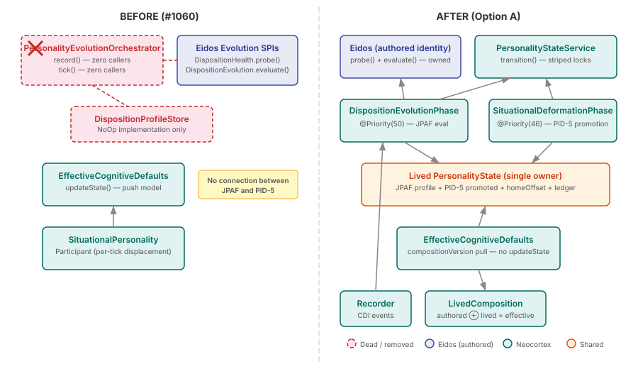

I started this session with a clear mental model: Jungian function evolution and PID-5 facet evolution are the same fundamental process — accumulated experiential pressure on a personality dimension causes lasting change. The dimension type determines what changes, not how signals accumulate. Build one signal model, one accumulator, one evaluation pipeline. Elegant. Clean. Wrong.

## The dead class

`PersonalityEvolutionOrchestrator` has existed in the codebase for months. Two public methods — `record()` and `tick()` — and zero production callers. Agency produces the bean. Nobody calls it. The class compiles, passes its own tests, and does nothing.

The original issue (#1060) asked three questions: what cadence should the evolution run at, how should the result propagate to `EffectiveCognitiveDefaults`, and how does it converge with PID-5 situational modulation from #712? I arrived at an answer I was pleased with: unify everything into one `PersonalityPressure` signal type, replace the Eidos evolution SPIs with a neocortex-native evaluation pipeline, and converge both families at a single consolidation phase with dimension-aware propagation.

Claude ran the standard adversarial design review — three dimensions (coherence, structure, robustness) plus cross-cutting, three rounds each. What came back was not a list of typos. It was a dismantling.

## Three false premises

The review's coherence dimension identified three things the initial spec assumed that turned out to be wrong:

**Nothing writes homeOffset.** Wrong. `PersonalityStateIntegrator.closeHour()` already moves `homeOffset` from the signed exposure integral. It's bounded by `dMax` (0.10) and decays back toward zero over 180 days. The #712 situational modulation work already handles PID-5 lasting drift. The initial spec proposed building something that already existed.

**updateBase() is a durable propagation path.** Wrong. `CognitionCore.tick()` calls `effectiveDefaults.updateBase(tenantId, toDescriptorView(descriptor), ...)` on every cognitive tick. That re-bases from whatever the Eidos descriptor currently says. Any "lasting" change written to `EffectiveCognitiveDefaults` by a personality evolution phase is overwritten on the next tick. The propagation path the initial spec relied on is a one-tick write.

**JPAF evaluation is simple enough to reimplement.** Wrong. The existing Eidos SPIs (`DispositionHealth.probe()`, `DispositionEvolution.evaluate()`) encode four evaluation rules, vocabulary-generic shadow resolution, per-tenant preferences, and canonical normalisation. The review's structure dimension traced through the actual Eidos code and showed that "just reimplement the threshold logic" meant reimplementing a system whose semantics are defined by its vocabulary, not by neocortex's signal model.

## What the review actually built

The spec that emerged from twelve rounds of adversarial dialogue looks nothing like what went in. It grew from roughly 325 lines to 1,403 — not from padding, but from precision forced by reviewers who could read the actual code.

**Separated dynamics, shared outcomes.** The two personality families genuinely have different accumulation and evaluation processes. JPAF operates on discrete type transitions — a Jungian function stack reorders when accumulated signals cross a threshold. PID-5 operates on continuous elastic-band drift — facet scores shift gradually under sustained situational pressure. Forcing both into one pipeline meant either oversimplifying the JPAF evaluation (losing Eidos's vocabulary-aware rules) or over-engineering the PID-5 path (adding thresholds where a continuous integrator already exists). The reviewed design keeps each family's native dynamics and unifies only what they genuinely share: the store of record, the propagation mechanism, the time basis, the cadence ownership, and the audit trail.

**Pull replaces push.** The initial spec had evolution phases calling `updateState()` and `updateBase()` directly — pushing results into `EffectiveCognitiveDefaults`. The robustness review found two defects in that model. First, when displacement fast-forwards to below the publish threshold, the stale state sticks forever. Second, a concurrent `updateBase()` that read the old snapshot can beat a newer `updateState()`. The reviewed design deletes `updateState()` entirely. Instead, `PersonalityStateService` commits state via `transition()`, bumps a quantised `compositionVersion`, and `EffectiveCognitiveDefaults` lazily re-derives when it notices the version changed. No writer publishes. Every committed change that moves the composition is visible at the first read after the commit, with no publication step for any writer to omit.

**Target anchoring.** The cross-cutting review discovered that the original PEO design has a rank-relative targeting defect: under sustained negative input, the type alternates every rate-bound interval forever. The root cause is that signal recording targets the *lived* profile (which just swapped), so negative pressure immediately pushes the new arrangement back. The fix is conceptually simple — target the *authored* profile, so the fixed reference provides a stable equilibrium — but the dynamics analysis that proved the fix required working through multi-period trajectories of the Eidos evaluation loop against real code, not the spec's pseudocode. That analysis, with its fixed-point proofs and dead-zone characterisation, occupies over a hundred lines of the final spec.

## What this means for the codebase

The implementation plan is 14 tasks across 6 batches. The first batch renames `PersonalityStateService` to `PersonalityStateService` and adds the striped locking infrastructure that makes all subsequent changes safe. The last batch deletes `PersonalityEvolutionOrchestrator` and wires everything up. Each batch is a safe wrap point.

What matters more than the task count is what the design *removes*:

- The halt mechanism is gone. The review proved it never prevents a transition and blocks legitimate evolution.
- `EffectiveCognitiveDefaults.updateState()` is gone. The push model had two verified defects. Pull is correct by construction.
- `DefaultPersonalityStateSource` is gone. `PersonalityStateService` implements the SPI directly.
- The unified signal model is gone. It was an abstraction over two fundamentally different processes that would have made both harder to understand and test.

The design adds a `ReflectionLedger` with eleven fields that tracks everything the JPAF evaluation needs: when it last reflected, what transitions are pending, whether the authored profile changed, and whether the type is oscillating. That ledger, plus the striped locking in `PersonalityStateService`, is what makes crash recovery, authored-edit detection, and reversal observation possible without cross-store protocols.

## The process observation

I went in with a first-principles analysis that felt right. The unified signal model was clean architecture. The adversarial review didn't reject it on aesthetic grounds — it rejected it because the code doesn't work the way the model assumed. The reviewers read the actual Eidos implementations, found the actual `closeHour()` method, and traced the actual `updateBase()` call path. Every false premise was verified against line numbers.

The result is a design that respects the existing system instead of reshaping it to match a theory. That's a less satisfying conclusion than "here's a beautiful unified model," but it's the one the code supports.
