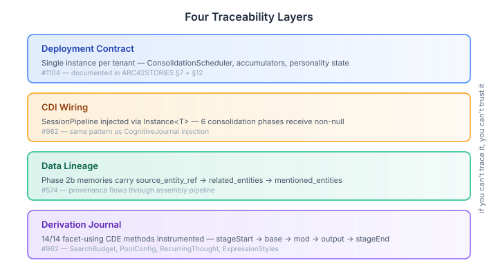

# The Pipeline That Couldn't Explain Itself

A cognitive pipeline that works correctly but can't explain why it works is a liability. Not today — today it passes every test, every eval, every scenario run. The liability surfaces the first time someone asks "why did the agent respond that way?" and the answer is "we'd have to read the code." Six changes, one principle: if you can't trace it, you can't trust it.



## Six phases receiving null

`ConsolidationScheduler` has a `setSessionPipeline()` method. In production, nobody called it. The field was null. Every consolidation tick, the scheduler faithfully passed null to six phases via `phase.setSessionPipeline(null)`. Each phase checked for null and silently skipped its LLM work. Drive descriptions, belief revision, priority signatures — all skipped.

Two phases had already worked around the problem by injecting `SessionPipeline` directly via their own CDI constructors. The scheduler was the bottleneck. The fix follows the exact pattern already proven for `CognitiveJournal` injection — add `Instance<SessionPipeline>` to the CDI constructor, resolve if available:

```java
if (sessionPipelineInstance.isResolvable()) {
    this.sessionPipeline = sessionPipelineInstance.get();
}
```

Three lines. The kind of fix that makes you wonder how long the six phases were running empty.

## The contract nobody wrote down

The consolidation scheduler serialises all its work behind a `ReentrantLock`. The significance accumulator aggregates in-memory signals between ticks. The attention accumulator does the same. `EffectiveCognitiveDefaults` caches personality slots with version tracking. `PersonalityStateService` buffers pressure updates in memory.

Every one of these assumes one active neocortex instance per tenant. If two instances serve one tenant, events split across nodes. Per-agent state updates — personality pressure, drive adaptation cursors — lose writes. The in-JVM locks protect nothing across a network boundary.

This was an implicit assumption in every component. Now it's explicit: documented in ARC42STORIES §7 as a deployment constraint, in §12 as a scaling risk. Three future options when multi-instance is needed: tenant-affinity routing, optimistic versioning on MindMap nodes, or per-tenant leader election for consolidation. Until then: deploy with affinity.

## Memories that forgot where they came from

Phase 2b of the biography extraction pipeline synthesises memories from entity-level data — reflections across a person's experiences, mood snapshots for life periods. Phase 1 memories carry `related_entities`, `source_passage`, `mentioned_entities`. Phase 2b memories carried none of these.

The gap was invisible until I checked field coverage across a full Napoleon corpus: 76.5% coverage vs Frida's 17/17. The difference tracked exactly to the proportion of Phase 2b memories.

The fix adds three fields to every Phase 2b reflection and mood snapshot: `related_entities` (the entity that generated it), `source_entity_ref` (which entity produced this memory), and `source_provenance` set to `"entity-synthesis"` to distinguish from passage-level extraction. During assembly, `related_entities` flows through to `mentioned_entities` automatically — no downstream changes needed.

## Completing the derivation journal

The cognitive derivation engine maps personality facets to cognitive defaults. Fourteen methods use PID-5 facets. After the instrumentation pass in an earlier session, ten had journal entries — `stageStart`, `base`, `mod`, `output`, `stageEnd` events tracing every facet contribution to every derived value. Four didn't.

The four uninstrumented methods were the ones that pre-dated the journal infrastructure. `deriveSearchBudgetDefaults` maps seven facets through breadth, depth, laterality, and convergence parameters. `deriveRecurringThoughtConfig` maps anxiousness and withdrawal through fixation, obsession, and rumination thresholds. `derivePoolConfig` is two facets producing two values. `deriveExpressionStyles` is the odd one — it uses boolean facet thresholds (`isHigh`/`isLow`) to select string descriptions, not continuous numeric modulation.

Each method got the same treatment: backward-compatible overload delegating to `Ctx.NOOP`, instrumented version with the full event chain. For expression styles, the adaptation was recording facet scores as base values and style count as the output — the categorical decisions don't map to `mod` events, but the driving facet values are now visible in the journal trace.

The `derive()` pipeline method now passes `ctx` to all fourteen methods. Zero blind spots.

## When the observer breaks the observed

The derivation journal traces individual facet-to-value mappings inside the CDE. The consolidation scheduler sits one level up — it orchestrates the phases but had no journal entries of its own. You could trace what happened inside each phase, but not which phases ran, how long they took, or how many artifacts they produced.

The fix is a single `journal.record()` call after each phase completes:

```java
journal.record(new CognitiveEntry.Consolidated(
        tenantId, "_system",
        EventRef.consolidation(EventRef.init()),
        Instant.now(), 0, phaseArtifacts.size(),
        elapsed, phase.name()));
```

The interesting part isn't the instrumentation — it's what went wrong with the first version. The `journal.record()` call sat inside the same try-catch that wraps `phase.run()`. The phase's success `PhaseResult` was already added before the journal call. If the journal threw, the catch block added a *second* `PhaseResult` — one success, one failure — for the same phase. The phase actually ran fine; only the observer failed.

This is a category of bug worth naming: observability code that corrupts the data model of the thing it observes. The journal is downstream of the consolidation; a journal failure must never make a successful phase look failed. The fix wraps the journal call in its own defensive try-catch that logs and continues — observability writes to the side, never into the main result path.

```java
try {
    journal.record(new CognitiveEntry.Consolidated(
            // ...
    ));
} catch (Exception je) {
    LOG.log(Level.WARNING,
            "Journal record failed for phase " + phase.name(), je);
}
```

The pattern generalises: any observability instrumentation added to a runtime loop must be isolated from the loop's error handling. If the observer shares the subject's exception path, the observer's failures become the subject's failures. The observer must be a side-channel — it can fail silently, but it cannot fail loudly.

## The ThreadLocal that didn't cross the boundary

Two journal bridges existed — `DerivationJournalBridge` for personality derivation, `MemoryRecallJournalBridge` for memory queries. Both were fully implemented, tested, and dead. Nobody wired them into production CDI.

The derivation bridge needed per-tenant instantiation (the journal entry carries the tenant ID, but derivation is called from a cache slot that serves multiple tenants). A `Function<String, DerivationObserver>` factory on `EffectiveCognitiveDefaults` lets `CognitionCoreFactory` provide the bridge: `tenantId -> new DerivationJournalBridge(journal, tenantId)`. The recall bridge was simpler — a singleton observer passed through the retriever's constructor.

The subtler problem was `@ObservesAsync`. The extraction pipeline fires `ExtractionRequested` with CDI's `fireAsync()`, which runs the observer on a different thread. `MutationContext.agentId()` is a `ThreadLocal`. The caller sets it; the observer never sees it. Every MindMap mutation during extraction had no agent attribution — the `GraphMutatedJournalBridge` silently skipped them.

The fix carries the agentId as a field on the event record itself, then restores it on the observer thread:

```java
MutationContext.set("extraction");
if (event.agentId() != null) {
    MutationContext.setAgent(event.agentId());
}
```

`ThreadLocal` and `@ObservesAsync` don't compose. If your observer needs context from the caller, the event must carry it. CDI doesn't propagate `ThreadLocal` across async boundaries — by design, not by accident.

## What this opens up

Full journal coverage means the derivation trace is complete: given an agent's personality descriptor, every derived cognitive default can be explained through a chain of facet scores, base values, modulations, and final outputs. The runtime consolidation entries extend that — which phases ran, how long each took, how many artifacts were produced. And now the bridges are wired: derivation and recall events flow to the journal in production, extraction mutations carry agent attribution across the async boundary.

That's the foundation for calibration. When an agent behaves unexpectedly, the question isn't "what happened?" but "which facet contribution was miscalibrated, was the consolidation phase running, and whose extraction mutations were misattributed?"

The deployment contract and provenance fields are quieter wins, but they're the same principle applied at different layers. A system that can't explain its operational constraints will violate them. A memory that can't trace its origin will be trusted when it shouldn't be. An observer that crashes the thing it's observing is worse than no observer at all. And a `ThreadLocal` that doesn't cross the boundary is indistinguishable from one that was never set.
