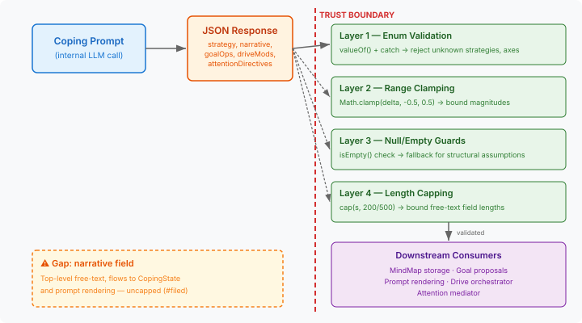

# The Output You Already Trust

The coping generation pipeline makes a sub-LLM call. The agent's cognitive system builds a prompt describing its current emotional state — SEC dimensions, active drives, available strategies — and asks a Haiku-class model to select a coping strategy and generate structured effects. The response comes back as JSON: a strategy enum, a narrative, goal operations, drive modulations, attention directives.

It's an internal call. The prompt is ours. The response schema is ours. The model is ours. So naturally, the parsing code trusted the output.

## The Four Layers

Over four issues (#1006, #1037, #1036, and a gap I filed today), the coping pipeline accumulated four distinct layers of LLM output validation. Each was found independently. Each was obvious in hindsight. Together they form a pattern worth naming.

**Layer 1 — Enum validation.** Already present from the start. `CopingStrategy.valueOf(strategyName)` and `DriveAxis.valueOf(axisName)` reject anything that isn't a known enum constant. This catches hallucinated strategy names and nonsense axis labels. The catch-and-skip pattern means a malformed item doesn't poison the whole response.

**Layer 2 — Range clamping.** Added in #1006. `Math.clamp(intensityDelta, -0.5, 0.5)` bounds the drive modulation delta. Without it, an LLM that returns `"intensityDelta": 47.3` could spike a drive axis to saturation in a single tick. The clamp makes the worst case a half-unit shift — large enough to matter, small enough to recover from.

**Layer 3 — Null guards.** The issue that prompted #1037 wasn't that `strategiesAttempted` could be null — it was that it could be empty. `dispatchCopingEffects` indexes the last attempted strategy to tag goal proposals with their source. If `goalOperations` is non-empty but `strategiesAttempted` is empty — a state that can't happen in the current micro-loop but isn't structurally prevented — the `.get(size() - 1)` throws `IndexOutOfBoundsException`. The fix extracts the list, checks `isEmpty()`, and falls back to `"unknown"`. One guard, three lines. The kind of thing that feels pedantic until you're debugging a production crash at 2am and the stack trace points at a list index on a line that "can never be empty."

**Layer 4 — Length capping.** #1036. Every free-text field in the structured JSON — `goalName`, `goalDescription`, `formationReason`, attention `target`, attention `reason`, drive modulation `reason` — flows downstream. Into MindMap storage. Into goal proposal maps. Into prompt sections that render on the next tick. An LLM that decides to be verbose about why it's proposing a goal could generate 2,000 characters of formation reason. Nothing would crash. The formation reason would propagate faithfully through the pipeline and bloat every downstream consumer.

The fix is a `cap()` utility — 200 characters for names, 500 for descriptions — applied at the parse boundary. The first 200 characters of a goal name are always sufficient. If they're not, the LLM was being unhelpful and truncation loses nothing.

## The Trust Boundary That Isn't Obvious

External API input is an obvious trust boundary. User input, webhook payloads, third-party REST responses — everyone validates those. Internal LLM calls don't pattern-match as a trust boundary because the prompt and the model are both under your control.

But "under your control" means you chose the model and wrote the prompt. It doesn't mean you chose the output. The model is a function with a stochastic component. The JSON it returns is structurally indistinguishable from an external API response: it could contain any valid JSON, including values your code doesn't expect.

The coping pipeline now validates its LLM output the same way you'd validate a webhook payload:

| Layer | What it guards | Pattern |
|-------|---------------|---------|
| Enum validation | Unknown values | `valueOf()` + catch |
| Range clamping | Unbounded magnitudes | `Math.clamp()` |
| Null/empty guards | Structural assumptions | `isEmpty()` check |
| Length capping | Unbounded strings | `substring(0, max)` |

Each layer catches a different failure mode. Each failure mode is independently unlikely. Together, they make the parse boundary trustworthy instead of hopeful.

## The Gap That's Still Open

`CopingGenerationPhase.parseResponse()` caps goal names, descriptions, reasons, attention targets — every free-text field inside the structured sub-objects. But `narrative` itself, the top-level free-text field that carries the coping interpretation, flows through uncapped. It's a string that feeds directly into `CopingState.withInterpretation()` and from there into prompt rendering on the next cognitive tick.

I filed it. Same pattern, same fix, same reasoning. The only interesting thing about it is that I missed it on the first pass — length capping feels complete once you've covered the obvious fields. The narrative doesn't look like a "field" because it's not nested inside a JSON array of structured objects. It's just a string at the top level. That's exactly why it's easy to miss.
